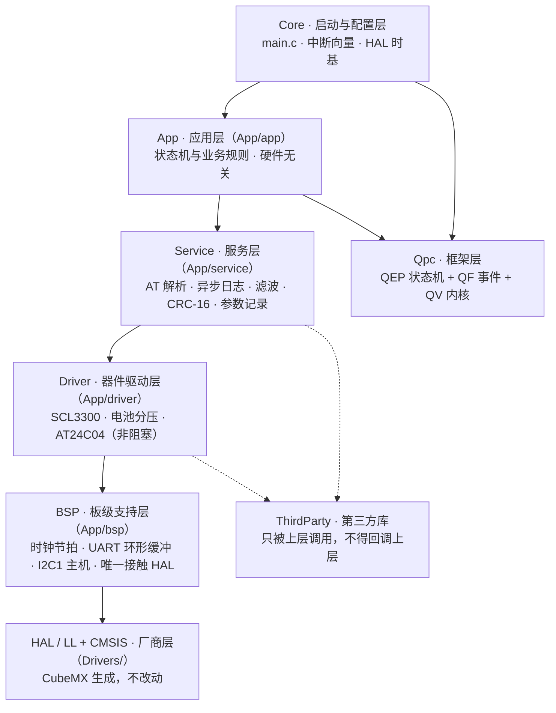
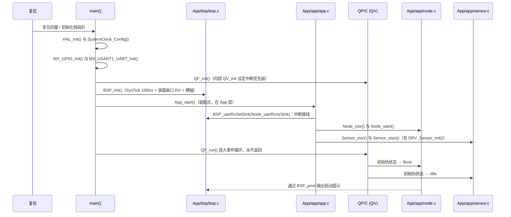
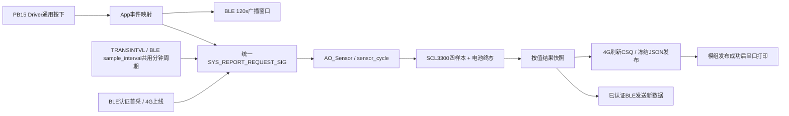

# 程序框架

## 新JSON与寄存器分层（2026-10-14）

组件内部 `modem_command.c/h` 只做JSON编解码；App的 `cloud_command.c/h` 负责云端白名单，`app_register.c/h` 负责地址映射，`app_register_command.c` 区分云端负载与串口结果行；Service的 `svc_register.c/h` 只做ASCII结构/CRC/逐项编解码，通过read/write端口调用App映射。参数更新复用Store，测量按事件分别送Node/Modem，各自拥有快照，无跨AO共享测量状态。新增源码由既有Keil同步脚本发现，未改生成层。

怎么验证：`powershell -NoProfile -ExecutionPolicy Bypass -File sensor-node-fw/App/tools/register_test.ps1`；协议和阶段边界见 [[06-协议格式]]，正式编译数字见 [[08-改动日志]] #133。

> [!important] 通信组件层
> `App/component/` 是新增的可移植组件层。核心与协议只依赖标准 C；芯片差异放在 `backend/`，STM32/QP 适配放在 `App/app/` 与 `App/bsp/`。当前链路是 `AO_Ble → BLE component → VG6328 backend → BlePort → USART2`（2026-09-20 与 4G 对调；占哪一路由 `APP_CFG_BLE_UART_ID` 决定，不再写死在 BSP 里）。

4G 使用同一边界：`AO_Modem → Modem component → ML307C/NT26/MN316 backend → ModemPort → USART3`。三个后端编译期三选一，由 `APP_CFG_MODEM_BACKEND` 选择（**2026-09-20 起为 MN316**），未选中的用 `#if` 排除、不产生代码也不占 Flash；整块 4G 另受 `APP_CFG_MODEM_ENABLE` 控制（现为 1，置 0 时 4G 完全不参与编译）。

程序自上而下分为 **App 应用层、Service 服务层、Driver 器件驱动层、BSP 板级支持层、厂商层（HAL/LL + CMSIS）** 五层，依赖方向单向向下；`ThirdParty/` 是横切的第三方库，只被上层调用；`Qpc/` 是框架层，被上方各层共同依赖。`Core/`、`Drivers/` 由 CubeMX 生成，属于「不要手改」的区域（详见 [[01-项目介绍#目录结构]]）。

## 分层与依赖

| 层            | 目录                           | 职责                                    | 是否可手改        |
| ------------ | ---------------------------- | ------------------------------------- | ------------ |
| App 应用层      | `App/app/`                   | 业务状态机、统一命令执行、心跳、参数存储编排，与硬件无关                   | 是            |
| 命令模型层      | `App/app_command/`           | 可复用的命令来源、解析结果、关联 ID 和统一结果模型；不执行硬件动作         | 是            |
| Service 服务层  | `App/service/`               | AT 解析、异步日志、滤波、CRC-16 组帧/解析、参数记录编解码 | 是 |
| Driver 器件驱动层 | `App/driver/`                | 传感器统一语义接口、AT24C04（非阻塞 Start/Process/State） | 是 |
| BSP 板级支持层    | `App/bsp/`                   | QP 的 BSP 钩子、时钟节拍、串口驱动、I2C1 非阻塞主机、ISR 到事件桥接 | 是 |
| 框架层          | `Qpc/platform`、`Qpc/port/qv` | QEP/QF/QV 源码与 Cortex-M 移植             | 仅在编译器兼容必要时   |
| 第三方库         | `ThirdParty/<库名>/`           | 外部算法 / 协议库，只读，适配层放在上层                 | 新增库需登记       |
| 启动与配置层       | `Core/`                      | 时钟、外设初始化、中断向量、HAL 时基                  | 仅在 USER CODE 区 |
| 厂商层          | `Drivers/`                   | HAL 与 CMSIS                          | 否            |

> [!note] 统一命令模块的边界
> `App/app_command/` 只保存可移植的数据模型：`AppCommandRequest` 描述来源、命令和 4G 关联 ID，
> `AppCommandResult` 描述完成状态、错误码和 AT 原始响应。具体动作由
> `App/app/command_dispatch.c` 执行，因此命令模型可以复用，但本工程的 Store 适配仍属于 App 层。
>
> [!warning] 依赖铁律
> 只能上层调下层。禁止 `Drivers/`、`Core/` 反向调用 `App/` 的业务函数，也禁止 `ThirdParty/` 回调本工程任何一层（它是纯被调用方）。唯一的例外是 HAL 的回调函数——`App/bsp/bsp.c` 里实现了 `HAL_UART_RxCpltCallback()`，由 HAL 从 USART1 中断中调用，这是「硬件通知应用」的正式通路。

各层的职责边界、命名前缀与「新增文件放哪里」的检查清单，写在对应目录的 `README.md` 里（`App/service/README.md`、`App/driver/README.md`、`ThirdParty/README.md`）。

## 启动流程

关键点：

- `HAL_Init()` 把 HAL 时基从 SysTick 改到 **TIM1**（`Core/Src/stm32f1xx_hal_timebase_tim.c`），因此 SysTick 被空出来，专门做 QP 的时钟节拍
- `QF_init()` 内部的 `QV_init()` 会把所有中断优先级统一设为 QF 安全级别，保证中断里可以投递事件
- **装配点在 App 层**：`main()` 只调用 `BSP_init()`（硬件）与 `App_start()`（组装 AO），BSP 不认识任何 AO
- `main()` 里的 `while (1)` 只是形式，`QF_run()` 内部有自己的事件循环，不会返回

## 源码分组

MDK 工程内的分组与 `App/` 下的分层目录一一对应，分组由 `App/tools/apply_qp_to_keil.ps1` 按磁盘实际文件自动生成：

| 工程分组 | 文件 | 说明 |
|---|---|---|
| `Application/MDK-ARM` | `startup_stm32f103xe.s` | 启动文件、中断向量表 |
| `Application/User/Core` | `main.c` `gpio.c` `usart.c` `stm32f1xx_it.c` `stm32f1xx_hal_msp.c` `stm32f1xx_hal_timebase_tim.c` | CubeMX 生成 |
| `Drivers/STM32F1xx_HAL_Driver` | 15 个 HAL 模块（`hal`/`rcc`/`gpio`/`usart`/`tim`/`dma`/`flash`/`pwr`/`cortex`/`exti` 等） | 生成代码 |
| `Drivers/CMSIS` | `system_stm32f1xx.c` | 系统时钟初始化 |
| `App` | `app.c` `command_dispatch.c` `node.c` `sensor.c` `sensor_cycle.c` `heartbeat.c` `ble.c` `ble_runtime.c` `modem.c` `modem_report.c` `store.c` `system.c` | 应用层：装配点 + 统一命令执行 + 控制台 AT AO + 采样 AO + 心跳 AO + BLE/4G 适配 AO + 参数存储 AO + 系统动作 AO（延迟复位；BLE/4G 按各自 ENABLE 开关决定是否编译） |
| `Service` | `svc_at.c` `svc_filter.c` `svc_frame.c` `svc_log.c` `svc_param.c` | 服务层：AT 解析、滤波、CRC-16 组帧/解析、异步日志、参数记录编解码 |
| `Driver` | `drv_scl3300.c` `drv_battery.c` `drv_button.c` `drv_storage.c` `drv_w25q32.c` `drv_at24c04.c` | 器件驱动层：真实SCL3300、电池、按键、存储器非阻塞驱动 |
| `BSP` | `bsp.c` `bsp_uart.c` `bsp_ble_uart.c` `bsp_modem_uart.c` `bsp_i2c.c` | 板级支持层：QP 钩子与节拍、USART1 收发与异步队列、BLE/4G 端口（实例由装配点的 ID 决定）、I2C1 非阻塞主机 |
| `Component` | `ble/`（component/protocol/backend/port）与 `modem/`（component/at/backend/port）含广播控制共9个C文件 | 可移植通信组件：平台无关的业务核心 + 编译期三选一的芯片后端 |
| `ThirdParty/<库名>` | 暂无 | 每个第三方库一个分组，按需加入 |
| `QP/C/platform` | `qep_hsm.c` `qep_msm.c` `qf_act.c` `qf_actq.c` `qf_defer.c` `qf_dyn.c` `qf_mem.c` `qf_ps.c` `qf_qact.c` `qf_qeq.c` `qf_qmact.c` `qf_time.c` `qv.c` | 13 个框架源文件 |
| `QP/C/port` | `qv_port.c` | QV 内核移植层 |

> [!note] 只编译了 QV
> 仓库里同时存在 `qk.c`、`qxk*.c` 等抢占式内核源码，但**没有加入编译**。当前工程只用 QV 协作式内核，切换到 QK/QXK 需要改 `Qpc/port/` 下的移植文件与 `qf_port.h` 配置（见 [[04-任务调度#切换内核]]）。

## 编译与宏定义

| 配置项 | 值 |
|---|---|
| 器件 | `STM32F103RC` |
| 预定义宏 | `USE_HAL_DRIVER`, `STM32F103xE`, `QV_PRJ` |
| 头文件路径 | `../Core/Inc`、HAL `Inc` 与 `Inc/Legacy`、CMSIS `Device/ST/STM32F1xx/Include`、CMSIS `Include`、`../App/app`、`../App/bsp`、`../Qpc/platform/inc`、`../Qpc/port/qv/inc`（新增层目录后由脚本自动补齐） |
| 优化等级 | `Optim=4` |
| 编译器 | ARM Compiler 6（工程标记 `uAC6=1`） |
| 源文件编码 | UTF-8；**含中文注释的 `.c` / `.h` 带 BOM**，否则 Keil 显示乱码（由 `apply_qp_to_keil.ps1` 自动补） |

> [!tip] 新增源文件时
> 放进 `App/` 下对应层的目录，然后跑一次 `App/tools/apply_qp_to_keil.ps1`，分组与头文件路径会自动更新；漏加不会在编译期报错，只会在链接期以「符号未定义」暴露。HAL 模块按需在 `stm32f1xx_hal_conf.h` 中开启。

## 扩展指引

要新增一个功能，按下面的落点放置代码：

1. 新的业务状态机 / 活动对象 → `App/app/`，在 `app_signals.h` 分配信号段、在 `app_prio.h` 登记优先级，并由 `App_start()` 装配
2. 新的硬件访问（新外设、新引脚） → 在 `App/bsp/` 封装成 `BSP_xxx()` 接口，不要从状态机里直接调 HAL
3. 新的器件（传感器、存储器） → `App/driver/` 建 `drv_<器件>.c`，通过 `BSP_xxx()` 访问总线
4. 协议打包 / 参数存储 / 日志 / 滤波 → `App/service/` 建 `svc_<模块>.c`5. 引入外部算法或协议库 → `ThirdParty/<库名>/`，按它的 `README.md` 登记，适配层写在第 3、4 步的文件里
6. 新的中断源 → 只有当它是 QF-aware 优先级时才允许投递事件，否则只写环形缓冲，见 [[04-任务调度#中断与调度的关系]]
7. 新增 AO 的完整步骤 → [[05-任务说明#新增 AO 的步骤]]

## 相关文档

- [[03-资源分配]] · [[04-任务调度]] · [[05-任务说明]] · [[00-索引]]

## 电池采样链路（2026-10-12）

`AO_Sensor → drv_battery.* → bsp_adc.* → ADC1/GPIOC`。BSP 独占硬件操作，Driver 负责开关稳定等待、平均和 mV 换算，App与倾角共用请求式批次及20ms推进事件，不新增 AO。
成功倾角快照同时携带电池 mV/有效位，通过现有事件池送到 AO_Modem，再进入可移植组件的 `ModemMeasurements`；4G 只发布有效电压。BLE现携带真实电压，倾角自检帧不再逐批输出。
新增文件由 `apply_qp_to_keil.ps1` 自动发现；运行 `battery_test.ps1` 验证真实 Driver 与 MQTT 组包器，执行命令见 [[07-接口约定#电池电压接口]]。

## PB15 按键链路（2026-10-12）

`bsp_gpio.*` 仅封装 PB15 低有效输入；`drv_button.*` 仅消抖、识别一次按下，不包含 QP、4G 组件、信号或业务动作。`AO_Modem` 在 App 层将通用按下结果映射为 `SYS_REPORT_REQUEST_SIG`，事件处理交给 `modem_report.*` 保存一次待发请求，同时请求新采样和BLE 120s广播窗口，再调用组件上报接口。以后更换按键用途，修改 App 层事件映射，Driver 无需修改。
不新增 AO、中断或事件池；复用 20ms 的 `MODEM_PROCESS_SIG` 与静态业务事件。`modem_report.*` 不依赖按键 Driver，同一上报事件可由其他 App 来源发起。

## 请求式数据链路（2026-10-12）

App新增`sensor_cycle.*`（批采样与滤波窗口）、`ble_runtime.*`（广播窗口与参数镜像）、`report_period.*`（统一分钟周期读写）；三者不依赖QP/HAL，AO只负责事件适配。BLE组件新增`ble_advertising.c`，通过backend生成ADE指令、Port传输，组件不调用业务采样。

全局事件连接AO，Driver不认识上报或广播。无周期1Hz采样或2s存活输出，20ms器件推进保留。验证入口与边界详见[[05-任务说明#AO_Sensor]]、[[07-接口约定#请求式采样、发布结果与广播接口（2026-10-12）]]。
