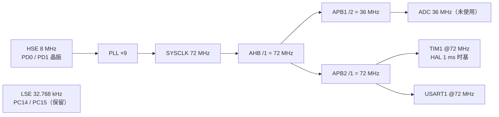

---
title: 资源分配
aliases:
  - 硬件与软件资源分配
  - 引脚分配表
tags:
  - sensor-node-fw
  - 硬件
  - 资源配置
status: 进行中
owner: 待填
updated: 2026-09-27---

# 资源分配

> [!important] 串口归属（2026-09-20 对调，按实机接线）
> **BLE 模组走 `USART2`（`PA2/TX`、`PA3/RX`），4G 模组走 `USART3`（`PB10/TX`、`PB11/RX`）**，两者 8N1；`USART2_IRQn` / `USART3_IRQn` 抢占优先级均为 5。GPIO、时钟和 NVIC 均由 `.ioc` 生成。
> 端口占哪一路现在是**装配信息**：`app_config.h` 的 `APP_CFG_BLE_UART_ID = 2` / `APP_CFG_MODEM_UART_ID = 3`，由 `AO_Ble` / `AO_Modem` 在构造时传给 `BSP_bleUartInit()` / `BSP_modemUartInit()`，BSP 按编号解析 HAL 句柄（`bsp_uart_id_t`），**因此换接线只改这两行**，不必再改 BSP 里的 `huartN`。
> BLE 模组另有两个控制脚：`VG6_EN`(`PB1`，电源使能，**高开启**）由 BSP 配成推挽输出并拉高；`VG6_IO`(`PB0`，唤醒，资料为「上电保持高、下降沿唤醒」) 当前**不配置、保持悬空**（用户 2026-09-20 确认）。
> **2026-09-20 起 4G 也开了**：模组是 **MN316**（`APP_CFG_MODEM_BACKEND = APP_CFG_MODEM_BACKEND_MN316`，AT 口 **9600**，见下方 warning），`APP_CFG_MODEM_ENABLE = 1`。电源使能 `MN316_EN`(`PB9`，**高开启**）由 BSP 配成推挽输出并拉高；复位脚 `NB_RESET`(`PB8`，经三极管）按用户决定**不配置、保持悬空**（三极管极性未确认，配错会把模组一直摁在复位态）。把 `APP_CFG_MODEM_ENABLE` 置 0 可让整块 4G 在编译期消失，RAM 省约 6 KB（见下方内存实测）。

> [!warning] 4G 模组的串口速率按后端分档，不是固定的 115200
> `USART3`（`PB10/TX`、`PB11/RX`、8N1）的波特率是 `app_config.h` 的 `APP_CFG_MODEM_UART_BAUD`，**按 `APP_CFG_MODEM_BACKEND` 分档**：ML307C 档 115200（2026-09-17 实机实测）、**MN316 档 9600（2026-09-19 实机扫描确认：9600 回 `OK`，115200 完全静默）**、NT26 档沿用 115200（未实测）。换模组时**先确认它的串口速率**——两边不一致时串口完全静默或全是乱码：模组收到的是乱码不会应答，我们这边也可能收不到任何字节、`uart_err` 计数还是 0，属于最难定位的一类故障。启动日志会打出实际生效值（`modem: <后端> on USART3 <波特率> 8N1`）。
>
> [!important] 这个波特率由**端口的 `BSP_*UartInit()` 在运行时写进外设**，不是 `.ioc` 配的（2026-09-27 修）
> 原先 `BSP_modemUartInit()` **从未应用** `APP_CFG_MODEM_UART_BAUD`：`.ioc` 里没有
> `USART3.BaudRate`（只有 `USART3.IPParameters=VirtualMode`），CubeMX 于是按默认值生成
> `huart3.Init.BaudRate = 115200`。后果是**宏只被启动日志打印、从未作用到硬件**——
> 日志写 `9600`、实际跑 `115200`，模组收到乱码不应答，现象与「模组没供电」完全同形
> （`rx` 一个字节都没有、`uart_err` 还是 0），2026-09-27 上板实测正是如此。
>
> 现在两个业务端口（`bsp_ble_uart.c` / `bsp_modem_uart.c`）都在自己的 `*UartInit()` 里
> `l_uart->Init.BaudRate = APP_CFG_*_UART_BAUD; HAL_UART_Init(l_uart);`。
> **放运行时而不是 `.ioc` 的理由**：端口的实例是装配信息（BLE 与 4G 对调过一次），
> 把速率钉死在 `.ioc` 里，一旦实例对调就会让某个端口跑在错的速率上。
> 启动日志现在读的是**外设句柄里的实际值**（`BSP_modemUartBaud()` / `BSP_bleUartBaud()`），
> 所以「配了但没生效」不会再被日志掩盖。
> 另有一条编译期检查：`APP_CFG_BLE_UART_ID` 与 `APP_CFG_MODEM_UART_ID` **不允许相同**
> （共用一路会让两个端口互相覆盖线速率），在 `bsp_uart.c` 里以 `#error` 卡住。

本章是所有其他章节的引用基础：[[04-任务调度]] 用到的时间基准、[[05-任务说明]] 用到的串口、[[06-协议格式]] 用到的物理层，都在这里定义。

## 器件与存储

| 项目 | 内容 |
|---|---|
| 型号 | STM32F103RCT6（`Mcu.CPN=STM32F103RCT6TR`） |
| 封装 | LQFP64 |
| 内核 | Cortex-M3，最高 72 MHz |
| Flash | 256 KB，起始 `0x08000000` |
| SRAM | 48 KB，起始 `0x20000000` |

## 时钟配置

| 项目 | 值 |
|---|---|
| 主时钟源 | HSE 外部晶振 8 MHz（`PD0` / `PD1`） |
| PLL | HSE ×9 = 72 MHz |
| SYSCLK | 72 MHz |
| AHB 分频 | /1 → 72 MHz |
| APB1 分频 | /2 → 36 MHz |
| APB2 分频 | /1 → 72 MHz |
| Flash 等待周期 | 2 WS（`FLASH_LATENCY_2`） |
| ADC 时钟 | 36 MHz（由 PCLK2 分频，当前未使用） |
| 低速时钟 | LSE 32.768 kHz 已在 CubeMX 中使能（`PC14` / `PC15`），当前代码未使用 |



> [!warning] 改晶振必看
> 如果换用 12 MHz 晶振，必须同时改 `SystemClock_Config()` 中的 `PLLMUL` 与 `HSEPredivValue`，并重新校核 USART1 的波特率误差与 Flash 等待周期。板子换了晶振却没改这里，是嵌入式最常见的「代码没错但通信乱码」的原因。

## 引脚分配

| 引脚 | 功能 | 模式 / 配置 | 连接对象 | 备注 |
|---|---|---|---|---|
| `PD0-OSC_IN` | `RCC_OSC_IN` | HSE 外部晶振 | 8 MHz 晶振 | 主时钟源 |
| `PD1-OSC_OUT` | `RCC_OSC_OUT` | HSE 外部晶振 | 8 MHz 晶振 | |
| `PC14-OSC32_IN` | `RCC_OSC32_IN` | LSE 外部晶振 | 32.768 kHz 晶振 | 已使能，代码未用 |
| `PC15-OSC32_OUT` | `RCC_OSC32_OUT` | LSE 外部晶振 | 32.768 kHz 晶振 | 已使能，代码未用 |
| `PA9` | `USART1_TX` | 复用推挽 `AF_PP`，高速 | USB-TTL 的 RX | 调试串口 |
| `PA10` | `USART1_RX` | 输入，无上下拉 | USB-TTL 的 TX | 中断逐字节接收 |
| `PA2` | `USART2_TX` | 复用推挽，高速 | BLE 模组 RX（`VG6_RX`） | BLE 发送 |
| `PA3` | `USART2_RX` | 输入，无上下拉 | BLE 模组 TX（`VG6_TX`） | 中断逐字节接收 |
| `PB0` | 未配置（悬空） | 复位默认输入 | BLE 模组 `VG6_IO`（唤醒） | 上电保持高、下降沿唤醒；本轮固件不管，保持悬空 |
| `PB1` | `GPIO_Output`（`VG6_EN`） | 推挽输出，初始 High | BLE 模组 `VG6_EN`（电源使能） | 高开启、低关闭；BSP 初始化时拉高（`.ioc` 已登记） |
| `PB8` | 未配置（悬空） | 复位默认输入 | 4G 模组 `NB_RESET`（经三极管复位控制） | 三极管极性未确认，按用户 2026-09-20 决定不配置；将来做恢复手段时再配 |
| `PB9` | `GPIO_Output`（`MN316_EN`） | 推挽输出，初始 High | 4G 模组 `MN316_EN`（电源使能） | 高开启、低关闭；BSP 初始化时拉高（`.ioc` 已登记） |
| `PB10` | `USART3_TX` | 复用推挽，高速 | 4G 模组 RX | Modem 发送（本轮 4G 关闭，不产生流量） |
| `PB11` | `USART3_RX` | 输入，无上下拉 | 4G 模组 TX | 中断逐字节接收 |
| `PB6` | `I2C1_SCL` | 复用开漏 `AF_OD`，高速 | AT24C04 的 SCL | 参数存储（`.ioc` 已配 `PB6.Mode=I2C`） |
| `PB7` | `I2C1_SDA` | 复用开漏 `AF_OD`，高速 | AT24C04 的 SDA | 同上 |
| `PA13` | `SYS_JTMS-SWDIO` | Serial Wire | 调试器 SWDIO | 调试口，不可复用 |
| `PA14` | `SYS_JTCK-SWCLK` | Serial Wire | 调试器 SWCLK | 调试口，不可复用 |

> [!important] I2C1 参数存储（2026-09-27 新增）
> 器件是 **AT24C04**（4 Kbit = 512 B，页写 16 B），接在 `I2C1`：`PB6`=SCL、`PB7`=SDA。
> 从机 7 位地址 **0x50**（A1/A2 接地，用户 2026-09-27 确认），由 `APP_CFG_STORE_I2C_ADDR` 配置。
> 速率 **100 kHz**（`Core/Src/i2c.c` 的 `hi2c1.Init.ClockSpeed`，由 `.ioc` 生成）。
> `PB6`/`PB7` 是开漏复用，**必须有外部上拉电阻**（典型 4.7 kΩ）；`i2c.c` 里没有配置内部上拉。
> AT24C04 的 512 B 被分成两个槽（`0x000` 与 `0x100`），A/B 交替写入，靠 CRC + 槽序号选最新的
> 一份——写到一半掉电时旧记录仍然完好。第 9 位地址由器件地址字节的 `P0` 位承载，
> 因此 0x00–0xFF 用 0xA0、0x100–0x1FF 用 0xA2，这段差异在 `drv_at24c04.c` 内部消化。

> [!note] 时钟门控
> 代码中使能的 GPIO 端口时钟是 **GPIOA / GPIOB / GPIOC / GPIOD**（见 `gpio.c`；`GPIOB` 是 `USART3`(PB10/PB11) 与 `VG6_EN`(PB1) 需要的），另外 `stm32f1xx_hal_msp.c` 使能了 **AFIO** 与 **PWR**。`PB0` 按设计不使用，保持复位默认（浮空输入），因此没有任何模式配置。
>
> （2026-09-20 订正：本节原写「`GPIOB` 时钟未开启」——那是 `.ioc` 里 PB10/PB11 加入 USART3 之前的旧事实，`gpio.c` 早已使能，BLE 也正是靠它工作。）

## 中断与优先级

优先级分组为 4 位抢占、0 位子优先级（`HAL_Init()` 默认设置，与 `.ioc` 中 `NVIC_PRIORITYGROUP_4` 一致）。

| 中断 | 抢占优先级 | 子优先级 | 服务路径 | 用途 |
|---|---|---|---|---|
| `USART1_IRQn` | 5 | 0 | `USART1_IRQHandler` → `HAL_UART_IRQHandler` → `HAL_UART_RxCpltCallback` | 串口逐字节接收，投递事件给 AO |
| `USART2_IRQn` | 5 | 0 | `USART2_IRQHandler` → `HAL_UART_IRQHandler` → `HAL_UART_RxCpltCallback` | BLE 环形缓冲，投递事件给 AO |
| `USART3_IRQn` | 5 | 0 | `USART3_IRQHandler` → `HAL_UART_IRQHandler` → `HAL_UART_RxCpltCallback` | 4G 环形缓冲，投递事件给 AO（本轮 4G 关闭） |
| `SysTick` | 15 | 0 | `SysTick_Handler` → `QF_TICK_X(0U, 0)` | QP 时钟节拍（100 Hz） |
| `I2C1_EV_IRQn` | 5 | 0 | `I2C1_EV_IRQHandler`（实现在 `App/bsp/bsp_i2c.c`）→ `HAL_I2C_EV_IRQHandler` | I2C1 传输事件（参数存储） |
| `I2C1_ER_IRQn` | 5 | 0 | `I2C1_ER_IRQHandler`（同上）→ `HAL_I2C_ER_IRQHandler` | I2C1 错误（NACK / BERR / ARLO 等） |
| `TIM1_UP_IRQn` | 15 | 0 | `TIM1_UP_IRQHandler` → `HAL_TIM_IRQHandler` | HAL 1 ms 时基（`HAL_IncTick`） |
| `HardFault` / `NMI` / `MemManage` / `BusFault` / `UsageFault` | 0 | 0 | 死循环 | 异常兜底，便于挂调试器定位 |

> [!important] I2C1 中断的使能位置与别处不同（2026-09-27）
> **`.ioc` 里没有勾选 I2C1 的 Event/Error 中断，`Core/Src/stm32f1xx_it.c` 里也没有对应的 handler。**
> 这两路中断由 `App/bsp/bsp_i2c.c` 自己负责：
> ① `BSP_i2cInit()` 调 `HAL_NVIC_SetPriority/EnableIRQ()` 使能（优先级 5）；
> ② 该文件里给出 `I2C1_EV_IRQHandler` / `I2C1_ER_IRQHandler` 的强定义，覆盖启动文件
> `startup_stm32f103xe.s` 里的 `[WEAK]` 向量。
>
> 这样做的好处是**不需要改 `.ioc` 再走一次 CubeMX 再生成**，也不会与生成代码重复定义。
> ⚠ 如果将来在 CubeMX 里勾选了这两个中断，必须删掉 `bsp_i2c.c` 里的两个 handler，
> 否则链接期会报 `multiply defined`。脚本 `apply_qp_to_keil.ps1` 检查不出这种冲突。

> [!important] QF-aware 优先级约束
> QP 只允许优先级数值 **≥ 3** 的中断调用 QP 服务（`QF_AWARE_ISR_CMSIS_PRI` = `QF_BASEPRI(0x3F)` >> (8 - 4) = 3）。这是「数值越大优先级越低」的 CMSIS 记法。当前 `USART1/2/3` 用 5、`SysTick`/`TIM1` 用 15，都满足；**不要给任何需要投递事件的中断分配 0、1、2**。
>
> **NOTE (L4 审计口径)**：上表的数值是 `.ioc` / `usart.c` 在**初始化阶段**设的值；`QF_init()` 内部的 `QV_init()`（`Qpc/port/qv/src/qv_port.c:101`）随后会把**所有**已实现中断的优先级统一改写为 `QF_BASEPRI`，即 4 位优先级下的 **3**。因此运行时实测各中断优先级都是 3（彼此不可抢占），而上表反映的是寄存器在 `QF_init()` 之前的配置。审计时两者都要看，不要只核对其中一个。

## 内存与运行时布局

MDK 使用 `MDK-ARM/sensor-node-fw/sensor-node-fw.sct`（由 uVision 按目标对话框自动生成）：

```
LR_IROM1 0x08000000 0x00040000  {    ; 256 KB Flash
  ER_IROM1 0x08000000 0x00040000  {
   *.o (RESET, +First)
   *(InRoot$$Sections)
   .ANY (+RO)
   .ANY (+XO)
  }
  RW_IRAM1 0x20000000 0x0000C000  {  ; 48 KB SRAM
   .ANY (+RW +ZI)
  }
}
```

| 区域 | 起始地址 | 大小 | 内容 |
|---|---|---|---|
| `ER_IROM1` | `0x08000000` | 256 KB | 代码、只读数据、中断向量表 |
| `RW_IRAM1` | `0x20000000` | 48 KB | 已初始化变量、未初始化变量、栈、堆 |

> [!warning] 当前没有 Bootloader 分区
> 整个 256 KB 从 `0x08000000` 直接启动。将来若要加 Bootloader / OTA，需要先重新划分分区，并同步修改 scatter 文件与启动地址（见 [[01-项目介绍#待办]]）。

## 内存占用实测

**2026-09-27（新增参数存储：BSP I2C + AT24C04 驱动 + svc_param + AO_Store，GCC L2 烟测口径）**：

| 配置 | text | data | bss | Flash（text+data） | RAM（data+bss） |
|---|---|---|---|---|---|
| **本轮**：BLE 开 + 4G(MN316) 开 + 存储开 | 122250 | 1752 | 15420 | 124002 B ≈ **47.3%** / 256 KB | 17172 B ≈ **34.9%** / 48 KB |
| 其中本轮**新增源码自己的目标文件** | 6506 | 0 | 817 | 6506 B | 817 B |

- 本轮 Flash = text + data = **124002 B ≈ 47.3% / 256 KB**；RAM = data + bss = **17172 B ≈ 34.9% / 48 KB**。
  108 个文件、**0 error / 0 warning、链接通过**（`App/tools/smoke_build.ps1`）。
- 新增源码的 4 个目标文件单独测量（同一套编译参数）：`bsp_i2c.o` 1072 B text / 20 B bss、
  `drv_at24c04.o` 1022 / 33、`svc_param.o` 1287 / 0、`store.o` 3125 / 784，
  合计 **6506 B text + 817 B bss**；另加 `node.c`/`ble.c`/`app.c`/`bsp.c`/`svc_at.c` 的小幅增长。

> [!warning] 与 2026-09-20 记录的 97594 B 不可直接相减
> 本节下面那份基线取自 **2026-09-20 的树**（103 文件），本轮是 108 文件；两者相差 **+24.6 KB**，
> 明显大于新增源码本身的 ~6.5 KB，差额不能全部归给本轮改动。已知的两个干扰项：
> ①烟测脚本**不启用 `--gc-sections`**，58 个 HAL 源文件都被整份链接，各文件之间互相牵动的
> 死代码处理方式与 Keil 默认设置不同；②两份数字相隔多个未记录在案的树状态。
> 因此**本表只作为「本轮实测口径」与趋势参考**，正式数字以 Keil / ARM Compiler 6 的 L1 为准
> （见 [[08-改动日志]] `#24` 的遗留项）。

**2026-09-20（端口参数化 + BLE 走 USART2 之后，GCC L2 烟测口径）**：

| 配置 | text | data | bss | Flash（text+data） | RAM（data+bss） |
|---|---|---|---|---|---|
| **本轮发布态**：BLE 开（USART2）+ 4G 开（**MN316**，USART3） | 97594 | 1752 | 14412 | 99346 B ≈ **37.9%** / 256 KB | 16164 B ≈ **32.9%** / 48 KB |
| 只开 BLE（`APP_CFG_MODEM_ENABLE = 0`） | 94682 | 1752 | 8356 | 96434 B ≈ **36.8%** / 256 KB | 10108 B ≈ **20.6%** / 48 KB |

两者的差（text +2088、bss +6040）就是整块 4G 组件 + `USART3` 端口的代价；关掉 4G 能把 RAM 占用从 ~33% 降到 ~21%，这对 48 KB 的 F103RC 是实打实的余量。两种配置均为 103 文件、**0 error / 0 warning、链接通过**。

接入 4G 后端（当前为 **MN316**）、保留连接步骤诊断（`traceStepResult` / `traceStepProgress`）、并接上基站定位（`AT+LBS`）后的 GCC L2 镜像为 `text=97594 B`、`data=1752 B`、`bss=14412 B`（103 个源文件；口径：Flash = text + data = 99346 B ≈ 37.9% / 256 KB，RAM = data + bss = 16164 B ≈ 32.9% / 48 KB）。这是 GCC 烟测口径，不替代下表的 AC6/Keil L1 口径；需在有 Keil 的环境重新记录正式 Flash/RAM。三个后端在同一份源码下各编一次的实测值（2026-09-19、端口参数化之前）为 **ML307C 96578 / NT26 96234 / MN316 96266**（data 与 bss 三者相同，均 0 error / 0 warning、链接通过）；2026-09-20 的改动只动公共 BSP（实例分发 + USART1 错误恢复），三档未逐一复测（2026-09-20 的「链路自愈」改动之后复测值为 **MN316 97594 / NT26 97322 / ML307C 97666**，data 1752、bss 14412 三者相同），即换后端只影响约 ±350 B 的 text。换后端现在只需改 `APP_CFG_MODEM_BACKEND` 一行（显示名由它推导，见 [[08-改动日志]] `#11`）。逐轮累计（2026-09-19）：步骤诊断关掉 `APP_CFG_MODEM_TRACE_ENABLE` 即整体消失；排障期加在 `modem.c` 的临时状态打印占 184 B，已删除；为轮询步补 `wait`/`recover` 标签 +64 B；接上 `AT+LBS` 定位 +464 B（含 `ml307cLocation*` 两个函数、`location_requested` 标志与核心的 LOCATION 分支，`ModemAt_ParseE6()` 原本就在 AT 引擎里，未新增）；`ModemAt_NextField()` +208 B；4G 成功步骤只打进度（三个 trace 辅助函数）+232 B；BLE 日志按阶段分两档（`sanitize()` / `traceConfig()`，以及四条静默路径的 trace）+520 B。与 4G 组件重构前（text 84954 / data 1752 / bss 11436）相比，text 增加约 11.4 KB，主要来自模组状态机、三个后端、`snprintf` 与报文拼装；bss 增加约 2.9 KB，来自 `ModemComponent` 的命令/应答/通知/主题缓冲（全部 static，无动态内存）。

**2026-09-28（新增 `AO_System` 与 `AT+RST` / `AT+REBOOT` 之后，GCC L2 烟测口径）**：

| 配置 | text | data | bss | Flash（text+data） | RAM（data+bss） |
|---|---|---|---|---|---|
| **本轮发布态**：BLE 开 + 4G 开（**MN316**）+ Store + System | 129042 | 1760 | 16228 | 130802 B ≈ **49.9%** / 256 KB | 17988 B ≈ **36.6%** / 48 KB |

- **110 个源文件**（新增 `App/app/system.c`），**0 error / 0 warning、链接通过**。
- **仅本轮 `#66` 的增量**：text **+928 B**、data **+8 B**、bss **+72 B**（相对 `#65` 的
  128114 / 1752 / 16156，109 文件）。`bss +72` 是 `System` 实例（含 4 槽队列存储与 `QTimeEvt`）
  加上 `AO_System` 的倒计时字段；`text +928` 是重启状态机、三条判据与新增接口（含 `AT+RST` 别名）。
- 与本节上一条 2026-09-20 的记录（103 文件 / text 97594）之间的差**不是一轮造成的**：
  区间里还夹着统一命令分发器、数值型参数 `TRANSINTVL`、`AT+VER?`/`AT+CAD?`/`AT+I2C?`、
  `AT24C04` 参数存储与 `svc_param`、4G 诊断与基站定位等多轮改动。

**2026-09-28（`deviceId` 改为取自参数 `SN` 之后，GCC L2 烟测口径）**：

| 配置 | text | data | bss | Flash（text+data） | RAM（data+bss） |
|---|---|---|---|---|---|
| **本轮发布态**：BLE 开 + 4G 开（**MN316**）+ Store + System | 129850 | 1760 | 16228 | 131610 B ≈ **50.2%** / 256 KB | 17988 B ≈ **36.6%** / 48 KB |

- **110 个源文件**，**0 error / 0 warning、链接通过**。**Flash 已过 50%**（131.6 KB / 256 KB），
  余量约 124 KB，仍宽裕但从此值得每轮留意。
- **本轮 `#67`→`#69` 三小轮的合计增量**：text **+608 B**、data/bss 不变（相对 `#66` 的
  129242 / 1760 / 16228）。构成：写权限判定 + 拒绝日志（`#67`，+120）、身份变更自动重启
  （`#68`，+80）、`deviceId` 取自 `SN` 的两道闸（`#69`：`SVC_Param_IsValidDeviceId()`、
  等配置就绪、身份不可用告警、值校验，其余约 +400）。
- 对比同一天 `#66` 之前的 128114（109 文件）：这一天净增约 1.7 KB。

> [!warning] Keil（L1）口径的占用尚未重新记录
> 本机没有 Keil，本节原先挂的是一份**旧骨架**（三 AO、无组件层）的 Code 12814 / RO 698 / RW 12 / ZI 2132、Flash 13524 / RAM 2144 表格——它与当前镜像相差一个数量级，留着只会误导，2026-09-20 已删除。正式数字应在有 Keil 的环境用 ARM Compiler 6 全量编译后补回；在那之前**唯一可信的口径是上面的 GCC L2 烟测值**（两者不同源，不可混用）。

栈与堆由启动文件 `MDK-ARM/startup_stm32f103xe.s` 定义，与 `.ioc` 中 CubeMX 的设置一致：

| 项目 | 大小 | 来源 |
|---|---|---|
| 主栈 `Stack_Size` | `0x1000`（4 KB） | `.ioc` 与 `startup_stm32f103xe.s` |
| 堆 `Heap_Size` | `0x200`（512 B） | 同上 |

## QP/C 静态资源配置

| 配置项 | 值 | 位置 | 说明 |
|---|---|---|---|
| 内核 | QV（协作式，非抢占） | `Qpc/port/qv` | 只有内核源码 `qv.c` 与 `qv_port.c` 参与编译 |
| `QF_MAX_ACTIVE` | 16 | `Qpc/port/qv/inc/qf_port.h` | 上限，当前使用 5 个 AO |
| `QF_MAX_TICK_RATE` | 2 | 同上 | 上限，当前只用节拍 0 |
| `QF_BASEPRI` | `0x3F` | 同上 | 临界区屏蔽阈值 |
| `QF_AWARE_ISR_CMSIS_PRI` | 3 | 同上（推导值） | 可投递事件的中断优先级下限 |
| `BSP_TICKS_PER_SEC` | 100 | `App/bsp/bsp.h` | SysTick 节拍频率，即 10 ms 一次 |
| `BSP_RX_RING_SIZE` | 64 | `App/bsp/bsp_uart.h` | 值来自 `APP_CFG_UART_RX_RING_SIZE`，满则丢弃新字节 |
| `BSP_LOG_TX_RING_SIZE` | 256 | `App/bsp/bsp_uart.h` | 异步日志发送队列，值来自全局配置 |
| `APP_CFG_BLE_RX/TX_RING_SIZE` | 512 / 1536 | `App/app/app_config.h` | BLE 端口（现 USART2）收发环形缓冲 |
| `APP_CFG_MODEM_RX/TX_RING_SIZE` | 512 / 1024 | `App/app/app_config.h` | 4G 端口（现 USART3 = MN316）收发环形缓冲 |
| 串口装配 | BLE = `APP_CFG_BLE_UART_ID`(2)、4G = `APP_CFG_MODEM_UART_ID`(3) | `App/app/app_config.h` | 装配信息：决定两个业务端口各占哪一路 USART |
| AO 优先级 | Node=1、Sensor=2、Heartbeat=3、Ble=4、Modem=5、Store=6 | `App/app/app_prio.h` | 0 被 QP 保留，不可使用 |
| AO 事件队列 | Node=10、Sensor=8、Heartbeat=4、Ble=12、Modem=12、Store=8 | 各 AO 的 `.c` | 每个 AO 独立静态持有 |
| AO 私有栈 | 无 | —— | QV 内核下所有 AO 共用主栈，不单独分配 |
| 参数影子 `SvcParam` | 7×40 + 8 = 288 B | `App/app/store.c`（`l_store.param`） | 运行期唯一真相，读参数不碰总线 |
| 存储记录缓冲 `rec` / `vfy` | 177 B × 2 | 同上 | 编码后的记录与回读校验比对用 |
| I2C BSP 状态 | ~24 B | `App/bsp/bsp_i2c.c` | busy / 状态 / 诊断计数 |
| AT24C04 驱动状态 | ~40 B | `App/driver/drv_at24c04.c` | 相位、位置、期限与重试计数 |
| `SvcAtCmd` + 响应缓冲 | ~200 B（栈上） | `App/app/node.c` 的 `atHandleLine()` | 只在处理一行命令期间占用栈 |

> [!tip] 改这些值的影响
> 增大 RX/TX 环形缓冲或事件队列都会直接占用 RAM。当前三 AO 版本的 Keil L1 内存数字尚待重新测量，扩功能前不能继续沿用旧骨架的 4.4% 结论。

## 未使用与保留资源

| 资源 | 状态 | 备注 |
|---|---|---|
| `GPIOB` | 已使用 | `USART3`(PB10/PB11) 与 BLE 电源使能 `VG6_EN`(PB1)；时钟在 `gpio.c` 中已开启 |
| `PB0` | 保留（悬空） | BLE 唤醒脚 `VG6_IO` 接到这里，按用户决定不配置、保持复位默认输入 |
| `PB8` | 保留（悬空） | 4G 复位脚 `NB_RESET`（经三极管）接到这里，极性未确认前不配置 |
| ADC1 / ADC2 | 未配置 | 传感器采集大概率会用，注意 ADC 时钟 36 MHz |
| DMA | 未配置 | 串口高速收发或 ADC 连续采样时建议启用 |
| SPI / CAN | 未配置 | 视传感器接口而定（**I2C 已用于参数存储**，不再是「未配置」） |
| LSE + RTC | LSE 已使能，RTC 未启用 | 需要时间戳或低功耗唤醒时启用 |
| 定时器 TIM2 ~ TIM4 | 未配置 | 可用于周期性采样 |
| 独立看门狗 IWDG | 未启用 | 量产固件建议启用 |
| 低功耗模式 | 未使用 | 当前 `QV_onIdle()` 只执行 `WFI`，见 [[04-任务调度#低功耗行为]] |

## 相关文档

- [[02-程序框架]] · [[04-任务调度]] · [[06-协议格式]] · [[00-索引]]
