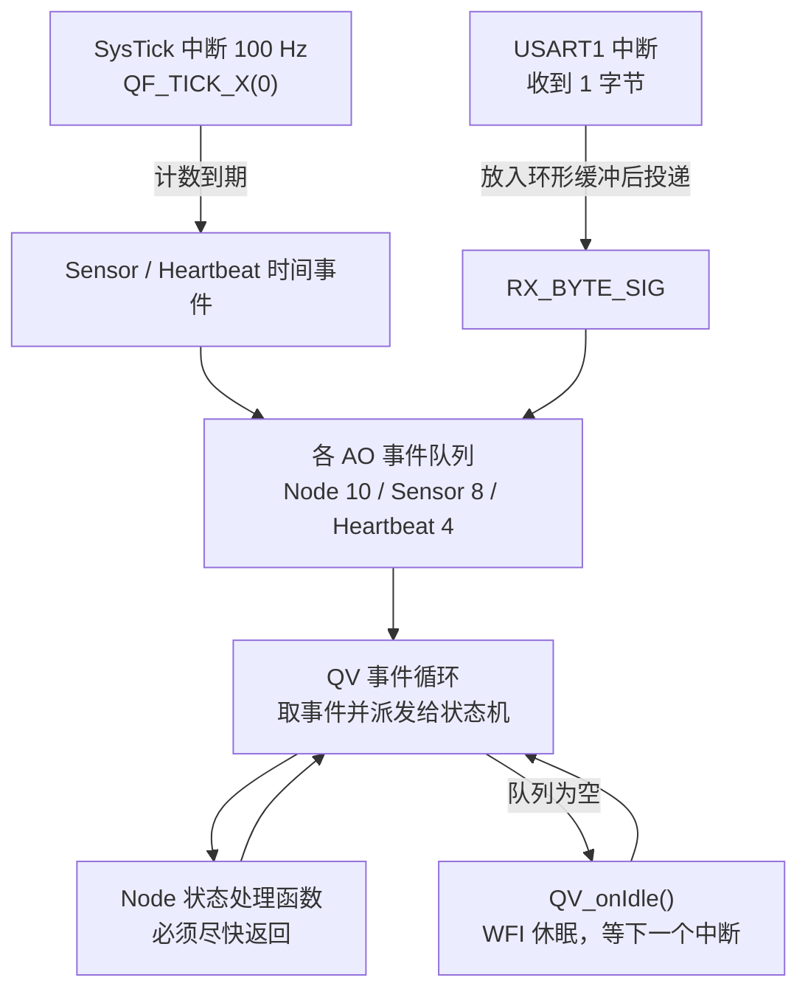
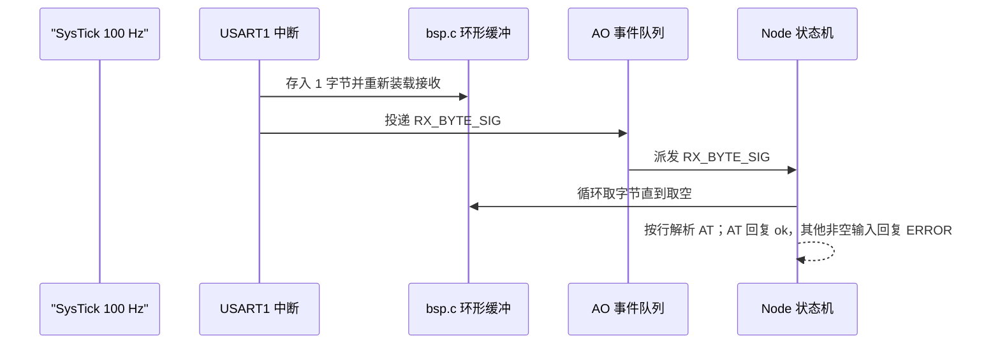

# 任务调度

## AO_Ble

`AO_Ble` 使用优先级 4、12 槽事件队列和 100 ms 周期事件，增量推进 VG6328 配置、RX 解析、超时与上报，不使用忙等或 `HAL_Delay()`。`AO_Sensor` 从 8 项静态事件池分配 `BleMeasurementEvt`，按值投递采样快照；两个 AO 不共享可变测量对象。

## AO_Modem

`AO_Modem` 使用优先级 5、12 槽事件队列和 20 ms 周期事件（`APP_CFG_MODEM_PROCESS_PERIOD_MS`），每拍只调一次 `Modem_Component_Process()` 就返回：组件内部按「发起 AT 命令 → 等串口行 → 判期限」推进，AO 从不等待模组应答。三条触发源分别是自身周期事件、USART3 收到字节（`Modem_uartRxIsrSink`）与 `AO_Sensor` 的采样快照事件（`ModemMeasurementEvt`）。

## AO_Store

`AO_Store` 使用优先级 6（最低）、8 槽事件队列和 10 ms 周期事件（`APP_CFG_STORE_PROCESS_PERIOD_MS`）。它是**掉电参数存储**的状态机：每拍把底层 AT24C04 作业往前推一小步（页拆分、写周期等待、重试），再按相位决定下一步。三条触发源分别是自身周期事件、I2C1 中断（`Store_i2cSink` → `STORE_BUS_SIG`）与「有新请求」（`STORE_CMD_SIG`，用户改参数或请求扫描时投递）。

单次处理的代价是微秒级：发起一次中断传输后立刻返回，等 `BSP_i2cIsBusy()` 落下再继续。**唯一的有界阻塞**是 `AT+I2C?` 扫描里的单次地址探测（`BSP_i2cProbe()`，2 ms 上限，每拍最多 4 个地址）。`AO_Ble` 在探测模组前会等 `App_Store_ConfigResolved()`，确保用的是介质里的配置而不是编译期默认值。

连接失败时 `AO_Modem` 打印一次诊断读数，按 `APP_CFG_MODEM_RECONNECT_PERIOD_S` 重连，最多 `APP_CFG_MODEM_CONNECT_ATTEMPTS` 次；**次数用尽后不再永久沉默**（2026-09-20 改）：改为给模组断电 `APP_CFG_MODEM_POWER_OFF_MS` 再上电，然后从第 1 次重新计，循环往复（`APP_CFG_MODEM_POWER_CYCLE_ENABLE = 0` 时退化为清零计数、继续重试）。在线期按 `APP_CFG_MODEM_REPORT_PERIOD_S` 置上报请求、按 `APP_CFG_MODEM_CELL_REFRESH_PERIOD_S` 置小区刷新请求；上行失败先按 `APP_CFG_MODEM_UPLINK_RETRY` / `APP_CFG_MODEM_UPLINK_RETRY_MS` 重试，重试用尽才判链路失效。真正的 AT 往返由组件在下一个 Process 周期发起。组件与后端的边界见 [[02-程序框架]] 与 `sensor-node-fw/App/component/README.md#4G 分层`。

本工程**不使用 RTOS，也没有传统的「任务」**。调度由 QP/C 的 **QV 协作式内核**完成，「任务」的对应物是**活动对象（Active Object, AO）**——一个状态机加一个事件队列。所有并发都在同一个主栈上以「处理一个事件、处理完再取下一个」的方式运行。

## 调度模型

调度的三个来源只有这么几个：**SysTick 里推进时钟节拍**、**USART1 中断里投递事件**、**AO 在事件循环中逐个处理事件**。没有时间片、没有抢占、没有上下文切换。

## 时钟节拍

| 项目 | 值 | 位置 |
|---|---|---|
| 节拍频率 | 100 Hz（10 ms 一次） | `BSP_TICKS_PER_SEC`，`App/bsp/bsp.h` |
| 节拍源 | SysTick | `BSP_init()` 中 `HAL_SYSTICK_Config()` |
| 节拍处理 | `QF_TICK_X(0U, 0)` | `Core/Src/stm32f1xx_it.c` 的 `SysTick_Handler` |
| 使用的节拍号 | 0 | 只使用 tick rate 0 |
| HAL 时基 | TIM1，1 ms | `Core/Src/stm32f1xx_hal_timebase_tim.c` |

> [!note] 为什么把 HAL 时基挪到 TIM1
> 如果 HAL 时基还留在 SysTick，`HAL_IncTick()` 会和 QP 的节拍抢同一个中断，节拍精度也会被 HAL 逻辑影响。现在两者分工明确：**TIM1 管 HAL 的毫秒计数，SysTick 只管 QP 的节拍**。代价是 CPU 至少每 1 ms 会被 TIM1 唤醒一次（见 [[#低功耗行为]]）。

## AO 一览

| AO | 优先级 | 事件队列 | 私有栈 | 触发源 | 实现文件 |
|---|---|---|---|---|---|
| `AO_Node` | `APP_NODE_PRIO` = 1 | 10 个事件（模块内 `l_nodeQueueSto`） | 无（QV 共用主栈） | USART1 中断（经 `Node_uartRxIsrSink`） | `App/app/node.c` |
| `AO_Sensor` | `APP_SENSOR_PRIO` = 2 | 8 个事件（模块内 `l_sensorQueueSto`） | 无（QV 共用主栈） | 自身 1 Hz 时间事件、来自 `AO_Node` 的全局段事件 | `App/app/sensor.c` |
| `AO_Heartbeat` | `APP_HEARTBEAT_PRIO` = 3 | 4 个事件（模块内 `l_heartbeatQueueSto`） | 无（QV 共用主栈） | 自身 2 s 时间事件（`APP_CFG_HEARTBEAT_PERIOD_S`） | `App/app/heartbeat.c` |
| `AO_Ble` | `APP_BLE_PRIO` = 4 | 12 个事件（模块内 `l_queue`） | 无（QV 共用主栈） | 自身 100 ms 时间事件、USART2 中断（经 `Ble_uartRxIsrSink`）、`AO_Sensor` 的 `BLE_MEASUREMENT_SIG` | `App/app/ble.c` |
| `AO_Modem` | `APP_MODEM_PRIO` = 5 | 12 个事件（模块内 `l_queue`） | 无（QV 共用主栈） | 自身 20 ms 时间事件、USART3 中断（经 `Modem_uartRxIsrSink`）、`AO_Sensor` 的 `MODEM_MEASUREMENT_SIG` | `App/app/modem.c` |
| `AO_Store` | `APP_STORE_PRIO` = 6 | 8 个事件（模块内 `l_queue`） | 无（QV 共用主栈） | 自身 10 ms 时间事件、I2C1 中断（经 `Store_i2cSink`）、本 AO 段内的 `STORE_CMD_SIG` | `App/app/store.c` |
| —— | `APP_FORBIDDEN_PRIO` = 0 | —— | —— | —— | 0 被 QP 保留 |

- 优先级上限由 `QF_MAX_ACTIVE` 决定（当前 16），枚举定义在 `App/app/app_prio.h` 的 `AppActorPrio`
- **承载 BLE / 4G 的 USART 由 `app_config.h` 的 `APP_CFG_BLE_UART_ID`(2) / `APP_CFG_MODEM_UART_ID`(3) 决定**，装配点在 `Ble_ctor()` / `Modem_ctor()` 调用 `BSP_*UartInit(port, id)` 时传入；BSP 按编号解析 HAL 句柄，HAL 的公共回调按 `huart->Instance` 分派（见 [[03-资源分配#引脚分配]]）。换接线只改这两行
- 本轮（2026-09-20）两个业务端口都在跑：BLE 在 USART2、4G（**MN316**，AT 口 9600）在 USART3；`APP_CFG_MODEM_ENABLE = 0` 时 `AO_Modem` 及其端口整块不编译
- 事件队列存储由各 AO 自己的 `<Ao>_start()` 持有（`Node_start()` / `Sensor_start()`）
- 构造函数与启动调用集中在 `App/app/app.c` 的 `App_start()`（装配点在 App 层，BSP 不参与）
- 新增 AO 的完整步骤见 [[05-任务说明#新增 AO 的步骤]]

## 事件与投递

| 事件 | 信号（所属段） | 来源 | 投递方式 | 载荷 |
|---|---|---|---|---|
| 收到字节 | `NODE_RX_BYTE_SIG`（Node 段） | USART1 中断 → `Node_uartRxIsrSink()` | `QACTIVE_POST_X(AO_Node, &l_rxByteEvt, 0U, 0U)` | 无（字节在 BSP 环形缓冲里） |
| 采样拍 | `SENSOR_SAMPLE_SIG`（Sensor 段） | `AO_Sensor` 私有 `QTimeEvt`，1 Hz | 内核在节拍到期时入队 | 无 |
| 开始采样 | `SYS_SENSOR_START_SIG`（全局段） | `App_start()` 启动时投递 | `QACTIVE_POST_X(AO_Sensor, ...)` | 无 |
| 心跳拍 | `HEARTBEAT_TICK_SIG`（Heartbeat 段） | `AO_Heartbeat` 私有 `QTimeEvt`，默认 2 s | 内核在节拍到期时入队 | 无 |
| 存储节拍 | `STORE_TICK_SIG`（Store 段） | `AO_Store` 私有 `QTimeEvt`，10 ms | 内核在节拍到期时入队 | 无 |
| I2C 传输结束 | `STORE_BUS_SIG`（Store 段） | I2C1 中断 → `Store_i2cSink()`（`BSP_i2cSetSink` 注册） | `QACTIVE_POST_X(AO_Store, ...)` | 无（结果由 `BSP_i2cLastStatus()` 取） |
| 存储有新请求 | `STORE_CMD_SIG`（Store 段） | `App_Store_SetName()` / `ResetDefaults()` / `RequestScan()` | `QACTIVE_POST_X(AO_Store, ...)` | 无（改的是影子，值就地更新） |

信号编号集中在 `App/app/app_signals.h` 并按 AO 分段（全局 0..31、Node 32..63、Sensor 64..95、Heartbeat 96..127、Ble 128..159、Modem 160..191、Store 192..223），跨 AO 投递必须用全局段，见 [[07-接口约定#全局信号表分段]]。

`l_rxByteEvt` 是**静态事件**，不会被 QP 回收，因此可以反复投递。事件不带数据，真正的字节放在 `bsp_uart.c` 的 64 字节环形缓冲中，由 `AO_Node` 一次性抽干。

## 典型时序

## 中断与调度的关系

- 只有 **QF-aware 优先级**（数值 ≥ 3）的中断才允许调用 QP 服务，USART1 用 5，安全
- 中断里只做三件小事：存字节、重新装载接收、投递事件；不做打印、不做解析
- `QACTIVE_POST_X()` 的 margin 传 0，表示**队列满时不触发断言**：字节留在环形缓冲里，等 AO 下一次处理事件时再取
- 环形缓冲满时新字节被直接丢弃（`BSP_uartRxPut()` 的行为），不阻塞中断

> [!warning] 协作式内核的编程约束
> QV 不抢占。任何状态处理函数只要不返回，整个系统（包括心跳和命令响应）就都停摆。因此：
> - 状态处理函数里**禁止忙等、禁止长延时、禁止阻塞式发送大量数据**
> - `BSP_print()` 用的是带超时的阻塞发送，只适合低频调试输出；大批量输出请改 DMA 或拆分到多个事件
> - 耗时操作要拆成「发起 → 等待事件 → 继续」的多步状态，而不是原地等

## 低功耗行为

`QV_onIdle()` 直接调用 `QV_CPU_SLEEP()`（内部执行 `WFI`），因此空闲时 CPU 会休眠，由中断唤醒。但由于 **TIM1 每 1 ms 产生一次 HAL 时基中断**，即使应用完全无事，CPU 也会每 1 ms 醒一次。

要真正做到低功耗，需要按顺序做这几件事：

1. 提高 TIM1 的时基周期，或在进入低功耗前关闭 HAL 时基
2. 降低 SysTick 节拍（当前 100 Hz，改动会影响心跳精度，`BSP_TICKS_PER_SEC` 与时间事件要一起改）
3. 评估是否改用 STOP 模式，注意 STOP 会关闭 TIM1 与 SysTick，需要重新设计唤醒源
4. 关闭调试串口相关时钟与 GPIO

## 切换内核

如果要引入抢占式调度（例如接入了严格的实时控制回路），可以把 QV 换成 QK 或 QXK：

- `Qpc/platform/src` 下已经有 `qk.c`、`qxk*.c` 源码，但**当前没有加入 MDK 编译**
- 需要替换 `Qpc/port/qv` 为 `Qpc/port/qk` 或 `Qpc/port/qxk`（仓库外需另行获取对应移植文件）
- 切换后每个 AO 需要自己的私有栈，RAM 占用会明显上升（参考 [[03-资源分配#内存占用实测]]）
- 各 AO 的 `<Ao>_start()` 中，`QACTIVE_START` 的栈参数不能再传 0

## 相关文档

- [[02-程序框架]] · [[03-资源分配#中断与优先级]] · [[05-任务说明]] · [[00-索引]]
