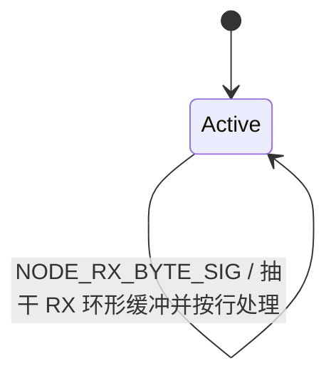
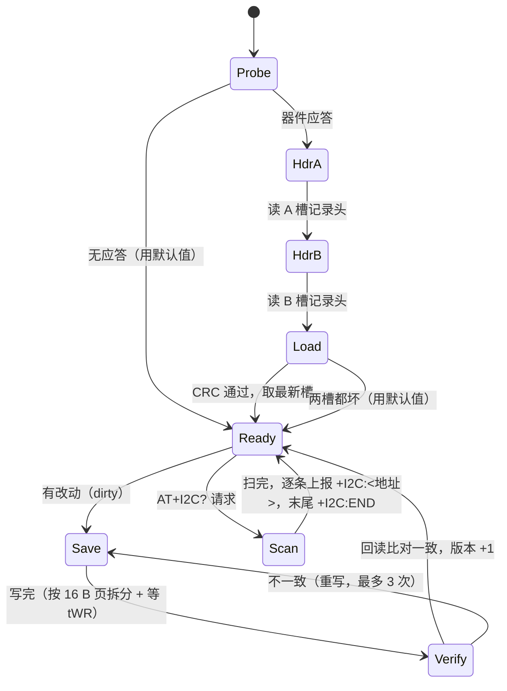
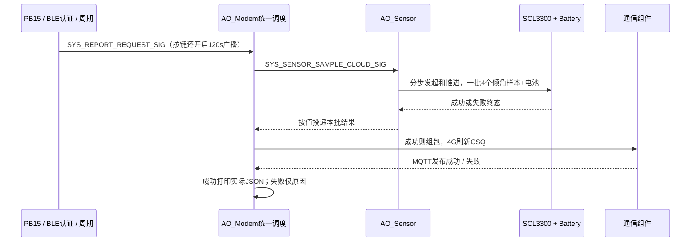

# 任务说明

## AO_Ble 任务

上电后执行 VG6328 探测与透明模式、默认关闭广播、名称、长度、UUID/广播字段、MAC 查询配置；每一步均为“发送后返回，由 RX 或 1 s 超时继续”。**其中广播名（`AT+NAM=`）取参数 `SN`**（2026-09-28 起：产品决定广播名就是设备 SN，`name` 槽位退役，见 [[08-改动日志]] `#76`），因此产线只需刷一条 `AT+SN=`。连接后先认证，随后处理参数发现、get/set、ping、NAK、reboot 与周期 data。模组缺失时只将 BLE 标为不可用并记录一次 ASCII 日志，其余 AO 继续运行。

探测在上电 500 ms 后开始，失败后每 2 s 重试，最多 3 次。失败日志包含原因、AT 步骤、TX/RX 字节、UART 错误和溢出计数，用于区分模组未上电、TX/RX 接反、错误波特率和协议响应异常。

连接并认证成功后立即投递统一上报事件，新采样同批用于4G和BLE；之后由唯一分钟周期调度。BLE `sample_interval`和`AT+TRANSINTVL`是同一持久参数，单位分钟、范围1~20，修改任一入口都会改变两个通道的节奏。上电不广播，PB15 每次有效按下开启/重计 120s 窗口，窗口结束保留已连接会话，断开后关闭广播并等待下次按键。收到已认证客户端的 `reboot` 命令时先发送确认，调试口打印明确的 reboot requested 日志，然后执行软件复位。

本工程使用 QP/C 活动对象（AO）表达并发业务。当前有 `AO_Node`、`AO_Sensor`、`AO_Heartbeat`、`AO_Ble`、`AO_Modem` 五个 AO，均由 `App/app/app.c` 的 `App_start()` 构造并启动；队列存储由各 AO 自己持有。

## AO 一览

| AO | 优先级 | 队列 | 当前职责 |
|---|---:|---:|---|
| `AO_Node` | 1 | 10 | USART1 接收事件、AT 行解析、参数命令的执行与回复 |
| `AO_Sensor` | 2 | 8 | 按请求批采 SCL3300 与电池、批内滤波、投递成功/失败结果 |
| `AO_Heartbeat` | 3 | 4 | 当前不启动（`APP_CFG_HEARTBEAT_ENABLE=0`） |
| `AO_Ble` | 4 | 12 | VG6328 配置、小程序协议与周期上报 |
| `AO_Modem` | 5 | 12 | 4G 入网、MQTT 与云业务；云端 AT 命令下行的执行 |
| `AO_Store` | 6 | 8 | 掉电参数存储：上电加载、异步落盘、I2C 扫描 |
| `AO_System` | 7 | 4 | 系统级动作：延迟复位的唯一管理者（配合 `AT+RST` / `AT+REBOOT`） |

七个 AO 都运行在 QV 协作式内核上，没有私有栈，共用主栈；状态处理函数必须快速返回。`AO_Ble` / `AO_Modem` 分别受 `APP_CFG_BLE_ENABLE` / `APP_CFG_MODEM_ENABLE` 控制；`AO_Store` 受 `APP_CFG_STORE_ENABLE` 控制（置 0 时不碰总线，参数退化为只有编译期默认值）；`AO_System` 恒在（它只做只读判断与复位，不占外设）。

`AO_Modem` 的 MN316 连接在清理客户端前先查询 `AT+MQTTSTAT?`，按手册语义分三档处理：状态 5 **且模组里的配置与当前身份一致时**才复用现有云会话（跳过 MQTT 清理与重新打开）；状态 3/4/6/7（连接正在路上）只重问、不拆连接，等满预算仍未就绪才按未连接继续；状态 0/1/2 直接走重建。**复用前必须比对**：紧挨 `MQTT_STATE` 之前有一步 `AT+MQTTCFG?`（`MODEM_OP_MQTT_CFG_QUERY`），把模组里的 host/port/**clientId** 读回来与当前 `deviceId`（= 参数 `SN`）比对，结果存进 `remote_cfg_matches`；**不一致就不复用**，照常走 DISC/DEL/CFG/OPEN 把新身份下发下去。这一条是必需的：MCU 重启不断模组的 MQTT 会话，若期间设备身份改过，直接复用会让 broker 侧的 `clientId` 停留在旧值（实测发现，见 [[08-改动日志]] `#71`，它关闭了 `#40` 的遗留）。重建时 `AT+MQTTCFG` 成功后先等待 `APP_CFG_MODEM_MQTT_OPEN_SETTLE_MS`，再发送 `AT+MQTTOPEN`；明确收到 `+MQTTOPEN:FAIL` 时按 `APP_CFG_MODEM_MQTT_OPEN_RETRY_MS` 退避，最多 `APP_CFG_MODEM_MQTT_OPEN_ATTEMPTS` 次。`AT+MQTTDEL` 的 `+CME ERROR:8002` 不再一步放行，改为按 `APP_CFG_MODEM_MQTT_TEARDOWN_RETRY_MS` 重试 3 次。查询、等待和重试都由时间事件推进，不阻塞 QV。

**在线期会话复核（2026-10-14 新增，见 [[08-改动日志]] `#138`）**：连接建立后会话仍可能**悄悄失效**——实测日志里发布成功 61 s 后出现 `+MQTTTO:5`（手册 MQTT 用户手册 §2.9/§2.11：type=5 = ping 超时，PINGREQ 没等到 PINGRESP），随后 broker 在「最后收到报文 + 1.5×keepalive」把设备判离线，而设备侧**上行还能发、下行静默**、日志上几乎看不出来。为此后端新增一个可选钩子 `session_notice()`，核心在**在线期**对每一行收到的文本调用它：
- `MODEM_SESSION_LOST`（MN316：`+MQTTREC:n` = 模组自己在重连、`+MQTTDISC:OK` = 已断链）→ 直接判链路失效，AO 整条重建；重建路径天然包含 DISC/DEL/CFG/OPEN 与**全部主题的重新订阅**，这正是「模组自己重连后订阅丢失」的补救。
- `MODEM_SESSION_RISK`（MN316：`+MQTTTO:<type>` = 心跳超时、在线期收到 `+CME ERROR:8002` = 状态机不符合）→ 置 `session_check`，下一次推进**优先**发一条 `AT+MQTTSTAT?`（复用计划里的 `MQTT_STATE` 步，`MODEM_RUNTIME_STATE`），只有模组报 **5（已连接）**才算会话可用，否则判失效重建。
- 复核只看状态值本身，**不**复用 `remote_cfg_matches` 判据：那个比对是连接**前**读回的，会话刚被我们重建过时它必然为 false，会把握手成功的会话反复判死。
同时 `APP_CFG_MODEM_KEEP_ALIVE_S` 由 60 s 提到 **300 s**：keepalive 必须大于上报周期，让数据报文自己保活；原值 60 s 小于上报周期（默认 20 min），两次上报之间全靠 ping，而 NB-IoT 上频繁 ping 最脆弱。

在线态下，`AO_Modem` 每次组件Process后取走按值JSON请求，由 `App_CloudCommand_Dispatch()` 按白名单执行AT/RST或寄存器命令。读写请求为id/command/data，回复仅id/data；云端不再走串口全文解析。寄存器由 `App_Register_Dispatch()` 共用校验与地址映射，串口另包AT结果行。当前主题按配置带前导 `/`，见 [[06-协议格式#4G 下行命令（平台 `command` 主题）]]。Sensor将同批快照按事件分别投递Node/Modem，两者独立持有；读取不阻塞采样，失败批次清有效标志。01周期写复用Store异步保存；02/03合法写暂为NP，零点标定未执行。

**设备身份（`deviceId`）来自参数 `SN`**（2026-09-28 改）：`Modem_ctor()` 把 `App_Store_Value(SVC_PARAM_BLE_SN)`（指向参数影子）交给 `ModemConfig.device_id`，MQTT 的 `clientId` 与全部 10 条主题都从它拼。因此 `AO_Modem` 启动前有两道闸：

1. **等配置就绪**：`App_Store_ConfigResolved()` 为真才往下走——上电瞬间影子里还是编译期默认值，不等就会拿默认 SN 去订主题（BLE 侧早就有同样的等待，见 `ble.c`）；
2. **身份合法才上线**：`SVC_Param_IsValidDeviceId()` 不过就**拒绝启动 4G**，串口打 `modem: device SN unusable …`。非法值拼出的主题在 MQTT 里是"合法但没人发"的，静默失效（同 `#51`），宁可不连。

改 `SN` 会触发自动重启（[[06-协议格式]] 的写权限小节），所以运行期不存在"主题已拼好但身份变了"的窗口。

**周期上报的间隔**（2026-09-28 改）由参数存储里的 `transintvl`（分钟，1~20，掉电保存）决定，而不再是编译期常量：`AO_Modem` 每个 `MODEM_PROCESS_SIG` 都从参数影子读一次（`reportIntervalMin()`）再比较计数，因此 `AT+TRANSINTVL=<n>` 改完**立即生效**（改小后下一拍就可能立即上报）、断电重启仍是新值。跨过一次在线态时把该值同步进 4G 组件的只读镜像 `sample_interval_min`——那条旧的云属性通道自本轮起**不再驱动**上报节奏，只用于读回来核对。**连上后先采再报一帧**（2026-10-12 改）：进入在线态时 `AO_Modem` 主动请求一次新采样并把周期计数归零，完成后刷新 CSQ 再发布，因此现场不必再等满一个周期（默认 20 分钟）才在平台看到数据；平台用 `report_enabled` 停报时不发（不绕过停报开关）。

## AO_System

`AO_System` 是单状态 `Active` 活动对象（2026-09-28 新增），负责**系统级动作：延迟复位**。它与 `AT+RST` / `AT+REBOOT` 这条命令配套——命令本身只"请求"，真正的复位由它按三个判据延时执行。

命令路径与串口/4G 完全共用：`svc_at.c` 解析出 `SVC_AT_KIND_REBOOT` → `command_dispatch.c` 回 `OK\r\n` 并调 `App_System_RequestReboot(source)` → 投递 `SYS_REBOOT_REQUEST_SIG` → `AO_System` 倒计时。

```text
[W <ms>] system: reboot requested by serial, waiting for reply+store
[W <ms>] system: rebooting now, src=cloud waited=612 ms
```

三个判据（每拍只做只读判断，100 ms 一次）：

| 判据 | 接口 | 为什么 |
|---|---|---|
| 最短延时 500 ms | `APP_CFG_SYSTEM_REBOOT_MIN_DELAY_MS` | 给"命令回复出设备"留下限时间 |
| 落盘干净 | `App_Store_IsIdle()` | `AT+TRANSINTVL=5` 紧接着 `AT+RST` 时不能丢值 |
| 上行空闲 | `Modem_IsUplinkIdle()` | 4G 的 `command/reply` 要等 `AT+MQTTPUB` 走完，否则平台判指令超时 |
| 硬上限 5 s | `APP_CFG_SYSTEM_REBOOT_MAX_WAIT_MS` | 到点无条件复位，避免"等条件"退化成"永不重启" |

复位前先 `BSP_logFlush()` 排空串口发送环，再 `BSP_systemReset()`（`NVIC_SystemReset()`）；下次启动横幅的 `reset` 行会显示 `SOFT (software reset)`。**幂等**：倒计时期间重复到来的请求只记一行日志，不重置计时。BLE 侧已有的 `reboot` 命令仍是自己的固定延时实现，尚未并入本 AO（见 [[08-改动日志]] `#66` 遗留）。

## AO_Node

`AO_Node` 是单状态活动对象，唯一状态为 `Active`。它不再负责周期心跳，也不存在旧版的 `Boot` / `Running` / `Halted` 状态和 `g/h/s/x/d/?` 单字符命令。



- 进入 `Active` 时打印一行控制台提示与三行命令清单（`params:` / `names:` / `store:`），只打一次的现场自助说明。
- USART1 中断经 `Node_uartRxIsrSink()` 把字节写入 BSP 环形缓冲，并投递静态事件 `NODE_RX_BYTE_SIG`。
- `Active` 收到事件后循环调用 `BSP_uartRxGet()` 抽干缓冲。
- 可打印 ASCII 暂存到行缓冲；CR/LF 触发行处理。
- 命令按标准 AT 形态（V.250 / 3GPP 27.007，2026-09-27 改写）：`AT` 回 `OK`；`AT+<参数名>?` 回 `+<参数名>:"<值>"` 后追加 `OK`；`AT+<参数名>="<值>"` 回 `OK`（异步落盘，引号可省）；`AT+<参数名>=?` 回 `+<参数名>:(<最大长度>)` 后追加 `OK`；`AT+VER?` 回版本与编译日期；`AT+CFG?` / `AT&F` / `AT+I2C?` 见 [[06-协议格式#AT 输入]]。
- 其他非空行回复 `ERROR\r\n`；空行静默。
- 非 CR/LF 的控制字符直接回复 `ERROR\r\n`。
- **所有命令都必须以 CR 或 LF 结束**——「裸 `at` 不带行尾也认」的捷径已删除（它会让 `AT+SN?` 的前两个字符 `AT` 误触发）。

AT 解析在 Service 层 `svc_at.c`（只解析，产出 `SvcAtCmd`）；`node.c` 只负责构造
`AppCommandRequest`、调用 `App_Command_Dispatch()` 和输出 `AppCommandResult.raw`。
具体执行与回复在 App 层 `command_dispatch.c` 完成，参数读写要落到 `AO_Store` 上异步完成，
Service 层不允许反向调用 App。响应通过 `LOG_WRITE()` 进入异步 UART 发送队列。

## AO_Store

`AO_Store` 持有参数集合的 **RAM 影子**（`SvcParam`），它是运行期的唯一真相：读参数永远走内存，EEPROM 只在启动读一次、修改时写一次。相位机如下：



关键行为：

- **上下文与 AO**：`AO_Store`（优先级 6、8 槽队列、10 ms 节拍）。三条触发源是自身节拍、I2C1 中断（`Store_i2cSink` → `STORE_BUS_SIG`）与「有新请求」（`STORE_CMD_SIG`）。
- **不阻塞**：每拍只发起一次中断传输就返回，页与页之间靠 `APP_CFG_STORE_WRITE_CYCLE_MS`（6 ms）的期限等待推进；驱动层不允许忙等，AO 层不允许 `BSP_delayMs()`。唯一的有界阻塞是 `AT+I2C?` 扫描的单次地址探测（2 ms 上限，每拍最多 4 个地址）。
- **掉电安全**：A/B 双槽交替写 + 槽序号 + CRC-16。先写「不是当前那份」的槽，写完**回读逐字节比对**，通过才切换。写到一半掉电时旧记录仍然完好。
- **介质空白或损坏**：回落到 `app_config.h` 的编译期默认值，并打一条 `store: ... using built-in defaults`；**不会**自动把默认值写进介质（避免每次上电都写一遍）。
- **与 BLE 的时序**：`Ble_ctor()` 用影子的值构造 `BleConfig`（此时是默认值），`AO_Ble` 在探测模组前等 `App_Store_ConfigResolved()`，所以真正写进模组的一定是介质里的值。`BleConfig.local_name` 与 `serial_number` **同指 `SVC_PARAM_BLE_SN`**（单一真相，见 [[08-改动日志]] `#76`）。
- **配置热改**：`AT+SN="VWA2608A0020"` 只改内存并立即生效于后续读取（含蓝牙认证应答里的 `sn`）；**写进模组（广播名）需要重启**（BLE 只在启动时配一次模组）。这一点已由「写 `SN` 自动重启」闭环：产线刷完 `AT+SN=` 无需再手动 `AT+RST`，日志与文档都按这个口径说明。

```text
[I 120] store: eeprom at 0x50 ready, 512 B, page 16 B
[I 130] store: loaded ver=3 seq=2 slot=B
[I 240] store: saved ver=4 seq=3 slot=A 128 B
```

## AO_Sensor

`AO_Sensor` 保留 `Idle/ Sampling` 两态；上电 `SYS_SENSOR_START_SIG` 进入 Sampling 只是启用 20ms 推进，不表示器件初始化或采样已经成功。不再创建 1Hz 采样定时器，也不输出旧 `sensor> #... frame=22B` 自检行。

按键、BLE认证首采、4G首次/重新上线和统一周期到期，均通过`Modem_RequestReport()`投递`SYS_REPORT_REQUEST_SIG`给AO_Modem，再请求AO_Sensor采集。BLE sample_interval写入Store的transintvl参数（1~20分钟），BLE不再自行启动秒级周期。进行中的请求合并到同一批，完成后用于云端上传，已认证BLE同步发送同批电池与SCL3300数据。

1. `App_SensorCycle_Process()` 按 `BSP_spiProcess → DRV_Sensor_Process → DRV_Battery_Process` 推进初始化、恢复与采样。
2. 每批清空角度滤波窗口，取得 `APP_CFG_SENSOR_MAVG_LEN=4` 个 SCL3300 样本，角度取批内平均，温度取最后一个样本；不会混入几分钟前的角度。
3. SCL3300 就绪后开启一次电池作业，等倾角和电池各自终态；电池成功附电压，失败仅省略电压。
4. 批次成功或失败均通过不可变事件通知通信 AO。SCL3300 失败不发送旧数据，批次总期限 8000ms；超时后的迟到 SPI 结果会消费清理，后续请求可恢复。
5. 4G 组件刷新 CSQ（失败为未知 99），冻结本次 JSON 并发布；发布重试、下行和后续测量不能改动该 JSON。收到模组成功终态才输出 `cloud> sent {...}`。



唯一周期按发起时刻计时，参数更新保留已累计时间，改小后下一拍可能立即采集。按键和BLE认证的即时请求不重置周期；首次/重新上线归零周期。忙时合并、没有并行第二批，实际发送时间还包含采样和通信耗时；BLE断开不影响周期云端上报。120秒广播窗口独立于业务周期。

## AO_Heartbeat

当前 `APP_CFG_HEARTBEAT_ENABLE=0`，不启动 AO、定时器或输出存活日志，`actors` 行也不列 `heartbeat p3`。源码保留用于排障，开启宏后才恢复原 2s 心跳；正常流程验证改用 AT 响应、采样/发布终态和订阅端数据。

## 错误处理

| 机制 | 行为 |
|---|---|
| QP 断言 | 关中断，打印 ASCII 断言信息，然后死循环等待调试器 |
| HAL 错误 / CPU 异常 | 关中断或进入死循环，保留现场 |
| RX 环形缓冲满 | 丢弃新字节，不阻塞中断 |
| AO 队列满 | `QACTIVE_POST_X(..., 0U, ...)` 不触发断言 |
| 日志 TX 队列满 | 丢弃字节并增加丢弃计数 |

量产前仍需增加看门狗、错误持久化或受限降级策略。

## 新增 AO 的步骤

1. 在 `App/app/app_signals.h` 表尾追加 32 个信号的专属段；跨 AO 信号放全局段。
2. 在 `App/app/app_prio.h` 的 `APP_MAX_PRIO` 前登记唯一优先级。
3. 在 `App/app/` 新建 AO 的 `.h/.c`；首成员必须是 `QActive super`。
4. 实现 `<Ao>_ctor()` 与 `<Ao>_start()`；队列静态存储放在 AO 自己的 `.c`，QV 栈参数必须为 `(void *)0, 0U`。
5. 在 `App_start()` 中先构造、后启动，并同步启动横幅的 `actors` 行。
6. 若由中断驱动，中断只存数据、重装外设、投递事件，且抢占优先级数值必须 ≥ 3。
7. 运行 `App/tools/apply_qp_to_keil.ps1`，再按 [[AGENTS#8. 验证要求]] 完成验证并更新文档与改动日志。

## 相关文档

- [[04-任务调度]] · [[06-协议格式]] · [[07-接口约定]] · [[00-索引]]

## 电池采样作业（2026-10-12）

本次按用户确认，替换原“每秒采集、分钟上传”的业务：电池与 SCL3300 同批按请求采集，按键、BLE认证首采、4G上线和共用分钟周期统一触发上报；BLE sample_interval映射到AT+TRANSINTVL。电池 Driver 本身不改周期、不认识业务事件。
状态为 `空闲 → 开启/等待稳定 → 四次 PC0 转换 → 释放 PC1 → 四次 VREFINT 转换 → 换算 → 结果待取`。`APP_CFG_BATTERY_GATE_HOLD_LOW=0`，PC1 正常按需开漏低/高阻释放，PC0 始终模拟输入。电池失败仍可发送有效倾角，但云端省略 `battery_voltage`，BLE data 省略 `voltage`；不发 0 占位，不沿用旧电压。

## PB15 按键触发一次上报

PB15 外部上拉、按下低有效，20ms 扫描；当前配置消抖 `APP_CFG_BUTTON_DEBOUNCE_MS=10`（按实际配置，历史记录中的40ms不代表当前值）。长按只触发一次，上电已按住须先稳定松开再按。

`DRV_Button_Poll()` 只返回通用按下结果，App 映射为两个事件：`SYS_REPORT_REQUEST_SIG` 请求新采样后一次 4G 发布，`SYS_BLE_ADVERT_REQUEST_SIG` 开启/重计120s广播。离线保留至多一份待发数据；已有上报在途时，新请求等其完成再交付。保留 `report_enabled` 停报保护，不修改分钟周期。BLE 窗口到期不踢掉现有连接，已连接时避免往透传通道插入 AT，断开通知后才发 `AT+ADE=0`；关闭生效存在 UART 应答时延，须上板确认是否出现短暂重新广播。

验证命令（仓库根目录执行）：

```powershell
powershell -NoProfile -ExecutionPolicy Bypass -File sensor-node-fw/App/tools/workflow_test.ps1
powershell -NoProfile -ExecutionPolicy Bypass -File sensor-node-fw/App/tools/button_test.ps1
powershell -NoProfile -ExecutionPolicy Bypass -File sensor-node-fw/App/tools/battery_test.ps1
```

L5：上电手机应搜不到广播；按键一次出现广播和一条新采集的4G报告，长按不重复；120s后未连接则停止广播，已连接则仍可认证/收数，断开后不再广播；再次按键重新开启。蓝牙认证后首包同时上传云端，BLE设置`sample_interval=2`后用`AT+TRANSINTVL?`确认2分钟、观察云端连续两次报告及BLE同批数据；BLE断开后仍应每2分钟上报，断电重启读回2；串口改为1后BLE get应读回1；`AT+TRANSINTVL=1` 后核对分钟级采样发布、两个通道并发和断网重连。成功日志必须匹配订阅端实际 JSON；发布失败只看原因，AT 始终可响应。未执行这些硬件实测，不标记 L5 通过。
