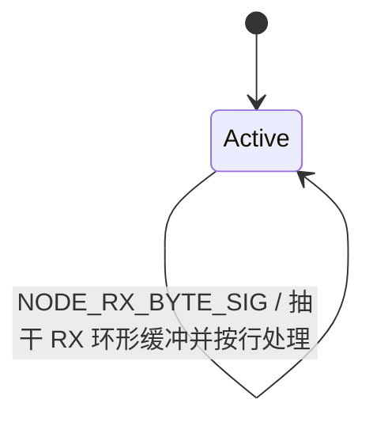
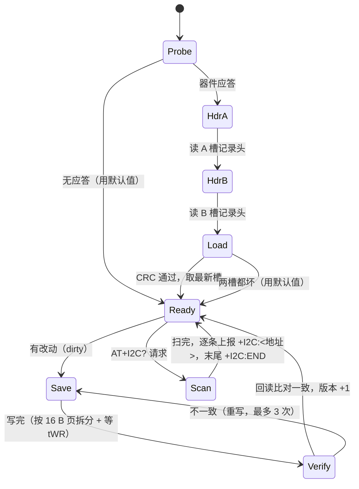
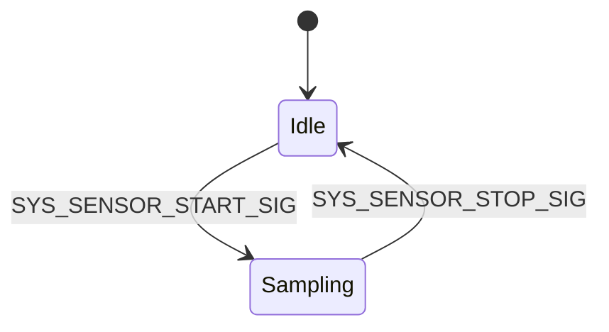

# 任务说明

## AO_Ble 任务

上电后执行 VG6328 探测与透明模式、自动广播、名称、长度、UUID/广播字段、MAC 查询配置；每一步均为“发送后返回，由 RX 或 1 s 超时继续”。连接后先认证，随后处理参数发现、get/set、ping、NAK、reboot 与周期 data。模组缺失时只将 BLE 标为不可用并记录一次 ASCII 日志，其余 AO 继续运行。

探测在上电 500 ms 后开始，失败后每 2 s 重试，最多 3 次。失败日志包含原因、AT 步骤、TX/RX 字节、UART 错误和溢出计数，用于区分模组未上电、TX/RX 接反、错误波特率和协议响应异常。

连接并认证成功后立即排队一次完整 `data` 上报，之后按 `sample_interval` 周期上报。收到已认证客户端的 `reboot` 命令时先发送确认，调试口打印明确的 reboot requested 日志，然后执行软件复位。

本工程使用 QP/C 活动对象（AO）表达并发业务。当前有 `AO_Node`、`AO_Sensor`、`AO_Heartbeat`、`AO_Ble`、`AO_Modem` 五个 AO，均由 `App/app/app.c` 的 `App_start()` 构造并启动；队列存储由各 AO 自己持有。

## AO 一览

| AO | 优先级 | 队列 | 当前职责 |
|---|---:|---:|---|
| `AO_Node` | 1 | 10 | USART1 接收事件、AT 行解析、参数命令的执行与回复 |
| `AO_Sensor` | 2 | 8 | 1 Hz 仿真采样、滤波、组帧/解析自检、ASCII 上报 |
| `AO_Heartbeat` | 3 | 4 | 默认每 2 s 输出异步心跳日志 |
| `AO_Ble` | 4 | 12 | VG6328 配置、小程序协议与周期上报 |
| `AO_Modem` | 5 | 12 | 4G 入网、MQTT 与云业务 |
| `AO_Store` | 6 | 8 | 掉电参数存储：上电加载、异步落盘、I2C 扫描 |

六个 AO 都运行在 QV 协作式内核上，没有私有栈，共用主栈；状态处理函数必须快速返回。`AO_Ble` / `AO_Modem` 分别受 `APP_CFG_BLE_ENABLE` / `APP_CFG_MODEM_ENABLE` 控制；`AO_Store` 受 `APP_CFG_STORE_ENABLE` 控制（置 0 时不碰总线，参数退化为只有编译期默认值）。

## AO_Node

`AO_Node` 是单状态活动对象，唯一状态为 `Active`。它不再负责周期心跳，也不存在旧版的 `Boot` / `Running` / `Halted` 状态和 `g/h/s/x/d/?` 单字符命令。



- 进入 `Active` 时打印一行控制台提示与三行命令清单（`params:` / `names:` / `store:`），只打一次的现场自助说明。
- USART1 中断经 `Node_uartRxIsrSink()` 把字节写入 BSP 环形缓冲，并投递静态事件 `NODE_RX_BYTE_SIG`。
- `Active` 收到事件后循环调用 `BSP_uartRxGet()` 抽干缓冲。
- 可打印 ASCII 暂存到行缓冲；CR/LF 触发行处理。
- 命令按标准 AT 形态（V.250 / 3GPP 27.007，2026-09-27 改写）：`AT` 回 `OK`；`AT+<参数名>?` 回 `+<参数名>:"<值>"`；`AT+<参数名>="<值>"` 回 `OK`（异步落盘，引号可省）；`AT+<参数名>=?` 回 `+<参数名>:(<最大长度>)`；`AT+CFG?` / `AT&F` / `AT+I2C?` 见 [[06-协议格式#AT 输入]]。
- 其他非空行回复 `ERROR\r\n`；空行静默。
- 非 CR/LF 的控制字符直接回复 `ERROR\r\n`。
- **所有命令都必须以 CR 或 LF 结束**——「裸 `at` 不带行尾也认」的捷径已删除（它会让 `AT+SN?` 的前两个字符 `AT` 误触发）。

AT 解析在 Service 层 `svc_at.c`（只解析，产出 `SvcAtCmd`）；**执行与回复在 App 层** `node.c` 的 `atExecute()`——参数读写要落到 `AO_Store` 上异步完成，Service 层不允许反向调用 App。响应通过 `LOG_WRITE()` 进入异步 UART 发送队列。

## AO_Store

`AO_Store` 持有参数集合的 **RAM 影子**（`SvcParam`），它是运行期的唯一真相：读参数永远走内存，EEPROM 只在启动读一次、修改时写一次。相位机如下：



关键行为：

- **上下文与 AO**：`AO_Store`（优先级 6、8 槽队列、10 ms 节拍）。三条触发源是自身节拍、I2C1 中断（`Store_i2cSink` → `STORE_BUS_SIG`）与「有新请求」（`STORE_CMD_SIG`）。
- **不阻塞**：每拍只发起一次中断传输就返回，页与页之间靠 `APP_CFG_STORE_WRITE_CYCLE_MS`（6 ms）的期限等待推进；驱动层不允许忙等，AO 层不允许 `BSP_delayMs()`。唯一的有界阻塞是 `AT+I2C?` 扫描的单次地址探测（2 ms 上限，每拍最多 4 个地址）。
- **掉电安全**：A/B 双槽交替写 + 槽序号 + CRC-16。先写「不是当前那份」的槽，写完**回读逐字节比对**，通过才切换。写到一半掉电时旧记录仍然完好。
- **介质空白或损坏**：回落到 `app_config.h` 的编译期默认值，并打一条 `store: ... using built-in defaults`；**不会**自动把默认值写进介质（避免每次上电都写一遍）。
- **与 BLE 的时序**：`Ble_ctor()` 用影子的值构造 `BleConfig`（此时是默认值），`AO_Ble` 在探测模组前等 `App_Store_ConfigResolved()`，所以真正写进模组的一定是介质里的值。
- **配置热改**：`AT+SN="VWA2608A0020"` 只改内存并立即生效于后续读取；**写进模组需要重启**（BLE 只在启动时配一次模组），日志与文档都按这个口径说明。

```text
[I 120] store: eeprom at 0x50 ready, 512 B, page 16 B
[I 130] store: loaded ver=3 seq=2 slot=B
[I 240] store: saved ver=4 seq=3 slot=A 128 B
```

## AO_Sensor

`AO_Sensor` 有 `Idle` 和 `Sampling` 两态。`App_start()` 在启动阶段投递一次 `SYS_SENSOR_START_SIG`，所以正常启动后会自动进入 `Sampling`；当前 AT 通道没有停止或立即采样指令。

> [!note] 启动提示已在 2026-09-20 清理
> `Idle` 入口原先打印 `sensor> idle (send 's' to start sampling)`，而 `s` 指令早已删除，属会误导现场的残留文案；现已改为 `sensor> idle`。采样仍由 `App_start()` 在上电时自动启动。



采样周期来自 `APP_CFG_SENSOR_PERIOD_S`（当前 1 s）。一次采样依次执行：

1. `DRV_Sensor_ReadTemp_cC()` / `DRV_Sensor_ReadRh_permil()` 读取仿真数据。
2. `SVC_Filter_Median3()` 与 `SVC_Filter_MavgPush()` 做中值和滑动平均。
3. `SVC_Frame_Pack()` 生成 CMD `0x10` 二进制帧。
4. `SVC_Frame_Parse()` 立即解析，检查长度、CRC 和载荷一致性。
5. 通过 BSP 输出 ASCII 诊断行。

```text
sensor> #12 t=23.44C rh=45.6% frame=10B selfcheck=SVC_OK
```

当前 `App/driver/drv_sensor.c` 是仿真数据源，没有配置真实传感器总线和引脚。接入真实器件时应在 Driver 层新增或替换具体器件实现，并先在 BSP 层封装总线。

## AO_Heartbeat

`AO_Heartbeat` 是单状态 `Running` 活动对象。周期来自 `APP_CFG_HEARTBEAT_PERIOD_S`（当前 2 s），可由 `APP_CFG_HEARTBEAT_ENABLE` 在编译期关闭。

```text
[I <uptime_ms>] heartbeat: started, period 2 s
[I <uptime_ms>] heartbeat: alive, t=2 s
```

日志通过 `SVC_Log_Printf()` 格式化，经 `BSP_logWrite()` 入队，由 USART1 发送中断异步搬出；队列满时按配置丢弃并累计 `BSP_logDropped()`。

## 错误处理

| 机制 | 行为 |
|---|---|
| QP 断言 | 关中断，打印 ASCII 断言信息，然后死循环等待调试器 |
| HAL 错误 / CPU 异常 | 关中断或进入死循环，保留现场 |
| RX 环形缓冲满 | 丢弃新字节，不阻塞中断 |
| AO 队列满 | `QACTIVE_POST_X(..., 0U, ...)` 不触发断言 |
| 日志 TX 队列满 | 丢弃字节并增加丢弃计数 |

量产前仍需增加看门狗、错误持久化或受限降级策略。

## 新增 AO 的步骤

1. 在 `App/app/app_signals.h` 表尾追加 32 个信号的专属段；跨 AO 信号放全局段。
2. 在 `App/app/app_prio.h` 的 `APP_MAX_PRIO` 前登记唯一优先级。
3. 在 `App/app/` 新建 AO 的 `.h/.c`；首成员必须是 `QActive super`。
4. 实现 `<Ao>_ctor()` 与 `<Ao>_start()`；队列静态存储放在 AO 自己的 `.c`，QV 栈参数必须为 `(void *)0, 0U`。
5. 在 `App_start()` 中先构造、后启动，并同步启动横幅的 `actors` 行。
6. 若由中断驱动，中断只存数据、重装外设、投递事件，且抢占优先级数值必须 ≥ 3。
7. 运行 `App/tools/apply_qp_to_keil.ps1`，再按 [[AGENTS#8. 验证要求]] 完成验证并更新文档与改动日志。

## 相关文档

- [[04-任务调度]] · [[06-协议格式]] · [[07-接口约定]] · [[00-索引]]
