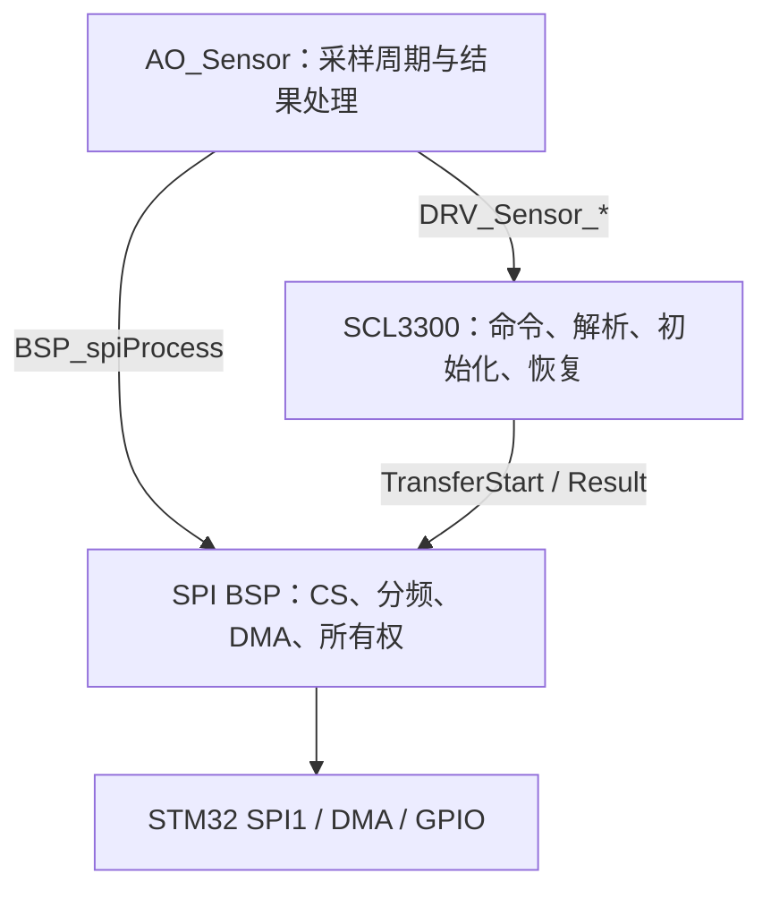
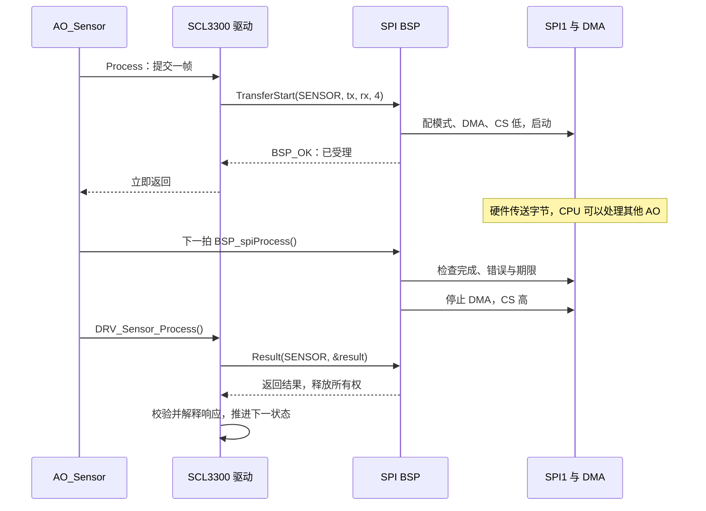
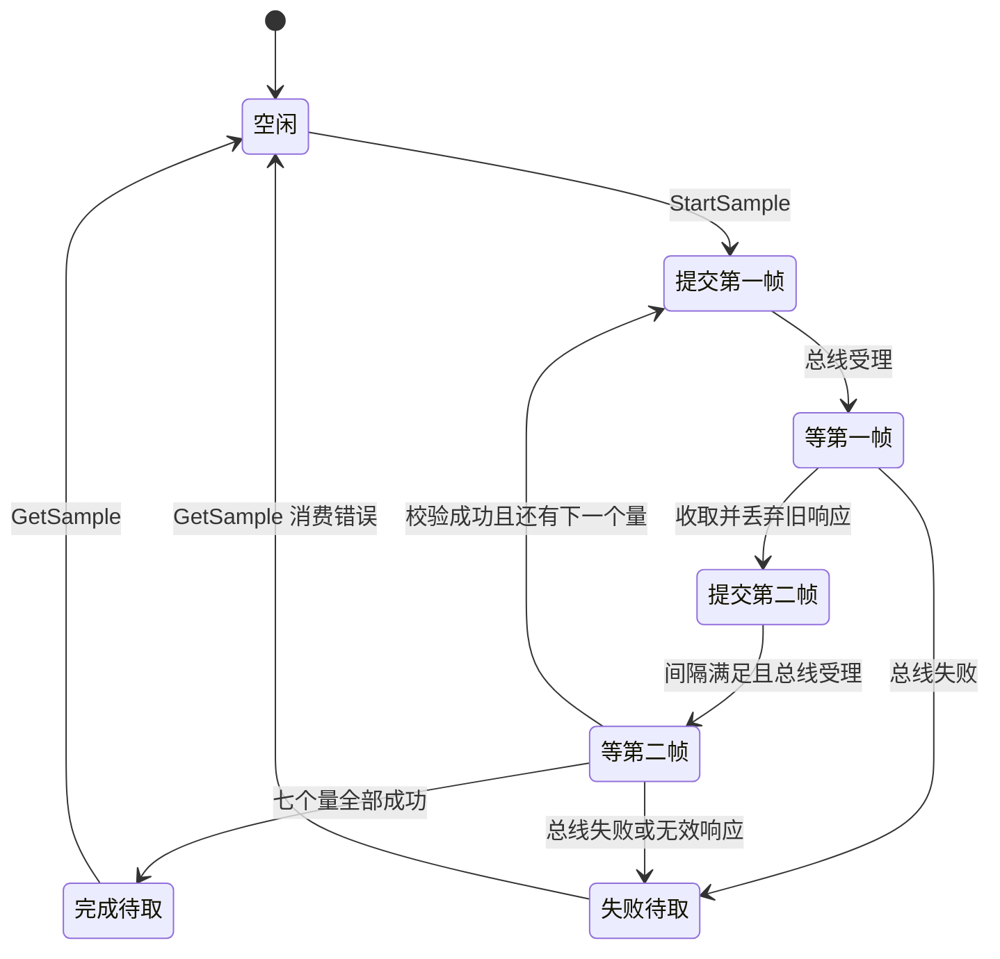

# 接口约定

## 寄存器服务接口（2026-10-14）

`SVC_Register_Execute(write,data,port,result)` 先检查整帧结构及CRC，通过后逐项回调read/write；坏帧不会写任何参数。地址和写数值严格2/4位大写hex，读16项/写6对，请求52字符、回复132字符。结果含frame_error/frame_code/all_ok/data，调用方持有缓冲。

`App_Register_Dispatch(request,snapshot,result)` 对串口添加+READ/+WRITE及最终结果行；云端raw仅寄存器负载或帧错误文本。AppCommandResult.raw因此按来源适配，不能再假设所有来源都含完整AT行。成功状态00、读异常XX/XY及写字母标记按实际文本参与CRC。配置02/03合法写暂为NP，01复用Store异步受理；当前固件能力见 [[06-协议格式]]，目标表见 [[13-寄存器表与读写命令]]。

怎么验证：`powershell -NoProfile -ExecutionPolicy Bypass -File sensor-node-fw/App/tools/register_test.ps1`，覆盖CRC无副作用、最大长度、部分成功、同批无效和新JSON实际链路；L5另行验证。

## Component 接口

通信组件使用 `context + write/read/get_tick_ms/trace` 的端口表。`write` 非阻塞且只能整包接收或返回 busy，`read` 不等待；核心禁止 HAL/QP/RTOS 与全局可变状态。对 App 的 BLE 公共入口固定为 `BLE_Component_Init/Start/Process/Report/IsConnected/IsReady`，更换芯片只替换编译期 backend。

4G 组件用同一套 Port 契约（`read` 同样不等待、`write` 同样整包接收或返回 `MODEM_PORT_BUSY`），对 App 的公共入口固定为 `Modem_Component_Init/Start/Process/RequestReport/RequestCellInfo/RequestLocation/IsReady`。差异只有一处：BLE 的后端是「AT 命令序列 + 行匹配」，4G 的后端是**连接计划步骤表**（每步给出命令、期望标记、超时与重试方式），由核心按期限推进，因此 4G 的 `Process` 不需要任何就地等待。`Modem_Component_Start()` 可被反复调用，用作失败重连。

平台命令接口为 `Modem_Component_TakeCommand(me, struct ModemCommandRequest *request)`，按值交付id/command/data/has_data；`Modem_Component_CompleteCommand(me,id,command,raw)` 负责JSON转义与发布。寄存器回复只有id/data，基础AT/RST另回显command，不再传ok布尔值。`App_CloudCommand_Dispatch` 执行白名单，`App_Register_Dispatch` 共享寄存器语义；组件不依赖QP或存储。单邮箱已有请求/应答时新增下行不执行，保留原应答。

`Modem_Component_RequestCellInfo/RequestLocation` 是**尽力而为**的请求：只置一个标志位，真正的 AT 往返由组件在下一个 `Process` 周期发起，查不到不改变在线状态、也不覆盖上一次取到的有效值；后端未实现该查询时请求被静默丢弃（见 `ModemBackend` 的可空钩子）。

[[02-程序框架]] 说明了「代码怎么分层」，本文件把它压到可执行的一级：函数怎么签名、错误码怎么定、缓冲区归谁、哪个函数能从中断里调。写新代码前先看这里，比事后重构便宜。

本文件约束 `App/` 下的自研代码（`app` / `app_command` / `service` / `driver` / `bsp`）与 `ThirdParty/` 的适配层。`Core/`、`Drivers/` 是 CubeMX 生成产物，只受 `/* USER CODE BEGIN..END */` 规则约束，不受本约定管理。本约定与 `AGENTS.md` 冲突时以 `AGENTS.md` 为准。

## 统一命令接口

- `App/app_command/app_command.h` 只定义可复用的数据模型：`AppCommandRequest` 携带
  `AppCommandSource`、`SvcAtCmd` 和可选的云端关联 ID；`AppCommandResult` 携带状态、错误码和
  AT 原始响应。
- `App/app/command_dispatch.c` 是本工程的动作适配层，允许访问 `App_Store_*` 和
  `app_config.h`；`App/app_command/` 不得反向依赖 Store、QP 或硬件。
- `App_Command_Dispatch()` 返回 `true` 表示已经识别并生成结果，返回 `false` 表示调用方应按
  「未处理命令」处理。即使动作失败，只要已经识别命令，也返回 `true`，并在结果中提供错误文本。
- 串口请求使用 `APP_COMMAND_SOURCE_SERIAL`；4G MQTT 请求将使用
  `APP_COMMAND_SOURCE_MODEM`，两者必须复用同一套 `SvcAtCmd` 语义和动作分支。

## 总原则

五条，后面的细则都是它们的推论。

1. **依赖单向向下。** App → Service → Driver → BSP → HAL。反向调用一律视为缺陷，唯一的正式例外是 HAL 回调（`HAL_UART_RxCpltCallback()` 实现在 `App/bsp/bsp.c`，由 HAL 从中断里调用）。
2. **下层不认识上层。** BSP 不得 `#include` 任何 `App/app`、`App/service`、`App/driver` 的头文件，也不得引用上层的类型与函数。
3. **下层不依赖 QP。** Driver 与 Service 不得 `#include "qpc.h"`，因此也不能使用 `Q_ASSERT`、`QF_CRIT_ENTRY`、事件队列这类框架设施。这条直接决定了它们的接口形态：所有等待必须是有限时的，所有异步必须由调用方（App 层）用事件驱动，下层只提供「发起」和「查询」两个动作。
4. **静态分配。** 不用 `malloc`，缓冲区与队列存储一律 `static` 数组。QP 事件池只在跨 AO 传递变长数据时才引入。
5. **中断里只做三件事。** 存数据、重新装载外设、投递事件。不打印、不解析、不做业务。

## 状态码体系

### 三层各有一套，不共用

每层定义自己的状态码类型，取值用「层前缀 + `_OK` / `_ERR_<原因>`」。不跨层复用同一个枚举，理由是各层的失败原因是不同的集合，硬合并会逼出 `*_ERR_OTHER` 这种无信息量的兜底值。

| 层 | 类型 | 取值 | 说明 |
|---|---|---|---|
| BSP | `bsp_status_t` | `BSP_OK`、`BSP_ERR_PARAM`、`BSP_ERR_BUSY`、`BSP_ERR_TIMEOUT`、`BSP_ERR_IO` | 总线与外设层面的失败 |
| Driver | `drv_status_t` | `DRV_OK`、`DRV_ERR_PARAM`、`DRV_ERR_BUS`、`DRV_ERR_TIMEOUT`、`DRV_ERR_NODEV`、`DRV_ERR_BUSY` | 器件语义层面的失败，沿用 `App/driver/README.md` 已定的四个值，新增 `DRV_ERR_NODEV`；`DRV_ERR_BUSY` 是非阻塞接口专用的「上一次作业还没结束」 |
| Service | `svc_status_t` | `SVC_OK`、`SVC_ERR_PARAM`、`SVC_ERR_RANGE`、`SVC_ERR_CRC`、`SVC_ERR_STATE`、`SVC_ERR_NOMEM` | 数据与协议层面的失败 |
| App | 不用状态码 | —— | App 层是状态机，失败走「降级状态 + 事件」或 `Q_ASSERT`，不向上返回错误 |

> [!important] `DRV_` 前缀的双重身份
> `DRV_` 既是 Driver 层的函数前缀（`DRV_SHT30_Read`），又是状态码前缀（`DRV_OK` / `DRV_ERR_*`）。区分方式是硬规则而不是习惯：**函数名里必定有器件名段，状态码里必定带 `OK` 或 `ERR_`**。新增宏或函数时按这条自检，不要出现 `DRV_TIMEOUT` 这种既像函数又像状态码的名字。

### 跨层映射不丢信息

上层翻译下层错误时，把下层的具体原因映射到本层最接近的取值，并把原始值留在自己的错误记录里，不要压成「失败」两个字。

| 下层返回 | Service 层应返回 | 理由 |
|---|---|---|
| `DRV_OK` | `SVC_OK` | 直通 |
| `DRV_ERR_PARAM` | `SVC_ERR_PARAM` | 调用方参数问题，直通 |
| `DRV_ERR_BUS` | `SVC_ERR_STATE` | 总线故障对本层表现为「设备不可用」，属于状态问题 |
| `DRV_ERR_TIMEOUT` | `SVC_ERR_STATE` | 同上，超时不是数据问题 |
| `DRV_ERR_NODEV` | `SVC_ERR_STATE` | 器件不存在，上层应停止重试而不是继续组帧 |

### 什么时候不用状态码

不是所有返回值都该是状态码，滥用会让调用点全是无意义的判断。

| 场景 | 返回类型 | 现有例子 |
|---|---|---|
| 可能失败的动作 | `*_status_t` | `DRV_SHT30_Read()` |
| 纯判定 / 有无数据 | `bool` | `BSP_uartRxGet(uint8_t *byte)` |
| 纯输出且不可能失败 | 直接返回值或 `void` | `BSP_printU32(uint32_t)` |
| 已构造完成的对象 | 无返回值，用断言兜底 | `Node_ctor()` |

## 各层接口形态

### BSP 层

职责是「板级语义 + 唯一的寄存器/HAL 接触点」。接口用 `BSP_<对象><动作>()` 的驼峰段式，与现有 8 个函数（`BSP_print`、`BSP_uartRxStart`、`BSP_uartRxGet` …）保持一致，不重命名既有函数。

```c
/* 动作类：可能失败，返回状态码 */
bsp_status_t BSP_i2cInit(uint32_t speedHz);
bsp_status_t BSP_i2cWrite(uint8_t addr7, uint8_t const *buf, size_t len);
bsp_status_t BSP_i2cRead(uint8_t addr7, uint8_t *buf, size_t len);

/* 延时与时间：板级唯一时间来源 */
void   BSP_delayMs(uint32_t ms);        /* 只在初始化期使用，禁止在 AO 里调用 */
uint32_t BSP_uptimeMs(void);

/* ISR 安全的写入口，函数名不做特殊标记，靠注释与本节声明 */
void BSP_uartRxPut(uint8_t byte);        /* 仅限 USART1 中断调用 */
```

两条硬规则：

- **公开头文件里不允许出现 HAL 类型。** 不要出现 `UART_HandleTypeDef`、`GPIO_TypeDef`、`I2C_HandleTypeDef`。句柄用 `uint32_t` 编号或不透明指针，上层不需要也不应该知道底层用哪个外设。
- **每个 ISR 安全的函数必须在头文件注释里写明「由 XX 中断调用」。** 现有 `BSP_uartRxPut()` 已经这么做了，新增总线接口时沿用。

> [!important] 外设实例用「编号」注入（2026-09-20 起）
> 一路业务串口占哪个外设实例是**装配信息**，会随板子改版变化（BLE 与 4G 已经对调过一次）。因此端口初始化把实例编号作为入参，而不是在 BSP 里写死 `huartN`：
>
> ```c
> /* 实例编号是 BSP 自己的类型（App/bsp/bsp_uart.h），因此公开头文件里不出现 HAL 类型 */
> typedef enum { BSP_UART_NONE = 0, BSP_UART_1, BSP_UART_2, BSP_UART_3 } bsp_uart_id_t;
>
> void BSP_bleUartInit(BlePort *port, bsp_uart_id_t uart);      /* 编号来自 APP_CFG_BLE_UART_ID   */
> void BSP_modemUartInit(ModemPort *port, bsp_uart_id_t uart);  /* 编号来自 APP_CFG_MODEM_UART_ID */
> bool BSP_bleUartIsInstance(bsp_uart_id_t uart);               /* 供 HAL 回调按实例分派           */
> ```
>
> 编号到 `UART_HandleTypeDef*` 的映射留在各端口的 `.c` 里；HAL 的公共回调（`RxCplt` / `TxCplt` / `Error`）按 `huart->Instance` 翻成编号后分派给占用该实例的端口。**换接线只改 `app_config.h` 的两行宏**，BSP 代码不动。

> [!important] 端口要负责配置自己所占实例的**线速率**（2026-09-27 起）
> 既然实例是装配信息、可以随板子改版对调，**波特率就不能钉在 `.ioc` 里**——否则对调之后
> 会有端口跑在错的速率上。规矩是：`BSP_*UartInit()` 里
> `l_uart->Init.BaudRate = APP_CFG_*_UART_BAUD; HAL_UART_Init(l_uart);`（在装载接收之前）。
>
> 之所以专门写下这条：2026-09-27 上板发现 `BSP_modemUartInit()` **从未应用**该宏，
> `.ioc` 又没有 `USART3.BaudRate`，于是 `huart3` 一直是 CubeMX 的默认 115200，
> 而 MN316 要 9600——**宏只被日志打印、从未作用到硬件**，表现为模组完全不应答
> 且 `uart_err = 0`，与「模组没供电」无法区分。两条配套纪律：
> ① 启动日志打印**实际生效值**（读句柄，不读宏）；② 两个业务端口**不得占用同一实例**，
> 由 `bsp_uart.c` 的 `#error` 编译期卡住。

#### I2C（`App/bsp/bsp_i2c.{h,c}`，2026-09-27 新增）

参数存储用的 I2C1 主机。这是本工程第一个**非阻塞总线**接口：`MemWriteIt` / `MemReadIt`
只负责「发起」并立即返回，结束由中断回调通知（或用 `BSP_i2cIsBusy()` 轮询），
调用方永远不等总线——因为 QV 是协作式内核，驱动里一旦忙等全系统停摆（见 [[#时序与阻塞预算]]）。

```c
/* 发起：立即返回。完成/失败由 sink（中断上下文）或 isBusy 轮询得知 */
bsp_status_t BSP_i2cMemWriteIt(uint8_t devAddr8, uint8_t memAddr, uint8_t const *buf, uint16_t len);
bsp_status_t BSP_i2cMemReadIt (uint8_t devAddr8, uint8_t memAddr, uint8_t *buf, uint16_t len);
bool         BSP_i2cIsBusy(void);          /* 上一拍的动作完成没有 */
bsp_status_t BSP_i2cLastStatus(void);      /* 完成之后：BSP_OK 还是 BSP_ERR_IO */
void         BSP_i2cSetSink(BspI2cSink sink);   /* 中断上下文，只允许投递事件 */

/* 诊断与兜底 */
bsp_status_t BSP_i2cProbe(uint8_t devAddr8, uint32_t timeoutMs);  /* 有界阻塞，只给扫描用 */
bsp_status_t BSP_i2cBusRecover(void);                             /* 9 时钟 + STOP，最后手段 */
```

四条硬规则：

- **地址一律用「8 位地址字节」**（已经左移、最低位是 R/W），与 HAL 一致；例如 AT24C04 的 A1/A2
  接地时是 `0xA0`（0x00–0xFF 段）或 `0xA2`（0x100–0x1FF 段）。
- **`len` 上限 255**（HAL 的 IT 接口用 `uint16_t`，但内部按字节计数，超过 255 的行为不可依赖）。
- **缓冲在传输期间必须保持有效**：中断里才会把数据搬完，因此不能传栈上临时数组。
- **`BSP_i2cBusRecover()` 会重置外设**：只在总线卡死时调用，调用后 `hi2c1` 已完成
  `HAL_I2C_DeInit()` → `MX_I2C1_Init()`，可以继续正常使用。
- NVIC 的使能与 IRQ 入口由 BSP 自己负责（见 [[03-资源分配#中断与优先级]]），不写进 `.ioc`。

### Driver 层

职责是把器件抽象成语义接口，屏蔽走 I2C 还是 SPI、从机地址是多少。接口用 `DRV_<器件>_<动作><量纲>()`，器件名全大写。

```c
drv_status_t DRV_SHT30_Init(void);
drv_status_t DRV_SHT30_ReadTemp_cC(int32_t *out);   /* 单位 0.01 °C */
drv_status_t DRV_SHT30_ReadRh_permil(uint16_t *out); /* 单位 0.1 %RH */
```

约定：

- **量纲写进函数名，不在函数内部偷偷换算。** 原始码与物理量分离：`_raw` 后缀给原始值，带量纲后缀给换算后的整数。换算曲线属于 Service 层，不放在驱动里。
- **阻塞预算。** 允许毫秒级的总线等待（I2C 单次传输、EEPROM 写周期），但必须有超时，超时返回 `DRV_ERR_TIMEOUT`。超过毫秒级的等待（例如 Flash 擦除）必须拆成 `Start()` → `IsReady()` 两步，由 App 层用事件驱动。
- **不持有 AO 上下文。** 驱动是无状态或只持有器件状态的函数集合，不知道事件、队列、状态机的存在。
- **输出参数放最后，`const` 标只读。** 返回值只用来表达成功失败，输出走指针参数。

#### 非阻塞驱动的接口形态（`drv_at24c04` 是第一个）

需要跨多拍才能完成一个动作的器件（EEPROM 页写 + 写周期、Flash 扇区擦除）统一用
**「Start / Process / State」三段式**，而不是阻塞式的一次调用：

```c
drv_status_t        DRV_AT24C04_WriteStart(uint16_t addr, uint8_t const *buf, uint16_t len);
void                DRV_AT24C04_Process(void);      /* 每拍调一次，推进一小步 */
drv_at24c04_state_t DRV_AT24C04_State(void);        /* IDLE / BUSY / DONE / FAILED */
drv_status_t        DRV_AT24C04_Result(void);       /* DONE 后取结果或失败原因 */
```

契约：

- `*Start()` **只发起**，不做任何等待；上一个作业没取走结果时返回 `DRV_ERR_BUSY`。
- `Process()` 由调用方（App 层的 AO）在周期事件里调用，内部完成分段、期限等待与重试；
  它**不会**阻塞超过一次寄存器操作的时间（本工程里是微秒级）。
- 结果用 `State()` 取，成功与失败都在 `DONE`/`FAILED` 后一次性交给调用方，驱动不打印、不投事件。
- **缓冲所有权仍在调用方**：`Start()` 拿到的指针在作业结束前必须有效，`DONE`/`FAILED` 之后才可释放。
- 器件差异（地址宽度、页大小、要不要擦除、写完等多久）全部在本层消化；上层只按线性地址读写。

### Service 层

职责是硬件无关的中间处理：组帧、校验、参数存储、滤波、换算。接口用 `SVC_<模块>_<动作>()`。

```c
/* 组帧：调用方提供缓冲区，函数只填内容并回报实际长度 */
svc_status_t SVC_Frame_Pack(uint8_t cmd, uint8_t const *payload, size_t len,
                            uint8_t *out, size_t cap, size_t *outLen);

/* 统计：无状态，纯函数 */
int32_t SVC_Filter_Median3(int32_t a, int32_t b, int32_t c);

/* 参数记录：影子由调用方持有，本模块只做编解码与校验 */
size_t       SVC_Param_Encode(SvcParam const *me, uint16_t ver, uint8_t seq,
                              uint8_t *out, size_t cap);
svc_status_t SVC_Param_Decode(SvcParam *me, uint8_t const *in, size_t len);

/* AT 解析：只解析，不产生响应文本、不访问存储 */
bool SVC_At_Feed(SvcAt *me, uint8_t byte, SvcAtCmd *out);
```

约定：

- **优先写成无状态函数。** 确实需要状态时，把状态做成一个结构体，由调用方（App 层的 AO）持有并作为第一个参数传入，Service 自己不定义全局变量。这样测试和重入都不需要额外设计。
- **缓冲区由调用方提供。** Service 不返回指向自己内部静态缓冲的指针——那会让缓冲生命周期和调用顺序耦合。入参是 `out` + `cap`，出参是 `*outLen`；`cap` 不足时返回 `SVC_ERR_NOMEM`，不做部分写入。
- **长度类型统一 `size_t`**，与 CMSIS、QP 一致。只有确实为了省空间时才用 `uint16_t`，并在注释里说明。
- **Service 不执行副作用**：`SVC_At_Feed()` 只把一行文本翻成 `SvcAtCmd`，「命令怎么执行、回复什么」由 App 层决定（参数写要经 `AO_Store` 异步落盘）。同理 `SVC_Param_*` 只碰调用方给的内存，不碰总线。

> [!note] `SVC_At_Feed()` 的接口在 2026-09-27 变更
> 原签名 `bool SVC_At_Feed(SvcAt *, uint8_t, char *resp, size_t cap)` 直接产出响应文本。
> 新增参数读写命令后，「回复什么」取决于存储层的结果，属于 App 层职责，因此改为产出
> 结构化命令 `SvcAtCmd`。调用点只有 `App/app/node.c` 一处，改动是受限的。
>
> 同一天还改了**命令语法本身**：从自定义的 `at` / `<名>?` / `<名>=<值>` / `cfg?` / `cfg!` / `i2c?`
> 改为标准 AT（旧写法不再兼容）。`SvcAtCmd.kind` 的当前取值为
> `NONE / PING / GET / SET / TEST / INFO / DEFAULTS / SCAN / CMD / VERSION / REBOOT / BLE_UUID`。
> **命令清单的唯一真相是 [[06-协议格式#命令一览]]**，本节不再抄（2026-09-28 订正：此前这里列过一份
> 当时的命令表，随后 `AT+VER?`/`AT+CAD?`/`AT+TRANSINTVL`/`AT+RST`/`AT+BLESVCUUID?` 陆续追加，
> 抄本必然失真）。

### AT 命令的接口契约（2026-09-28 新增）

命令语义在 `App/app/command_dispatch.c`，但**下面三条是跨命令的接口约定**，改任何一条都要同步双方文档：

| 约定 | 内容 |
|---|---|
| **身份类参数只允许串口写** | `SN`、`UUID` 属身份类：云端写回 `+CME ERROR:4`（`writeAllowedFrom()`）。读不受限（云端可 `AT+SN?` / `AT+BLESVCUUID?`） |
| **身份参数改动即重启** | 写身份类参数且**值真的变了**时，App 层请求 `AO_System` 复位（先等参数落盘）。`AT+SN="…"`/`AT+UUID="…"` 之后看到自动重启是正常现象 |
| **回显名跟着命令名走** | 通用读法回 `+<参数名>:"…"`；专用命令回自己的名字（如 `AT+BLESVCUUID?` → `+BLESVCUUID:"…"`）。平台侧按前缀匹配，写成 `+UUID:` 就对不上 |
| **退役参数对外不存在** | 槽位仍在（介质兼容），但读写测试三处一律回 `+CME ERROR:1`，也不进 `AT+CAD?` 清单。当前只有 `NAME`（广播名已并入 `SN`，见 [[08-改动日志]] `#76`）。判据：`SVC_Param_IsRetired()` |

`+CME ERROR` 码表见 [[06-协议格式#错误码]]（`1` 参数名未知 / `2` 值非法 / `3` 存储未就绪 /
**`4` 该来源无权写这条参数** / `5` 扫描忙）。新增错误码必须先在那张表登记。

### App 层

App 层是 QP/C 活动对象，接口形态已经在 [[05-任务说明]] 固定，这里只补两条与接口相关的：

```c
/* AO 对外只暴露三样：构造函数、单例句柄、信号枚举 */
void      Node_ctor(void);
extern QActive * const AO_Node;
enum NodeSignals { ... };

/* 新增：每个 AO 提供自己的启动函数，队列存储归 AO 自己所有 */
void Node_start(void);
```

`<Ao>_start()` 是本次新增的约定，用来把「队列存储 + `QACTIVE_START`」从装配点收回到 AO 自己的模块里。理由见 [[#现有偏差与整改项]] 的整改项 1。

## 信号与事件

### 全局信号表分段

QP 的信号号在同一个框架里是全局比较的，不同 AO 各自从 `Q_USER_SIG` 起定义枚举，加到第二个 AO 就会撞号。约定：**所有信号集中定义在一个头文件 `App/app/app_signals.h` 里，按段分配，每段 32 个。**

当前分段（2026-09-28，`AO_System` 加入后共 8 段；唯一真相是 `app_signals.h`）：

| 段 | 范围 | 拥有者 | 段内信号（示例） |
|---|---|---|---|
| 全局段 | 0..31 | 跨 AO 投递 | `SYS_SENSOR_START/STOP/REPORT/PERIOD_SIG`、**`SYS_REBOOT_REQUEST_SIG`** |
| Node | 32..63 | `AO_Node` | `NODE_HEARTBEAT_SIG`、`NODE_RX_BYTE_SIG` |
| Sensor | 64..95 | `AO_Sensor` | `SENSOR_SAMPLE_SIG` |
| Heartbeat | 96..127 | `AO_Heartbeat` | `HEARTBEAT_TICK_SIG` |
| Ble | 128..159 | `AO_Ble` | `BLE_PROCESS_SIG`、`BLE_RX_SIG`、`BLE_MEASUREMENT_SIG` |
| Modem | 160..191 | `AO_Modem` | `MODEM_PROCESS_SIG`、`MODEM_RX_SIG`、`MODEM_MEASUREMENT_SIG` |
| Store | 192..223 | `AO_Store` | `STORE_TICK_SIG`、`STORE_BUS_SIG`、`STORE_CMD_SIG` |
| System | 224..255 | `AO_System` | `SYSTEM_TICK_SIG` |

> [!note] 本节此前贴的是一段**示意用的旧代码**（`SYS_TICK_1S_SIG` / `SYS_ERROR_SIG` / "Sensor 段（预留）"），
> 与真实枚举早已不符 —— 2026-09-28 改成上表，并注明"唯一真相在头文件"，避免再出现抄本失真。

规则：

- 段内信号只允许本 AO 自己使用；跨 AO 投递必须用全局段，或显式使用对方段内的信号。
- 新增 AO 时在表尾追加一段，`_BASE` 接上一段的 `_END`，不要往中间插——插值会让已固化的信号号整体偏移。
- 不再保留各 AO 头文件里的 `MAX_SIG` 计数项，段边界 `*_SIG_END` 已经表达了计数。

### 事件的两种用法

| 用法 | 适用场景 | 现有例子 |
|---|---|---|
| 无载荷静态事件 + 数据留在原地 | 数据源是 BSP 的环形缓冲，事件只做「有数据了」的通知 | `Node_rxByteEvt` + `BSP_uartRxGet()` 抽干缓冲 |
| 带载荷的池事件 | 数据需要跨 AO 传递，且数据源没有缓冲 | 尚未使用 |

第一种是当前工程的模式，也是 QP 推荐的「中断到 AO」解耦方式，继续沿用。新增第二种时要走 QP 事件池（`QF_pool` / `Q_NEW`），并在本文档登记事件所有者与回收责任。

## 缓冲区与所有权

每个缓冲区都要能回答「谁写、谁读、满了怎么办、谁能释放」。

| 缓冲区 | 位置 | 写者 | 读者 | 满时行为 |
|---|---|---|---|---|
| 串口 RX 环形缓冲（64 B） | `App/bsp/bsp_uart.c` | USART1 中断（`BSP_uartRxPut`） | AO（`BSP_uartRxGet`） | 静默丢弃新字节，不阻塞中断 |
| 日志 TX 环形队列（256 B） | `App/bsp/bsp_uart.c` | 各层 `BSP_logWrite()`（线程上下文） | USART1 发送中断 | 丢弃该字节并累加 `BSP_logDropped()` |
| BLE RX/TX 环形缓冲（512 / 1536 B） | `App/bsp/bsp_ble_uart.c` | 业务串口中断 / `BlePort.write` | `BlePort.read` / 发送中断 | RX 满计数 `BSP_bleUartOverflow()`；TX 满返回 `BLE_PORT_BUSY` |
| 4G RX/TX 环形缓冲（512 / 1024 B） | `App/bsp/bsp_modem_uart.c` | 业务串口中断 / `ModemPort.write` | `ModemPort.read` / 发送中断 | RX 满计数 `BSP_modemOverflowCount()`；TX 满返回 `MODEM_PORT_BUSY` |
| AO 事件队列（Node 10 / Sensor 8 / Heartbeat 4 / Ble 12 / Modem 12 / Store 8） | 由 AO 的 `_start()` 持有 | 中断 / AO 投递 | QV 内核派发 | `QACTIVE_POST_X` 的 margin 传 0，不断言；`QACTIVE_POST` 用 `QF_NO_MARGIN`，**满了会断言**（见 08-改动日志 `#17` 遗留） |
| Service 组帧输出缓冲 | 调用方栈上或静态数组 | Service 函数 | 调用方 | 返回 `SVC_ERR_NOMEM` |
| 参数影子 `SvcParam`（288 B） | `App/app/store.c` 的 `l_store.param` | `AO_Store`（写）、所有 AO（读） | 任何调用 `App_Store_Value()` 的地方 | 定长数组，不会满；`App_Store_Value()` 永远返回合法字符串 |
| 存储记录缓冲 `rec` / `vfy`（177 B × 2） | 同上 | `AO_Store` / `svc_param` / `drv_at24c04`（中断里读） | 同上 | 编解码按最坏长度卡 `cap`，不足返回失败；中断期间缓冲必须保持有效 |
| I2C 传输数据缓冲 | 调用方提供 | `drv_at24c04` → `BSP_i2cMem*It()` | I2C1 中断 | 传栈上临时数组是**错误用法**（中断里才会搬完） |

规则：

- 环形缓冲维持现有的单生产者单消费者结构：中断只动 `rxHead`，AO 只动 `rxTail`，两边都不写对方的索引。这是一个不需要临界区的无锁设计，改动索引语义前先想清楚。
- 缓冲区大小用宏定义在拥有者的头文件里（`BSP_RX_RING_SIZE`），调用方不得硬编码数字。
- 缓冲区不动态分配，也不跨层传递指针的所有权：谁定义，谁负责生命周期。

## 时序与阻塞预算

| 上下文 | 允许的最长阻塞 | 禁止 |
|---|---|---|
| USART1 中断（`BSP_uartRxPut` 等） | 几微秒 | 打印、解析、等待、任何 QP 调用以外的复杂逻辑 |
| AO 状态处理函数 | 单次调用原则上不超过 1 ms | 忙等、`BSP_delayMs()`、大批量阻塞发送、原地等外设 |
| BSP 初始化（`BSP_init`） | 可到几十毫秒 | 在初始化里投递事件（此时 QP 尚未 `QF_run()`） |
| Driver 单次总线操作 | 毫秒级，必须带超时 | 无超时的死等、在驱动里做延时循环 |
| Driver 非阻塞作业的一拍（`DRV_AT24C04_Process()`） | 微秒级（只发起一次中断传输或做一次期限判断） | 在 `Process()` 里等待传输完成 |
| BSP I2C 扫描的单次探测（`BSP_i2cProbe()`） | `timeoutMs` 由调用方给（现场用 2 ms，典型 90 µs） | 在同一个处理函数里连续探测多个地址 |
| Service 函数 | 与数据量成正比，不做 I/O 等待 | 内部调用总线、内部做重传等待 |

`BSP_print()` 用带超时的阻塞发送是可以接受的，因为它只服务低频调试输出，单次最长阻塞约一个字节时间（115200 下约 87 µs）。一旦要输出成百上千字节（例如传感器数据批量打印），必须改 DMA 或拆成多个事件，不能靠加长超时解决。

## 中断安全与临界区

- 可以从中断调用的自研函数只有 BSP 层的白色名单：`BSP_uartRxPut()`，以及后续新增总线接口时明确标注的那几个。Driver 层与 Service 层的函数一律不允许从任何中断调用。
- 中断若要投递事件，其抢占优先级数值必须 ≥ 3（CMSIS 记法，数值越大优先级越低）。`USART1/2/3` 用 5、`I2C1_EV/ER` 用 5、`SysTick`/`TIM1` 用 15，都满足。详见 [[03-资源分配#中断与优先级]]。
- **中断里只允许投递事件，不允许碰状态机**：`Store_i2cSink()` 只 `QACTIVE_POST_X`，真正的推进在 `AO_Store` 的处理函数里（与 `Node_uartRxIsrSink` 同形）。
- App 层需要临界区时用 QP 提供的 `QF_CRIT_ENTRY()` / `QF_CRIT_EXIT()`，不要自己写 `__disable_irq()`，避免和 QP 的 `QF_BASEPRI` 嵌套出错。
- BSP 层内部确实需要屏蔽中断时（例如修改多字节共享量），用 HAL 的 `__disable_irq()` / `__enable_irq()` 成对包裹，且范围控制在几条语句内。当前 `BSP_uartRxPut()` 是单字节写入，不需要临界区。

## 数据类型与单位

STM32F103 是 Cortex-M3，没有硬件浮点。自研代码默认不用 `float` / `double`，物理量用整数加固定标度，标度写进函数名的量纲后缀。

| 物理量 | 标度 | 后缀 | 示例 |
|---|---|---|---|
| 温度 | 0.01 °C | `_cC` | `DRV_SHT30_ReadTemp_cC(int32_t *out)` |
| 相对湿度 | 0.1 %RH | `_permil` | `DRV_SHT30_ReadRh_permil(uint16_t *out)` |
| 电压 | mV | `_mV` | `BSP_adcRead_mV(uint16_t *out)` |
| 电流 | µA | `_uA` | `DRV_INA_ReadCurrent_uA(int32_t *out)` |
| 压力 | Pa | `_Pa` | `DRV_BMP_ReadPressure_Pa(int32_t *out)` |
| 时间（调度） | QP 节拍 | `_ticks` | `BSP_TICKS_PER_SEC/2` |
| 时间（实测） | ms | `_ms` | `BSP_uptimeMs()` |
| 经纬度 | 1e-6 度 | `_e6` | `ModemMeasurements.lon_e6` / `lat_e6` |
| 原始码 | 无标度 | `_raw` | `DRV_ADC_ReadRaw()` |

其余类型约定：

- 布尔用 `bool`（`<stdbool.h>`），不用 `int` 或自定义 `BOOL`。
- 指针参数：只读入参用 `T const *`；输出用 `T *`；结构体按指针传递，值传递只用于 4 字节以内的句柄。
- 入参合法性由被调函数校验，非法时返回 `*_ERR_PARAM`，不要依赖调用方自觉。
- 字符串统一 `char const *`，与既有 `BSP_print(char const *str)` 一致。
- 确需浮点时，限制在 Service 层的换算函数内部，并在本文档登记理由与调用点。

## 头文件与可见性

- 包含卫士用「文件名大写 + `_H`」：`BSP_H`、`DRV_SHT30_H`、`SVC_FRAME_H`、`APP_SIGNALS_H`、`NODE_H`。
- 头文件只放声明、类型、宏，不放变量定义（`static` 常量除外）。
- **每层头文件不得包含上层头文件。** `bsp.h` 只能包含 `<stdint.h>`、`<stdbool.h>` 这类标准头与 HAL 之外的东西，不能包含 `node.h`、`svc_*.h`、`drv_*.h`。
- **一个模块的私有辅助函数一律 `static` 放 `.c` 里**，不进头文件。
- 文件头注释按 `AGENTS.md` 的模板写，必须含「层次定位」一行，现有 `App/bsp/bsp.h`、`App/app/node.h` 已经这么做了。

## 现有偏差与整改项

以下是把上面的约定对着当前代码核对后发现的偏差。整改项 1 与 4 属于必须先处理再往下加功能的类型。

| 编号 | 现状 | 应改成 | 影响 | 状态 |
|---|---|---|---|---|
| 1 | `App/bsp/bsp.c` 包含了 `node.h` 并在 `BSP_start()` 里调用 `Node_ctor()` / `QACTIVE_START()`，形成 BSP → App 的反向依赖 | 装配点上移到 App 层：新增 `App/app/app.c` 提供 `App_start()`，`startup` 调用改为 `QF_init()` → `BSP_init()` → `App_start()` → `QF_run()`；`bsp.h` 只留 `BSP_init()` | 违反总原则 1 与 2，也让 BSP 无法脱离本应用复用 | **已整改（2026-09-13）**：`BSP_start()` 已删除，`BSP_uartRxSetSink()` 代替 BSP 直接投递事件 |
| 2 | AO 优先级表 `BspActorPrio` 定义在 `App/bsp/bsp.h` | 移到 `App/app/app_prio.h`（或并入 `app_signals.h`）。优先级是应用装配信息，不是板级信息 | 每加一个 AO 都要改 BSP 头文件，BSP 越界知道应用结构 | **已整改（2026-09-13）**：`App/app/app_prio.h` 的 `AppActorPrio` |
| 3 | 信号只在各 AO 自己的头文件里从 `Q_USER_SIG` 起编号 | 落地 [[#信号与事件]] 的全局分段表 | 单 AO 时无碍；加到第二个 AO 会撞号，必须在新增 `AO_Sensor` 之前完成 | **已整改（2026-09-13）**：`App/app/app_signals.h` 分段表，`AO_Sensor` 使用 64..95 段 |
| 4 | 文档中仍引用 `App/inc/`、`App/src/` 等已不存在的路径 | 改为 `App/bsp/`、`App/app/` 等实际路径 | 文档与代码不一致，按 `AGENTS.md` 应以代码为准修正 | 本次已修正 |
| 5 | `BSP_start()` 把 `nodeQueueSto[10]` 作为局部 `static` 定义在 BSP 内 | 队列存储随 AO 的 `_start()` 一起回到 AO 模块（见 [[#App 层]]） | 与整改项 1 同批处理，改完 `BSP_start()` 可以整个删掉 | **已整改（2026-09-13）**：队列存储移入 `node.c` / `sensor.c`，`BSP_start()` 已删除 |

> [!success] 装配整改已经落地
> `main.c` 当前调用顺序为 `QF_init()` → `BSP_init()` → `App_start()` → `QF_run()`；各 AO 的队列和 `QACTIVE_START()` 已归还各自模块，BSP 通过 `BSP_uartRxSetSink()` 完成中断接线，不再认识任何 AO。

## 新增接口自查

写完一个接口，逐条过一遍；任何一条不成立就说明落点或形态有问题。

1. 这个函数应该在哪一层？落错层的典型信号：BSP 里出现业务判断，Driver 里出现协议字段，Service 里出现 HAL 调用。
2. 它 `#include` 了谁？BSP 不能包含 `App/` 头文件，Driver/Service 不能包含 `qpc.h`。
3. 返回值用对了吗？可能失败用状态码，纯判定用 `bool`，不可能失败才用 `void`。
4. 参数方向明确吗？只读的加了 `const` 吗？输出参数在最后吗？
5. 有阻塞吗？阻塞上限是多少？超时返回什么？
6. 缓冲区归谁？调用方提供的缓冲区，长度上限通过 `cap` 传入了吗？
7. 量纲写进名字了吗？有没有偷偷在函数里做单位换算？
8. 需要从中断调用吗？如果需要，它是不是只做了存数据、重装外设、投递事件这三件事？
9. 中断安全与优先级：投递事件的中断，抢占优先级数值 ≥ 3 吗？
10. 命名与既有风格一致吗？BSP 用驼峰段式，Driver/Service 用下划线段式，App 用类名驼峰。
11. 新文件加进 `App/` 对应层了吗？跑过 `apply_qp_to_keil.ps1` 并确认 `缺失 = 0` 了吗？
12. 文档同步了吗？分层变化改 [[02-程序框架]]，资源变化改 [[03-资源分配]]，任务与信号变化改 [[04-任务调度]] 与 [[05-任务说明]]，协议变化改 [[06-协议格式]]，并把各篇的 `updated` 一起更新。

## SPI 通用知识手册与 SCL3300 驱动实例

本节面向第一次阅读底层代码的开发者，按「信号 → 时序 → 字节事务 → 器件协议 → 状态机 → 验证」讲解。
通用部分以常规四线 SPI 为范围；实例对应本仓库 STM32F103RCT6、共享 SPI1、SCL3300-D01 的实际实现。
文中的教学函数与伪代码用于解释设计，不是已经加入工程的新增接口。资源依据见 [[03-资源分配]]，源码阅读入口见 Driver 的 `README.md`。

### 1. SPI 负责什么

SPI（Serial Peripheral Interface）通过时钟同步传送二进制位。主机提供时钟并选择通信对象，从机按规定边沿接收和输出数据。
SPI 只解决位如何传输；寄存器地址、命令含义、数据长度、CRC、响应延迟和物理量换算由具体芯片规定。
因此「SPI 读成功」与「读到了一份有效温度」是两个判断。

| 信号 | 方向，以主机为参照 | 作用 |
|---|---|---|
| `SCK/SCLK` | 主机 → 从机 | 同步时钟，由主机产生 |
| `MOSI` | 主机 → 从机 | 主机输出、从机输入 |
| `MISO` | 从机 → 主机 | 从机输出、主机输入 |
| `CS/CSB/SS` | 主机 → 从机 | 片选；本例低有效，名称中的 B 或横线通常表示低有效 |

常规四线全双工模式下，每个时钟周期发送一位，也接收一位；发送四字节时会同时接收四字节。
需要读取数据时，主机仍须发送字节来产生时钟。发送什么取决于器件协议，不能默认所有器件都接受 `00` 作为空操作。
SCL3300 的第二帧仍发送有效的读命令。

“同步”指数据以 SCK 为时间基准，不等于软件函数必须等待；同一条 SPI 总线可以用轮询、中断或 DMA 方式操作。
软件是否阻塞，取决于接口是否原地等待完成。通用术语参考 [Microchip SPI Introduction](https://developerhelp.microchip.com/xwiki/bin/view/applications/SPI/)。

### 2. 一主多从靠片选，不靠统一设备地址

本板连接如下。所有器件还应共地，并满足各自电源和逻辑电平要求。

```text
STM32                       W25Q32             SCL3300
PA5  SCK  ----------------- CLK -------------- SCK
PA7  MOSI ----------------- DI --------------- MOSI
PA6  MISO ----------------- DO --------------- MISO
PA8  CS_FLASH ------------- /CS
PA4  CS_SENSOR -------------------------------- CSB
```

| 正在做的事 | PA8：Flash CS | PA4：SCL3300 CS |
|---|---|---|
| 总线空闲 | 高 | 高 |
| 访问 Flash | 低 | 高 |
| 访问 SCL3300 | 高 | 低 |

未选中的从机应释放 MISO，呈高阻态；这不是主动输出低电平，而是不驱动这根线。
若同一时刻选中多个会输出 MISO 的从机，可能出现电气争用和错误数据。硬件还要核实各从机及板上缓冲器是否在未选中时释放 MISO。

需要区分三个“地址”：

| 名称 | 本例 | 是否通过 SPI 发送 |
|---|---|---|
| 软件设备编号 | `BSP_SPI_SENSOR = 1` | 不发送，用作设备表下标 |
| 片选引脚 | PA4 | 通过 GPIO 电平选中芯片，不作为字节发送 |
| 芯片内部寄存器地址 | 温度寄存器 `0x05` | 编入 SCL3300 的命令字段 |

SPI 没有要求所有芯片使用统一的总线地址格式。本文是一主机、每个从机独立 CS 的接法，不讨论菊花链、Dual/Quad SPI 或多主机。

### 3. 四种 SPI 模式：CPOL 与 CPHA

`CPOL` 决定 SCK 空闲电平；`CPHA` 决定在每位的第一个还是第二个边沿采样。
第一个边沿是离开空闲电平的边沿，第二个边沿是回到空闲电平的边沿。

| 模式 | CPOL | CPHA | 空闲电平 | 第一个边沿 | 第二个边沿 |
|---|---|---|---|---|---|
| Mode 0 | 0 | 0 | 低 | 上升沿采样 | 下降沿更新 |
| Mode 1 | 0 | 1 | 低 | 上升沿更新 | 下降沿采样 |
| Mode 2 | 1 | 0 | 高 | 下降沿采样 | 上升沿更新 |
| Mode 3 | 1 | 1 | 高 | 下降沿更新 | 上升沿采样 |

Mode 0 的第一位数据需在第一个上升沿到来前准备好；以后在下降沿准备下一位。
数据要在采样沿前后保持稳定，分别满足器件规定的建立时间和保持时间；不能理解成在同一瞬间改变并采样。
模式关系见 [Microchip SPI Transfer Modes](https://onlinedocs.microchip.com/oxy/GUID-51879300-6673-4E10-9215-46AA47325161-en-US-11/GUID-C57B81FA-928F-4012-8788-D0F074B27896.html)。

SCL3300 手册 §5.1.2 明确使用 `CPOL=0 / CPHA=0`，即 **SPI Mode 0**。
项目中的 `APP_CFG_SCL3300_MODE=3` 是传感器测量模式，`APP_CFG_SCL3300_SPI_MODE=0` 才是通信模式，两个值不能互换。

### 4. 时钟、分频、位序与字节序

本板 SPI1 的输入时钟为 APB2 72 MHz，时钟来源由 `.ioc` 与实际时钟初始化决定。
当前每个从机分别保存分频，开始访问该设备前由 BSP 应用：

| 设备 | 分频 | 当前 SCK |
|---|---|---|
| W25Q32 | `/8` | `72 / 8 = 9 MHz` |
| SCL3300 | `/32` | `72 / 32 = 2.25 MHz` |

这些是本工程配置值，不是所有 SPI 器件的允许速率。频率上限、最小 CS 高/低时间及供电相关限制必须查对应器件手册。
STM32F1 的 `BR` 编码为 `/2→0`、`/4→1`、`/8→2`、`/16→3`、`/32→4`、`/64→5`、`/128→6`、`/256→7`。
所以 `config->divider=32` 时得到 `br=4`，寄存器位置是 `CR1[5:3]`，写入表达式为 `br << 3`。
寄存器含义参考 [ST RM0008 的 Serial peripheral interface 与 SPI_CR1 小节](https://www.st.com/resource/en/reference_manual/rm0008-stm32f101xx-stm32f102xx-stm32f103xx-stm32f105xx-and-stm32f107xx-advanced-armbased-32bit-mcus-stmicroelectronics.pdf)。

位序与字节序也要分别理解：

- MSB first：同一个字节先发 bit7，再发 bit6，直到 bit0。
- 本例四字节帧高字节先发：`0x140000EF` 对应 `14 00 00 EF`。
- STM32 的内存端序不决定线上的排列。不要把一个 `uint32_t *` 强制当成字节缓冲直接发送来代替明确拆字节。
- 读取 `rx[1]=0x16`、`rx[2]=0x02` 时，原始数据应拼为 `0x1602`，不是 `0x0216`。

发送四字节对应 32 个 SCK 周期，2.25 MHz 下时钟传输部分约 14.2 µs；这不包含片选间隔、软件调度和结果收取时间。
本工程 DMA 完成由周期函数检查，CS 可能一直保持低到下一次检查结束，而不是硬件第 32 个时钟结束立即自动拉高。

### 5. 开始写驱动前，从手册填写一张参数表

不要先猜一套“通用读寄存器代码”，应先把器件要求整理出来。本例引用仓库中的中英对照 Rev.2，页码为该 47 页 PDF 的页码；源码头部引用 Rev.4，跨版本查阅时应使用章节、命令和字段共同核对。

| 要确认的内容 | SCL3300 示例 | Rev.2 查阅位置 |
|---|---|---|
| 信号、模式、位序、响应延迟 | 四线、Mode 0、MSB first、响应滞后一条请求 | 第 23 页，§5.1.2、图 13 |
| 帧长和字段 | 32 位：OP、RS、D、CRC | 第 24 页，§5.1.3、表 14 |
| 合法命令 | 温度、WHOAMI、复位、角度使能等 | 第 25 页，表 15 |
| RS 与 CRC 参数 | 启动/正常/保留/错误；CRC-8 | 第 26～27 页，§5.1.5、§5.2 |
| 原始值与工程单位 | 温度完整 16 位补码，换算成摄氏度 | 第 31 页，§6.1.2 |
| 故障如何清除 | STATUS summary 读清及四帧示例 | 第 35～37 页，§6.3、§6.3.1 |
| 角度开关与设备识别 | ANG_CTRL 写 `0x001F`；WHOAMI 为 `0xC1` | 第 41 页，§6.6、§6.7 |

初始化顺序与等待时间另查 §4.2，不能把读取 WHOAMI 成功当作已经完成所有测量配置。
文档位置：[本地 SCL3300 中英对照手册](E:/stm32/sensor-node-fw/2.模块数据手册及资料/SCL3300-D01_数据手册_中英对照_Rev2.pdf)，以及 [Murata 官方数据手册](https://www.murata.com/-/media/webrenewal/products/sensor/pdf/datasheet/datasheet_scl3300-d01.ashx?cvid=20231213062930000000&la=en)。

### 6. 先划清总线驱动与器件驱动的边界



| 层 | 应知道的内容 | 本例文件 |
|---|---|---|
| App | 何时采样、滤波后如何交给通信模块 | `App/app/sensor.c` |
| Driver | SCL3300 命令、CRC、RS、原始值、状态机 | `App/driver/drv_scl3300.{c,h}` |
| BSP 配置 | PA4/PA8、GPIO、设备表、SPI 模式和分频 | `App/bsp/bsp_spi.c` |
| BSP 事务 | DMA 地址和长度、完成/错误/超时、所有权 | `App/bsp/bsp_spi_transfer.c` |

当前解耦方式是固定 BSP API：Driver 包含 `bsp.h`，调用 BSP 函数，不直接包含 HAL 或访问寄存器。
更换 MCU 时，只要重新实现相同语义的 BSP API，器件协议部分可以保留；它仍依赖本工程的设备编号和配置，并非独立的端口注入库。
若将来需要跨工程复用，可再设计 `start/result/time_ms` 端口函数表；本手册不引入这项改造。
标准的寄存器数值换算目前在 Driver 中实现，滤波在 Service/App；这描述的是现有代码，不新增分层约定。

### 7. 软件设备号怎样绑定到物理 CS

公开头文件定义的软件设备号为：

```c
typedef enum {
    BSP_SPI_FLASH = 0,     /* 第 0 个设备槽 */
    BSP_SPI_SENSOR,        /* 第 1 个设备槽 */
    BSP_SPI_DEVICE_COUNT   /* 设备总数，不是可访问设备 */
} BspSpiDevice;
```

以下是 BSP 层登记传感器配置的示意，实际工程由 `BSP_spiInit()` 完成，不要在每次采样前重复初始化：

```c
BspSpiConfig const sensor = {
    .cs_port = (BspSpiPort)APP_CFG_SCL3300_CS_PORT,
    .cs_pin = APP_CFG_SCL3300_CS_PIN,
    .mode = APP_CFG_SCL3300_SPI_MODE,
    .divider = APP_CFG_SCL3300_SPI_DIVIDER
};
bsp_status_t result = BSP_spiDeviceConfigure(BSP_SPI_SENSOR, &sensor);
/* 调用者须检查 result；登记成功不代表器件已经通过 WHOAMI 检查。 */
```

`BSP_spiDeviceConfigure()` 的处理顺序为：校验配置 → 确认空闲 → 计算 BR → 拒绝 SPI 引脚作 CS → 开 GPIO 时钟 → 检查 CS 重复 → CS 预置高 → 配置推挽输出 → 保存配置。
引脚编号 `4` 会转换为 `1U << 4`，即 HAL 使用的 `GPIO_PIN_4` 位掩码。
设备表实际保存 `port/pin/cr1/ready`；调用方的配置结构体不必永久保留，DMA 缓冲则必须保留到事务结果取走。

```c
/* 摘录事务层逻辑：根据设备下标取配置，再选中对应从机。 */
entry = &BSP_spiDevices[device];
SPI1->CR1 = entry->cr1;
HAL_GPIO_WritePin(entry->port, entry->pin, GPIO_PIN_RESET);
```

这里的 `SSM/SSI` 管理 SPI 外设内部 NSS 状态，实际片选由 GPIO 控制；`SSI=1` 不表示外部 CS 正在选中。
`GPIO_SPEED_FREQ_HIGH` 也是引脚输出速度等级，不是 SCK 分频。

### 8. 一笔非阻塞 SPI 事务的完整生命周期

| 接口 | 职责 | 返回/完成的含义 |
|---|---|---|
| `BSP_spiTransferStart(device, tx, rx, len)` | 发起全双工 DMA | `BSP_OK` 仅表示受理；忙时调用方稍后再试 |
| `BSP_spiProcess()` | 检查 DMA、SPI 错误和期限 | 完成后停 DMA、拉高 CS，保存结果 |
| `BSP_spiResult(device, &result)` | 原设备取走结果 | true 表示取到结果并释放所有权；result 才说明成功或失败 |
| `BSP_spiIsBusy()` | 查询是否仍有所有者 | 包括传输完成但结果尚未取走的情况 |



正常完成时 BSP 检查 RX/TX DMA 都完成且 SPI `BSY=0`，不能仅看到 TX DMA 完成就认定最后一位已经发完。
本实现不使能 SPI/DMA 传输中断，靠 `BSP_spiProcess()` 轮询推进；“用了 DMA”不等于“用了中断”。
硬件完成时 `l_done=true`，但 `l_owned` 仍为 true；只有匹配 `l_owner` 的设备取结果后才清除所有权。
这防止 Flash 覆盖传感器的接收缓冲，也防止某个设备误取另一个设备的完成结果。
目前仲裁是忙时稍后重试，没有公平等待队列；帧间释放总线提供共享机会，但不是公平性保证。

### 9. 温度命令 `14 00 00 EF` 怎样组成

SCL3300 的字段为：

```text
bit31        bit30..26       bit25..24       bit23..8       bit7..0
读写 RW      寄存器 ADDR     RS             数据 D         CRC
  1 位           5 位          2 位           16 位          8 位
```

MOSI 命令中的 RS 位置固定填 `00`；MISO 响应中的 RS 才表示返回状态。
读温度时 `RW=0`、`ADDR=0x05`、`D=0`：

```text
首字节：0 | 00101 | 00 = 00010100 = 0x14
数据字段：0x0000
前三字节：14 00 00
CRC：EF
完整帧：14 00 00 EF
```

下面是以“完整 16 位数据字段”为输入的教学组帧函数；CRC 函数见下一节：

```c
/** @brief 教学示例：显式打包 SCL3300 的读写字段，调用方须提供合法地址和命令。 */
static void buildSclFrame(bool write, uint8_t addr, uint16_t data,
                          uint8_t out[4]) {
    uint32_t op = (write ? 0x20U : 0U) | (addr & 0x1FU);
    uint32_t frame = (op << 26) | ((uint32_t)data << 8);
    out[0] = (uint8_t)(frame >> 24);
    out[1] = (uint8_t)(frame >> 16);
    out[2] = (uint8_t)(frame >> 8);
    out[3] = crcScl24(out);
}
```

工程现有 `SCL_BuildFrame()` 使用另一种内部表示：`SCL_DATA_MODE3=0x0225` 保存固定命令低 16 位，其中低字节是手册示例 CRC，组帧时清掉再重算。
例如测量 Mode 3 的实际写入数据是 `0x0002`，完整命令为 `B4 00 02 25`；不能把 `0x0225` 当作上方教学函数的 `data` 输入。
这种区别只涉及软件常量表示，最终发送到线上的字节必须相同。合法指令范围由器件命令表限定，不表示任意地址/数据组合都允许执行。

### 10. CRC 怎样计算，能证明什么

本例 CRC-8 参数为多项式 `0x1D`、初值 `0xFF`、高位先算、结果异或 `0xFF`；只覆盖前三字节。
这是 SCL3300 帧协议要求，不是所有 SPI 器件默认都带 CRC，也不是本工程业务帧的 CRC-16。

```c
/** @brief 教学示例：计算前三字节的 CRC，不访问硬件；需包含 stdint.h。 */
static uint8_t crcScl24(uint8_t const bytes[3]) {
    uint8_t crc = 0xFFU;
    unsigned i;
    unsigned bit;
    for (i = 0U; i < 3U; ++i) {
        crc ^= bytes[i];
        for (bit = 0U; bit < 8U; ++bit) {
            if ((crc & 0x80U) != 0U) {
                crc = (uint8_t)((crc << 1) ^ 0x1DU);
            } else {
                crc = (uint8_t)(crc << 1);
            }
        }
    }
    return (uint8_t)(crc ^ 0xFFU);
}
```

复制两个教学函数到独立 C 文件时，需包含 `<stdint.h>`、`<stdbool.h>`，并把 `crcScl24()` 定义或声明放在 `buildSclFrame()` 前面。
对 `14 00 00` 运算，CRC 内部状态依次为 `FF → 7D → D8 → 10`，最终取反得到 `EF`。

接收校验的核心表达式为 `crcScl24(rx) == rx[3]`。CRC 通过说明帧满足校验关系，并不能排除所有传输错误，也不能证明帧属于当前寄存器。
还必须核对响应对应关系、RS、器件要求的操作码和数据范围。

### 11. 完整走一次温度读取

SCL3300 采用错帧响应：请求 N 的结果在下一帧返回。本驱动为简化对应关系，对同一寄存器连续提交两帧。
这是一种实现选择；协议也允许连续提交不同命令并维护响应队列，不是 SPI 总线强制每次读两遍。

```text
第一帧：PA4 低 → MOSI 发 14 00 00 EF → MISO 收上一命令响应 → PA4 高
帧间隔：CSB 高至少满足器件要求；本工程额外受周期调度和总线占用影响
第二帧：PA4 低 → MOSI 发 14 00 00 EF → MISO 收温度响应 → PA4 高
```

手册要求两次请求之间 CSB 高至少 10 µs；本工程 `APP_CFG_SCL3300_FRAME_GAP_MS=1`，而推进周期为 20 ms，实际间隔还可能更长。
两次请求应各自结束并拉高 CS，不能把 CS 一直拉低发送八字节，当作两个完整请求。

以实测响应 `15 16 02 5B` 为例（本节字节均为十六进制）：

```c
/* 必须先确认 CRC、RS 及该响应确实对应温度请求。 */
uint8_t rs = rx[0] & 0x03U;
uint16_t raw = ((uint16_t)rx[1] << 8) | rx[2];
int32_t signedRaw = (int32_t)(int16_t)raw;
int32_t temp_cC = signedRaw * 10000L / 1890L - 27300L;
```

结果为 `RS=1`、`raw=0x1602=5634`、`temp_cC=2509`，显示为 `25.09°C`。
`00 00` 是发送请求的数据字段，`16 02` 才是收到的原始温度数据。
整数换算先乘后除保留精度，并向零截断；这是片内温度，不等同于环境气温。

串口旧追踪以十进制打印字节，因此同一响应显示为 `21 22 2 91`。
旧标签 `temp raw=0x5634` 实际也用十进制打印函数，不能按十六进制 `0x5634` 解释；这是已注明的显示问题，不是另一种温度格式。

### 12. 用状态机写器件驱动，避免等待卡住系统

本项目 QV 为协作式内核，AO 处理函数不返回，其他 AO 就不能运行。因此用状态和期限保存进度，下一次调用继续。
不在运行期用 `while (busy)` 或 `HAL_Delay()` 等待外设。

对外接口分工为：

| 接口 | 语义 |
|---|---|
| `DRV_Sensor_Init()` | 重置软件上下文；真正器件初始化由 Process 推进 |
| `DRV_Sensor_IsReady()` | 是否完成器件初始化并可接受采样 |
| `DRV_Sensor_StartSample()` | 建立新作业，不同步读完数据 |
| `DRV_Sensor_Process()` | 推进初始化、恢复或采样的一小步 |
| `DRV_Sensor_IsDone()` | 成功或失败的终态是否待取 |
| `DRV_Sensor_GetSample()` | 成功时输出快照，失败时返回真实错误；两种终态都消费 |

初始化路径在当前代码中为：软件复位 → 等待 → 设测量模式 → 使能角度 → 等模式稳定 → STATUS 序列 → WHOAMI 双帧检查 → READY。
部分枚举名称是历史名称，例如 `SCL_INIT_DISCARD` 当前仅检查模式稳定期限，不真的发出一帧。

一次普通采样的概念状态如下，完整实现还包含总线错误、作业超时和器件恢复：



实际驱动用 `point` 标记量的索引、`point_first` 标记第一/第二帧、`frame_pending` 标记未收取事务；另一套 `init` 状态独立管理初始化与恢复。
发起 DMA 后缓冲仍会被硬件读写，因此 `tx/rx` 放在静态上下文 `l_scl` 中。不能传入已经退出函数的局部数组，也不能在结果收取前改写发送缓冲。
成功快照包含七个分次读取的量，不等于七个通道在同一时刻锁存。

AO 当前改为业务事件请求式采样；每批连续取得4个样本并重建滤波窗口，每20ms调用：

```c
/* 现有 SENSOR_PROCESS_SIG 分支的关键顺序。 */
BSP_spiProcess();
DRV_Sensor_Process();
if (DRV_Sensor_IsDone()) {
    consumeSample(me);
}
```

一帧在当前状态机中通常跨“发起/收取”两个推进周期；14 帧按 20 ms 估算约 560 ms，再叠加争用和调度时间。
这是代码调度方式的估算，不是实测保证；也不是传感器内部输出速率。当前应用没有固定1Hz采样拍，采样由共用分钟周期、按键、BLE认证或4G上线发起。

### 13. 错误处理要分层，并保证能释放总线

| 层面 | 典型情况 | 对应处理 |
|---|---|---|
| 配置 | 空指针、非法引脚、重复 CS、分频非法 | 参数错误，先修配置 |
| 总线仲裁 | Flash 仍有事务或待取结果 | 本拍返回，后续再试，不判器件损坏 |
| SPI/DMA 事务 | DMA 错误、SPI OVR/MODF、事务超时 | 结束事务、CS 高、原所有者收取错误 |
| SCL3300 帧 | CRC 不匹配、响应错位、RS 异常 | 丢弃样本，按器件协议诊断 |
| 完整作业 | 超过作业期限 | 收回已有事务后结束作业并进入恢复 |

RS 含义为 `00` 启动、`01` 正常、`10` 保留、`11` 错误。`11` 是器件返回的状态，不能仅凭它认定线断了；它也可能与锁存故障或之前命令 CRC 错误有关。
**关键判据（2026-10-14 补）**：手册 §5.1.5 原文为「状态摘要寄存器中有**任何**标志活动时，或在之前的 MOSI 命令帧 CRC 错误时，RS 显示错误（`11`）」。也就是说 **RS=11 只说明摘要里有位**，不能据此认定器件损坏。
当前驱动把多类异常统一映射为 `DRV_ERR_BUS`，诊断时还要看原始帧和 STATUS，不能把错误码名字等同于唯一原因。

STATUS 状态摘要位定义（手册 §6.3 表 27 逐位照抄，2026-10-14 补登）：

| 位 | 名称 | 含义 | 手册要求的动作 |
|---:|---|---|---|
| 9 / 8 | DIGI1 / DIGI2 | 数字块错误 1 / 2 | 需要软件或硬件复位 |
| 7 | CLK | 时钟错误 | 需要软件或硬件复位 |
| 6 | SAT | 信号路径饱和（加速度过大，加速度/倾角/STO 数据全部无效） | 读清；属量程条件，不是器件故障 |
| 5 | TEMP_SAT | 温度信号路径饱和 | 读清；外部温度超范围 |
| 4 | PWR | **复位/启动后置位属正常**；运行期置位才是电压异常 | 复位后**无需处理** |
| 3 | MEM | 非易失存储器错误 | 需要软件或硬件复位 |
| 2 | PD | 未请求的掉电 | 需要软件或硬件复位 |
| 1 | MODE_CHANGE | 操作模式被改变（**我们自己写模式时必然置位**） | 未请求改模式时才需复位 |
| 0 | PIN_CONTINUITY | 器件内部连接错误 | 可能器件故障 |

摘要**读一次即复位**（手册 §6.3）；§6.3.1 的例子要连读三帧才返回 `0x0000`，而且应答里的数据会滞后一到两拍——所以必须**读到自己看见 0 为止**，不能假定第三次一定干净。

异常恢复路径（2026-10-14 修订）：丢弃本次样本 → 连续 STATUS 读清 → 只在出现上表里「需要软件或硬件复位」的位（`DIGI1`/`DIGI2`/`CLK`/`MEM`/`PD`/`PIN_CONTINUITY`）时才重新初始化器件，否则回 READY。
把 `PWR`/`MODE_CHANGE` 也当成故障会形成死循环：重初始化 → 写模式 → 这两位置位 → 采样被判 RS=11 → 又重初始化（用户 2026-10-14 实测正是如此，见 [[08-改动日志]] `#137`）。
初始化阶段同样读 STATUS 到 0 才继续 WHOAMI；采样中数据帧遇到 RS≠01 时，先插一条 STATUS 读清摘要再重做本点（有上限），不再直接作废整批。

务必分清三个完成点：

1. **硬件传完**：DMA 与 SPI 满足完成条件。
2. **总线释放**：原所有者已经 `BSP_spiResult()`，其他从机才可开始。
3. **作业完成**：七个量全部成功，或已产生失败终态，等待上层消费。

只清 `frame_pending` 而不收取 BSP 结果，会留下总线所有权；只重复查询不消费失败终态，会重复输出同一错误。
当前实际单帧超时使用 `APP_CFG_SPI_TRANSFER_TIMEOUT_MS=100`；`APP_CFG_SCL3300_XFER_TIMEOUT_MS=20` 在当前传输路径未使用，不能依据宏名宣称 20 ms 已生效。
整次采样期限为 `APP_CFG_SCL3300_JOB_TIMEOUT_MS=1500`，失败重初始化等待为 `APP_CFG_SCL3300_RECOVERY_DELAY_MS=1000`。
持续故障的重试上限、故障计数和退避策略仍可后续完善，本手册不把它们描述成已经实现。

### 14. 按什么顺序编写和验证一个新 SPI 器件驱动

1. 整理器件要求：引脚、电平、模式、速率、CS 边界、命令、响应延迟、CRC、状态与单位。
2. 完成 BSP：登记设备与 CS，验证空闲电平、时钟、字节传输和超时退出。
3. 编写纯函数：组帧、CRC、数据字段提取、单位换算；先用手册样例核对。
4. 识别器件：按正确响应时序读取 WHOAMI，不能忽略 CRC/RS，也不能只看首帧。
5. 实现初始化状态机：每次只做有限步骤，用时间戳等待，不阻塞调度。
6. 实现采样作业：保存帧与采样进度，成功/失败都定义明确的结果消费方式。
7. 加入恢复：区分忙、总线失败、器件异常；确保失败路径也收回事务并释放 CS。
8. 先验证单器件，再验证与 Flash 交替访问；最后做移动、断电重启与长期运行检查。

下面命令在 Windows PowerShell 中可直接执行；前三条是只读代码定位，烟测不访问硬件：

```powershell
Set-Location -LiteralPath 'E:\stm32\sensor-node-fw'
rg -n 'BSP_spiDeviceConfigure|BSP_spiDevices' sensor-node-fw/App/bsp
rg -n 'SCL_Submit|SCL_Collect|SCL_InitStep|SCL_JobStep|SCL_RecoverStep' sensor-node-fw/App/driver/drv_scl3300.c
rg -n 'SENSOR_PROCESS_SIG|BSP_spiProcess|DRV_Sensor_' sensor-node-fw/App/app/sensor.c
powershell -NoProfile -ExecutionPolicy Bypass -File sensor-node-fw/App/tools/smoke_build.ps1
```

新增/删除源文件、改变 include 或宏引用时，再按 [[AGENTS#8. 验证要求]] 运行 `apply_qp_to_keil.ps1`；本手册本身不新增源文件。
正式编译用 Keil ARM Compiler 6（L1）；GCC 烟测为 L2，不代替 L1，也不能证明电气和运行时表现。

逻辑分析仪应同时观察 PA4、PA8、SCK、MOSI、MISO，按 Mode 0、MSB first 解码，检查：

- 初始两个 CS 均高；访问 SCL3300 时 PA4 低且 PA8 高，反之亦然。
- 每个 SCL3300 请求在一次 CS 低区间内有 32 个时钟，帧间高电平满足要求。
- 温度 MOSI 为 `14 00 00 EF`，有效响应在下一请求帧，而不是同帧。
- 原始响应经过 CRC、RS 和命令对应关系检查后才参与换算。
- 一个器件异常时，另一器件仍有机会访问总线；AT响应和其他AO持续可用。

常见现象可按下表先找证据，不直接给器件下故障结论：

| 现象 | 优先核对 |
|---|---|
| 只有 TX，没有 RX 完成 | 是否调用 BSP_spiProcess、是否由正确设备取结果、DMA 配置和标志 |
| 全 `FF` 或全 `00` | 供电、共地、CS、MISO 路径、浮空或短接；该现象本身不能唯一定位 |
| CRC 失败或位偏移 | 模式、位序、频率、信号时序、CS 边界 |
| CRC 正确但物理量错 | 上一命令响应、寄存器对应、字节序、符号扩展、换算比例 |
| WHOAMI 是 `31` 而非 `193` | 是否把 ANG_CTRL 的旧响应当成 WHOAMI |
| 温度数千度 | 原始值与比例分母；正确百分度公式分母为 1890 |
| Flash 或传感器一直 BUSY | 是否遗留未收取结果的所有权；上层是否消费了失败终态 |
| 移动后持续 RS 错误 | STATUS 是否读清、原始故障位、恢复是否有效 |

2026-10-14角度已按16位补码符号扩展后换算百分度，再进入批内平均，不能将负小值作为无符号量解释为约360°。原始值0xFFFA旧换算为35996（359.96°），修复后为−3（−0.03°，整数截断）；四点原始值FFFA/0000/0000/0000旧输出8999（89.99°），修复后输出0，消除过零假跳变。参考[Murata官方数据手册§6.1、§6.1.3](https://www.murata.com/-/media/webrenewal/products/sensor/pdf/datasheet/datasheet_scl3300-d01.ashx?cvid=20231213062930000000&la=en-sg)。不能对已经混合平均后的89.99°简单减360°恢复原数据。
专项验证命令：`powershell -NoProfile -ExecutionPolicy Bypass -File sensor-node-fw/App/tools/scl3300_test.ps1`，65536种原始值换算/单调性和真实SPI→驱动→四点批采样均通过。未完成负角度板上L5，仍未实现零点标定；普通采样路径未额外校验回显OP；STATUS是最近一次初始化/恢复的值，并非每次采样重读。
温度正常与静置角度稳定，不足以证明这些边界或运动后自动恢复全部通过。相关实测和遗留见 [[08-改动日志]] 的 #92～#106。

### 15. 配套源码与资料

| 阅读目标 | 文件 |
|---|---|
| 公开总线接口 | [bsp_spi.h](E:/stm32/sensor-node-fw/sensor-node-fw/App/bsp/bsp_spi.h) |
| 设备登记与 CR1 组合 | [bsp_spi.c](E:/stm32/sensor-node-fw/sensor-node-fw/App/bsp/bsp_spi.c) |
| DMA 与所有权 | [bsp_spi_transfer.c](E:/stm32/sensor-node-fw/sensor-node-fw/App/bsp/bsp_spi_transfer.c) |
| 采样接口与单位 | [drv_scl3300.h](E:/stm32/sensor-node-fw/sensor-node-fw/App/driver/drv_scl3300.h) |
| SCL3300 协议与状态机 | [drv_scl3300.c](E:/stm32/sensor-node-fw/sensor-node-fw/App/driver/drv_scl3300.c) |
| 周期事件与结果消费 | [sensor.c](E:/stm32/sensor-node-fw/sensor-node-fw/App/app/sensor.c) |
| 配置宏 | [app_config.h](E:/stm32/sensor-node-fw/sensor-node-fw/App/app/app_config.h) |

本节解释和教学代码为本工程编写，使用纯函数说明通用思路；命令字段及器件参数依据 Murata 数据手册，不复制厂商整篇文档。
ST RM0008 是寄存器权威来源；[ST AN5543](https://www.st.com/resource/en/application_note/an5543-enhanced-methods-to-handle-spi-communication-on-stm32-devices-stmicroelectronics.pdf) 可作 SPI/DMA 完成时序的延伸阅读，其覆盖多代 STM32，具体寄存器实现仍应以 F1 手册为准。
本仓库 HAL/CMSIS 的许可见对应 `Drivers/` 文件头；QP/C 6.9.1 为 GPLv3/商业双许可，见 `Qpc/README.md`；器件数据手册的权利归 Murata，引用不改变上游许可。

## 相关文档

- [[02-程序框架]] · [[03-资源分配]] · [[04-任务调度]] · [[05-任务说明]] · [[06-协议格式]] · [[00-索引]]
- 层的职责边界：`sensor-node-fw/App/service/README.md`、`sensor-node-fw/App/driver/README.md`、`sensor-node-fw/ThirdParty/README.md`

## 电池电压接口

`drv_battery.h` 提供 `DRV_Battery_Init/StartSample/Process/IsDone/GetSample/Cancel`；单例仅由 AO_Sensor 操作。BSP 提供 `BSP_adcInit/Process/Start/Result/Cancel` 与 `BSP_batteryGateSet`，校准、启动和转换都非阻塞，无 HAL 类型泄漏。
`StartSample` 成功仅表示作业建立，未取终态返回 BUSY；`GetSample(NULL)` 不消费结果，失败不修改输出但消费错误终态。所有退出路径释放 PC1，并关闭已校准 ADC；启动校准失败时不伪装就绪，后续采样返回故障。
临时测量开关：`APP_CFG_BATTERY_GATE_HOLD_LOW=1` 时，BSP 覆盖释放请求，初始化后 PC1 保持开漏低，便于直接量取 PC0；ADC 清理与换算不变。用户完成测试后要求恢复，当前已为 0，下载当前固件后恢复正常释放行为。
快照包含 `raw/vref_raw/vdda_mV/voltage_mV`。换算用累加值比值：`电池 mV = round(sum_bat × VREFINT_mV × 分压倍数 / sum_ref)`，内部参考按 1200mV 典型值，可通过配置宏修正。零参考、非法 12 位值、估算 VDDA 超出 2400..3600mV 或电池超过 4500mV 时拒绝输出，失败不等于断言电池已损坏。
配置集中在 `app_config.h`，平均次数 1..16、默认 4，稳定等待 5ms、作业期限 800ms。BSP 单次转换期限 100ms，校准单阶段期限 200ms；全局毫秒差按无符号运算兼容回绕。空闲 PC1 高阻不代表耐压合规，见 [[03-资源分配#电池采样与现板限制]]。

`DRV_Battery_GetDiagnostic()` 返回最近作业的诊断快照，不消费结果；`GetSample()` 消费失败后诊断仍保留，直到下次成功发起作业或初始化。包含 ASCII 原因标签、最近 ADC 状态数值、通道、已采样次数、部分平均原始值及 32 位换算值。`raw_range` 时相应原始值是被拒绝的非法读数；未执行的步骤为零，不能将其当成真实零电压。诊断只供定位，失败仍不输出有效电压或 MQTT 电池属性。

| `reason` | 判定条件 |
|---|---|
| `adc_start` / `adc_result` | ADC 发起或收取失败；`adc` 数值为 BSP 状态，0 成功 / 1 参数 / 2 忙 / 3 超时 / 4 IO |
| `raw_range` | ADC 原始值大于 4095 |
| `vref_zero` | 内部参考累加值为零 |
| `vdda_range` | 估算 VDDA 不在 2400..3600mV |
| `battery_range` | 估算电池电压超过 4500mV |
| `job_timeout` | 整次作业达到 800ms 期限 |

上板重现失败后保存`battery:`原因日志，并在调试器读取`DRV_Battery_GetDiagnostic()`的采样次数和原始值定位。`DRV_ERR_BUS` 是驱动通用错误，并不说明电池使用 SPI 或与 Flash 冲突；本接口通过 ADC 工作。主机用例验证诊断在结果消费后保留、下次作业重置以及错误值不作为有效电压输出，不验证真实电气原因。

```powershell
powershell -NoProfile -ExecutionPolicy Bypass -File sensor-node-fw/App/tools/battery_test.ps1
powershell -NoProfile -ExecutionPolicy Bypass -File sensor-node-fw/App/tools/apply_qp_to_keil.ps1
powershell -NoProfile -ExecutionPolicy Bypass -File sensor-node-fw/App/tools/smoke_build.ps1
```

命令在仓库根目录执行。主机用例不验证 BSP 电气或真实 ADC 时序；L2 不替代 Keil ARM Compiler 6 的 L1，测量精度和 GPIO 电压须 L5 实测。

## 按键与业务事件边界

- BSP：`BSP_buttonInit/IsPressed` 只配置和读取 PB15，外部上拉、低有效、GPIO 输入无内部上下拉，不含消抖或业务。
- Driver：`DRV_Button_Init/Poll`，实例由调用者持有。`Poll` 只在稳定按下时返回 `true`，上电按住不触发，松开消抖后重新允许触发；不认识 QP、信号编号、AO 或 4G。时间差兼容回绕，配置取自 `APP_CFG_BUTTON_DEBOUNCE_MS=10`。
- App 映射：`AO_Modem` 读取 Driver 的通用结果，投递 `SYS_REPORT_REQUEST_SIG`和`SYS_BLE_ADVERT_REQUEST_SIG`。以后换成其他业务事件，只替换 App 映射，不向 Driver 注入具体业务信号。
- App 上报：`App_ModemReport_Init/Request/TrySend` 管理 `ModemReportRequest.pending`，只由 AO_Modem 操作，不认识按键；`Request` 最多保留一次请求，`TrySend` 等待在线、已有有效测量、`report_enabled=true` 且无报告排队/在途，再调用组件 `RequestReport`。不修改周期计数，交付不等于 MQTT 发布成功。

验证命令：`powershell -NoProfile -ExecutionPolicy Bypass -File sensor-node-fw/App/tools/button_test.ps1`。主机测试真实 Driver、App 请求逻辑与组件请求 API，GPIO/时钟和日志为替身，不验证真实按键电平或云端收包。

## 请求式采样、发布结果与广播接口（2026-10-12）

- `Sensor_RequestSample(SENSOR_TARGET_CLOUD/BLE)`向AO投递静态请求事件；true仅代表入队，结果异步返回。App层`sensor_cycle.*`按来源位合并请求，批次重置滤波窗口，返回`valid/battery_valid/targets`及数值快照。失败也投递事件以清除通信侧等待，SCL3300失败禁止沿用上次数据。
- `BleMeasurementEvt`包含电压mV和有效位；`ModemMeasurementEvt`另带`cloud_requested`，产品统一入口均请求云端批次，同时在BLE认证连接时发送。`Modem_RequestReport()`只投递全局`SYS_REPORT_REQUEST_SIG`；所有业务触发共用这一入口，Driver不认识此信号。
- `App_ReportPeriod_Minutes/Milliseconds/SetMinutes`读写Store的transintvl，BLE回调把sample_interval写入相同参数，范围1~20、单位min、异步保存。BLE每次协议处理前刷新镜像，不维护独立周期计时器。
- `Modem_Component_RequestReport()`同时请求刷新CSQ；组包时复制到独立`report_payload`，直至本次发布和重试结束都不变。`Modem_Component_TakeReportResult(...,&success)`单次消费结果；返回JSON指针仅在下一次组件变更前有效，App立即入日志队列。成功依据由后端定义，MN316为OK，无平台业务ACK。
- `Modem_Component_RequestSignal()`发起尽力查询，`signal_revision`变更表示新终态，失败CSQ=99；由全局`SYS_BLE_SIGNAL_SIG`快照通知BLE，BLE使用最近完成值，不阻塞采样等待网络。
- `Ble_RequestAdvertising()`只投递业务事件，`ble_runtime.*`持有120s窗口；`BLE_Component_SetAdvertising(bool)`只设置目标，实际命令由Component/backend/Port推进，三次失败上报FAILED。已连接时延后AT以保留透传会话，断开通知后执行关闭，实际生效有串口时延。
- `BLE_Component_TakeSentReport()`返回一次已成功交付UART的data JSON，非手机接收确认。协议认证、get/set/NAK/reboot及帧格式保留；`voltage`现在为真实mV，`signal_quality`为CSQ（未知99）。

Driver仍不依赖QP、业务事件或通信组件，单按钮驱动仅返回按下结果。接口验证运行`powershell -NoProfile -ExecutionPolicy Bypass -File sensor-node-fw/App/tools/workflow_test.ps1`，真实模块加硬件/时钟替身覆盖合并、迟到结果恢复、限时广播和冻结重试。
