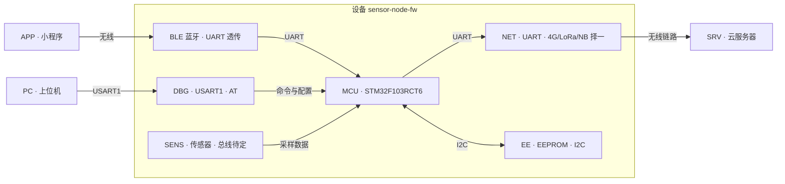

# 系统架构

本文件描述**系统级架构**（设备与外部系统、板上各器件、接口与总线），与 [[02-程序框架]]（代码分层）互补。
原图（手绘版）见 `08-改动日志.md` 的 `#19` 记录，规范点在于：命名统一、区分「外部系统 / 板上器件」、每个连接都标接口与方向。

## 1. 系统总览

> [!note] 图中约定
> - 箭头表示**数据/命令的流向**，`<-->` 为双向（有请求也有应答），`-->` 为单向。
> - 方框内是**设备内部**，`外部系统` 与设备之间的连线一律标注接口。
> - 虚线关系（尚未实现）不画进图，统一列在「待确认项」。

## 2. 命名规范对照

原图的叫法混用了器件型号（`AT24`）、口语（`主控`）、功能描述（`采集数据`）与缩写大小写不一致（`4g/lora/nbiot`）。规范后用**固定缩写 + 中文全称 + 接口**三段式：

| 原图叫法 | 规范命名 | 类型 | 接口 / 总线 | 说明 |
|---|---|---|---|---|
| 主控 | `MCU` | 设备主体 | — | STM32F103RCT6，256 KB Flash / 48 KB RAM |
| 小程序用户访问 | `APP` | 外部系统 | 经 `BLE` | 蓝牙侧上位应用，发命令、看数据 |
| 蓝牙 | `BLE` | 板上模块 | UART（透传） | 与 `APP` 之间的无线链路 |
| 4g/lora/nbiot | `NET` | 板上模块 | UART 或 SPI | **制式待定**，三选一 |
| AT24 | `EE` | 板上器件 | I2C | 存配置信息与数据存储需求 |
| 调试串口 | `DBG` | 调试通道 | USART1 · 115200 8N1 | 只走 AT 指令，见 [[06-协议格式]] |
| 采集数据 | `SENS` | 板上器件 | **待定**（ADC / I2C / SPI） | 传感器型号未定 |
| 服务器 | `SRV` | 外部系统 | 经 `NET` | 数据透传的目的地 |

命名纪律：**器件型号不写进图**（写进对照表），图中只用角色缩写；无线制式并列时标注「择一」。

## 3. 待确认项

以下不能靠猜，需确认后补齐（确认前图中保持 `待定` 字样）：

1. `NET` 到底选 **4G / LoRa / NB-IoT** 哪一个？（影响驱动、功耗预算与协议栈）
2. `SENS` 接什么传感器、走 **ADC 还是 I2C/SPI**？（影响 `drv_*` 与引脚分配）
3. `BLE` 模块型号与协议（透传 or AT 指令？与 `DBG` 的 AT 指令是否共用解析器）
4. `EE` 的容量与 I2C 地址（存配置存到什么粒度，是否需要磨损均衡）
5. `APP` 与 `NET` 两条链路的数据格式是否统一（是否共用同一套帧格式，见 [[06-协议格式]]）

## 4. 怎么验证

- 图与实物一致：按本文件第 2 节的接口列逐条对照原理图/实测（`MCU ↔ EE` 用 I2C 扫到器件地址、`DBG` 能出启动横幅）。
- 实现进度：`SENS` 与 `NET` 落地后，把图里的「待定」改成实际器件，并同步 [[03-资源分配]] 的引脚表。
- 每次涉及器件或接口的改动，按 [[00-索引]] 的维护约定更新本文件与 `updated` 字段。
