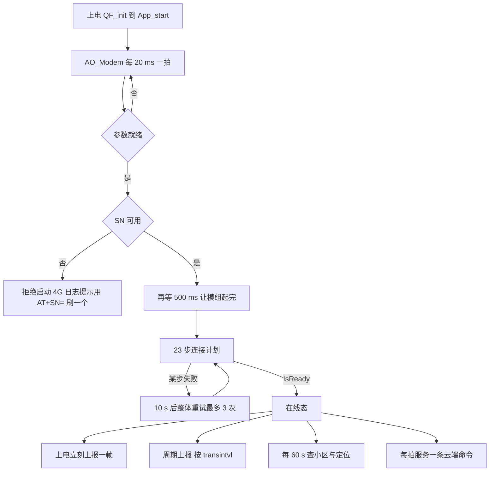
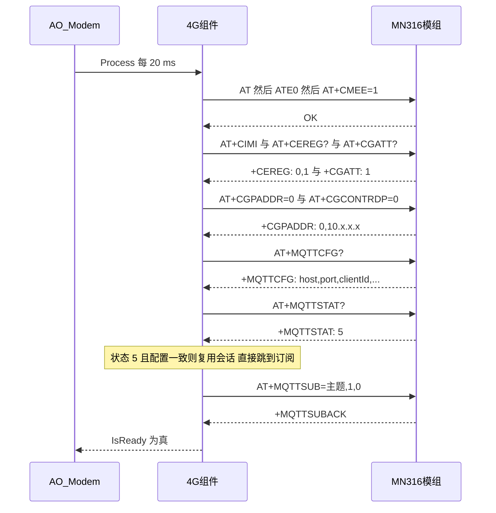
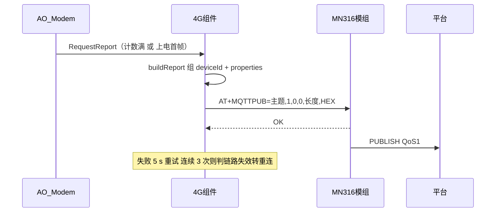
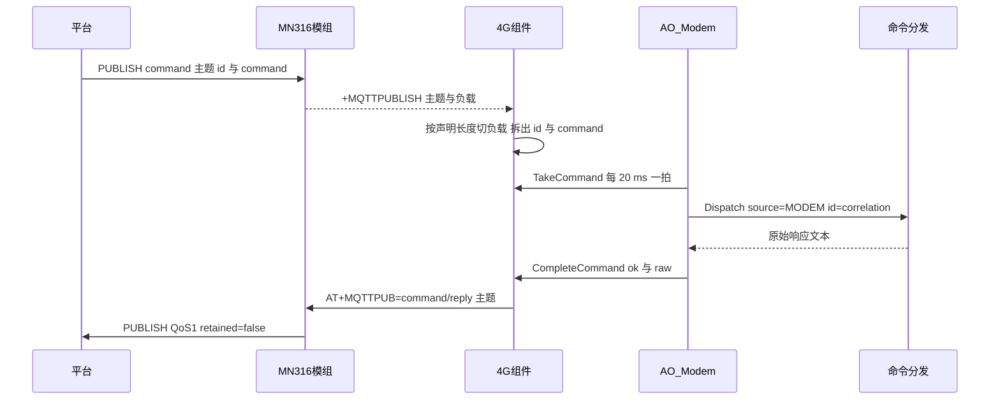

# 4G 云平台流程方案

> [!info] 这篇回答什么问题、与其它文档的分工
> 只回答一件事：**设备怎么连上云平台、怎么把数据发上去、平台怎么把命令打下来** —— 按流程串起来的一篇。
>
> 事实来源（**冲突时以代码为准**）：[[05-任务说明#AO_Modem 任务]]（AO 行为）、
> [[06-协议格式#4G 下行命令（平台 `command` 主题）]]（主题与报文）、[[11-平台接口需求]]（平台侧接口与待确认项）、
> `sensor-node-fw/App/component/modem/`（组件与 MN316 后端）。
> 本文**只做串联与索引**，不复制那几篇的细节表：改代码时先更新它们，再回来核对本文的流程图。

## 一页速览



三条链路，一句话各一条：

| 链路 | 一句话 |
|---|---|
| **连接** | 两道闸 → 23 步 AT 计划（探活/卡/注册/附着/IP/PDP/MQTT/订阅）→ 失败 10 s 后整体重试，最多 3 次 |
| **上报** | 20 ms 一拍计数到点（或上电首帧）→ 组 `deviceId` + `properties` → HEX 编码发 `AT+MQTTPUB` → 失败 5 s 退避，连续 3 次判链路失效 |
| **下发** | 模组 `+MQTTPUBLISH` 按**声明长度**切负载 → App 取走 → 喂进**与串口同一个** `App_Command_Dispatch()` → 结果拼成 `command/reply` 发回 |

## 一、连接云端（上电 → 在线）

### 1.1 两道闸（App 层，`App/app/modem.c`）

1. **等参数就绪** —— `App_Store_ConfigResolved()` 为真才往下走。上电瞬间参数影子里还是编译期默认值，
   不等就会**拿默认 `SN` 去订主题**（BLE 侧有同样的等待）。
2. **查身份可用** —— `identityUsable()`：`SN` 非空、含合法字符集、长度合规、**且不是出厂默认值**。
   不合法则**拒绝启动 4G**，串口打
   `modem: device SN unusable reason=… pos=… ch=0x… len=… -> 4G disabled; provision it: AT+SN="<device-id>"`。

> [!warning] 为什么非法 `SN` 必须拒绝启动，而不是"凑合连"
> `sensor-product//command` 这种拼出来的主题在 MQTT 里**是合法主题**，模组订阅照样回 `+MQTTSUBACK`，
> 只是永远收不到平台消息 —— 属于**静默故障**（同类事故见 [[08-改动日志]] `#51`）。
> 宁可不上线，也不要"在线但收不到命令"。

两道闸之后还有 500 ms（`APP_CFG_MODEM_STARTUP_DELAY_MS`）等模组自身启动完，然后进入连接计划。

### 1.2 连接计划（MN316 后端，当前 **23 步**）

计划表在 `App/component/modem/backend/modem_mn316.c` 的 `kMn316Plan[]`。
每一步是「发一条 AT → 等标记或超时 → 非阻塞推进」，**没有任何阻塞等待**。

| 阶段 | 步 | AT 命令 | 时限 / 重试 |
|---|---|---|---|
| 1 探活与基础 | 1–4 | `AT` → `ATE0` → `AT+CMEE=1` → `AT+CFUN?` | 探活 5 次 × 1.5 s |
| 2 卡与网络 | 5–9 | `AT+CIMI` → `AT+CGSN=1` → `AT+CSQ` → `AT+CESQ` → `AT+COPS?` | SIM 最多等 30 s |
| 3 注册与附着 | 10–12 | `AT+CEREG=2` → `AT+CEREG?` → `AT+CGATT?` | 注册最多 5 min（2 s 轮询）；附着 30 s |
| 4 地址与 PDP | 13–14 | `AT+CGPADDR=0` → `AT+CGCONTRDP=0` | 各 3 s，**可选步**（不支持就跳过） |
| 5 MQTT 会话 | 15–21 | `AT+MQTTCFG?` → `AT+MQTTSTAT?` →（拆/删/超时）→ `AT+MQTTCFG=…` → `AT+MQTTOPEN=…` | 打开 60 s，失败 5 s × 3 |
| 6 订阅主题 | 22 | `AT+MQTTSUB="<主题>",<qos>,0` 走 5 条 | 每条 20 s，等 `+MQTTSUBACK` |
| 7 收尾 | 23 | `AT+CSQ` | 3 s |

> [!note] 计划表里还有一组**默认关闭**的步（第 15–18 位置）
> 裸 TCP 公网可达性探测（`AT+NSOCR` / `NSOCO` / `NSOSD` / `NSOCL`），由 `APP_CFG_MODEM_NET_PROBE_ENABLE` 控制，
> 当前为 `0` —— 那 4 行被 `#if` 整段排除，所以 `plan_count` 与 `step k/N` 的编号都回到 23 步。
> 用途与结论见 [[08-改动日志]] `#45`。

### 1.3 时序



### 1.4 会话复用：为什么必须比对 `AT+MQTTCFG?`

**MCU 重启不会断开模组的 MQTT 会话**（模组自己保持连接）。所以「`+MQTTSTAT:5`」只能说明**模组连着呢**，
不能说明**它连的是我们的身份**。若期间设备身份（`SN` → 主题里的 `deviceId`、MQTT 的 `clientId`）改过，
直接复用会让 broker 侧停在**旧 clientId** 上：设备看起来在线、订阅也回 ACK，平台却认不出它。

因此 `MQTT_STATE` 之前有一步 `AT+MQTTCFG?`（`MODEM_OP_MQTT_CFG_QUERY`），把模组里的
**host / port / clientId** 读回来与当前身份比对，结果存进 `remote_cfg_matches`：

- **一致** → 复用会话：`session_reused = true`，成功后**跳过** 拆/删/超时/配置/打开，直插订阅步；
- **不一致** → 照常走 `DISC → DEL → TO → CFG → OPEN`，把新身份下发下去。

这条关闭了 `#40` 的遗留（见 [[08-改动日志]] `#71`）。

### 1.5 失败与重试策略

| 情况 | 处理 | 依据 |
|---|---|---|
| 单步超时 | 按该步的 `retry_ms` 重试，用尽后**整条计划失败** | 计划表每行的第 3–6 列 |
| 可选步（`OPTIONAL`）失败 | 容忍，继续下一步 | 例如 `AT+CGCONTRDP=0` 不被支持时回 `ERROR` |
| `AT+MQTTDEL` 回 `+CME ERROR:8002` | 按 1 s 重试 3 次（手册：状态机不符合，等一会儿再发） | `#59` 系列 |
| 注册/附着状态是 3/4/6/7 | 这些是"**连接正在路上**"，**不拆连接**，只重问，等满预算 | 手册 §2.3 |
| 整条计划失败 | `AO_Modem` 每 10 s 重试一次，最多 3 次 | `APP_CFG_MODEM_RECONNECT_PERIOD_S` / `_CONNECT_ATTEMPTS` |

两次 AT 之间还有 `APP_CFG_MODEM_AT_GAP_MS`（200 ms）静默间隔 —— 手册要求"前一条执行完才能发下一条"，
零间隔会得到 `+CME ERROR:8007`（AT 通道忙）。

## 二、数据上报（设备 → 平台）

### 2.1 触发时机

| 时机 | 说明 |
|---|---|
| **上电首帧** | 进入在线态时主动报一次（`#78`），现场不必等满一个周期 |
| **周期上报** | 每拍从参数影子读 `transintvl`（分钟，1~20，出厂默认 **20**），计数满即发；`AT+TRANSINTVL=<n>` **改完立即生效**、掉电保存 |
| 小区 / 定位 | 每 60 s（`APP_CFG_MODEM_CELL_REFRESH_PERIOD_S`）补查一次，随报文一起带上 |

### 2.2 报文形状（由平台定，`#77`）

```json
{"deviceId":"<SN>",
 "properties":{"temperature":23.87,"humidity":45.70,"signal_quality":20,
               "cell_tac":"6E55","cell_id":"02516E85"}}
```

- 外层**只有** `deviceId` 与 `properties` 两个键；`deviceId` 就是参数 `SN`（与主题里同源）；
- `properties` 的键名 = **平台物模型的属性标识符**，集中在 `modem_component.c` 的 `MODEM_PROP_*`，
  且与 `properties/read|write` 的字段名**共用同一套**；
- 取不到的字段**整条省略**（不报假值）；
- 组完后有一道**出网前自检**：出现 `{,"` 这种非法形态就**不发**并留日志（`#79` 的教训）。

> [!warning] 尚未对齐：属性标识符
> 平台给的样例是 `frequencyModulus` / `stress`（**振弦式**传感器的量），而本工程需求稿（[[10-4G业务参数清单]]）
> 写的是**倾角** `angle_x/y/z` + 电池电压。除 `temperature` 外，报文里的名字都还是**占位值**。
> 平台确认物模型后，只改 `MODEM_PROP_*` 一处。详见 [[11-平台接口需求#1.3 周期上报（`/properties/report`）]]。

### 2.3 时序



**负载是 HEX 编码的**（`AT+MQTTPUB="<topic>",<qos>,0,0,<len>,"<HEX>"`）—— 所以报文里的引号不必转义，
但长度必须是**原文**字节数。

> [!note] 发布为什么用 `OK` 当成功标记
> MN316 **没有** `+MQTTPUBACK` 这个 URC（手册 §2.5 的成功响应就是 `OK`；`MQTTSUB`/`MQTTUNSUB` 才有 ACK）。
> 曾经按 QoS 去等 `+MQTTPUBACK`，结果是 4 条 QoS 1 主题**每条都等满超时**、消息其实已经发出却被判失败并重发
> （见 [[08-改动日志]] `#59`）。查询类步骤仍必须用精确标记，发布这里没有更精确的标记可用。

### 2.4 上行的容错

单帧失败 → 按 `APP_CFG_MODEM_UPLINK_RETRY_MS`（5 s）重试；连续失败到
`APP_CFG_MODEM_UPLINK_RETRY`（3）次 → 判定链路确实不可用 → 转失败态，由 `AO_Modem` 走重连。
这条修复了历史上"20 分钟后永久沉默"的问题。

## 三、命令下发（平台 → 设备 → 平台）

### 3.1 请求与回复

```json
// 平台 → {productId}/{deviceId}/command
{"id":"cmd-at-175165b2-…","command":"AT+SN?"}
```

```json
// 设备 → {productId}/{deviceId}/command/reply   （QoS 1、retained=false）
{"id":"cmd-at-175165b2-…","ok":true,"data":"+SN:\"sftest0004\"\r\nOK\r\n"}
```

`id` 由设备**原样回显**，平台据此配对；失败时 `ok:false`、`error:"ERROR"`，`data` 里是设备自己的错误行
（例如 `+CME ERROR:4\r\nERROR\r\n`）。字段与失败示例见 [[06-协议格式#4G 下行命令（平台 `command` 主题）]]。

### 3.2 时序



负载**按 `+MQTTPUBLISH` 里声明的字节数切**，不按换行 —— AT 回复里本来就带 `\r\n`，
按行切会把一条命令截断。

### 3.3 与串口**同一条**执行路径

`AO_Modem` 把 `command` 字段逐字节喂进 Service 层的 `SVC_At_Feed()` 拿到 `SvcAtCmd`，
再构造 `AppCommandRequest{ source = APP_COMMAND_SOURCE_MODEM, correlation = id }`，
交给**与调试串口完全相同**的 `App_Command_Dispatch()` 执行。

好处：云端与串口对每条命令的**理解、错误码、响应文本完全一致** —— 新增一条 AT 命令只需要改
`App/app/command_dispatch.c` 一处，两条通道自动同时生效。

### 3.4 容量与权限约束

| 约束 | 值 / 行为 |
|---|---|
| 单条 AT 行上限 | 64 字符（`APP_CFG_AT_LINE_MAX`）；超长整行丢弃并回 `ERROR` |
| 云端 `command` 字段缓冲 | 96（`APP_CFG_MODEM_DOWNLINK_COMMAND_SIZE`） |
| 关联 `id` 缓冲 | 64（平台真实 id 形如 `cmd-at-<uuid>`，43 字符） |
| 身份类参数（`SN` / `UUID`） | **云端只能读**；写回 `+CME ERROR:4`，且不写进影子 |
| `AT&F`（恢复出厂默认） | **云端不可用**（回 `+CME ERROR:4`）：它会连 `SN` 一起重置，云端一旦能发就等于一条命令把设备"变砖"（设备会主动停 4G） |
| 退役参数（`NAME`） | 对外不存在，读写测试一律 `+CME ERROR:1`（广播名已并入 `SN`） |
| 写身份参数且值**真的变了** | 触发**设备自动重启**（先等参数落盘），属正常现象 |

## 四、时限与重试总表

| 参数 | 值 | 含义 |
|---|---|---|
| `APP_CFG_MODEM_PROCESS_PERIOD_MS` | 20 ms | AO 推进节拍（整条链路都是它的分片） |
| `APP_CFG_MODEM_STARTUP_DELAY_MS` | 500 ms | 等模组自身启动完 |
| `APP_CFG_MODEM_COMMAND_TIMEOUT_MS` | 3 s | 普通 AT 步的默认超时 |
| `APP_CFG_MODEM_PROBE_TIMEOUT_MS` / `_ATTEMPTS` | 1.5 s / 5 | 探活 `AT` |
| `APP_CFG_MODEM_SIM_WAIT_MS` | 30 s | 等 SIM 就绪 |
| `APP_CFG_MODEM_REGISTRATION_TIMEOUT_MS` / `_REG_POLL_MS` | 5 min / 2 s | 等网络注册 |
| `APP_CFG_MODEM_ATTACH_TIMEOUT_MS` | 30 s | 等附着 |
| `APP_CFG_MODEM_CONFIG_TIMEOUT_MS` | 10 s | 配置类步（`MQTTCFG` 等） |
| `APP_CFG_MODEM_MQTT_OPEN_TIMEOUT_MS` / `_RETRY_MS` / `_ATTEMPTS` | 60 s / 5 s / 3 | 打开 MQTT |
| `APP_CFG_MODEM_MQTT_OPEN_SETTLE_MS` | 2 s | `MQTTCFG` 成功后给模组内部生效的时间 |
| `APP_CFG_MODEM_MQTT_STATE_TIMEOUT_MS` / `_POLL_MS` | 30 s / 2 s | 查询连接状态 |
| `APP_CFG_MODEM_TOPIC_TIMEOUT_MS` | 20 s | 单条订阅等 `+MQTTSUBACK` |
| `APP_CFG_MODEM_AT_GAP_MS` | 200 ms | 两条 AT 之间的静默间隔 |
| `APP_CFG_MODEM_RECONNECT_PERIOD_S` / `_CONNECT_ATTEMPTS` | 10 s / 3 | 整条计划失败后的重来节奏 |
| `APP_CFG_MODEM_UPLINK_RETRY_MS` / `UPLINK_RETRY` | 5 s / 3 | 上行失败退避与判失效门槛 |
| `APP_CFG_MODEM_TRANS_INTERVAL_DEFAULT` | 20 min | 出厂上报周期（参数 `transintvl` 1~20） |
| `APP_CFG_MODEM_CELL_REFRESH_PERIOD_S` | 60 s | 小区 / 定位刷新 |
| `APP_CFG_MODEM_KEEP_ALIVE_S` | 60 s | MQTT keep-alive |

## 五、主题速查

完整串 = **前缀 + `<productId>/<deviceId>` + 后缀**；后缀自带 device 之后那个 `/`。
前缀由 `APP_CFG_MODEM_TOPIC_PREFIX_*` **一条主题一个宏**给出（值只能是 `""` 或 `"/"`，有编译期护栏）。

| 逻辑主题 | 完整示例（`SN = sftest0004`） | 方向 |
|---|---|---|
| 数据上报 | `/sensor-product/sftest0004/properties/report` | 设备 → 平台 |
| 读属性 / 应答 | `…/properties/read` · `…/properties/read/reply` | 平台 → 设备 · 设备 → 平台 |
| 写属性 / 应答 | `…/properties/write` · `…/properties/write/reply` | 双向 |
| 功能调用 | `…/function/invoke` | 平台 → 设备 |
| 状态查询 / 应答 | `…/state-check` · `…/state-check/reply` | 双向 |
| 云端 AT 命令 | `…/command` · `…/command/reply` | 平台 → 设备 · 设备 → 平台 |

> [!warning] `/` 的归属是**按主题**的，不是按收发方向
> 曾经按方向一刀切，把回复发成 5 段主题，平台事件停在 `MQTT_PUBLISHED · WAITING_RESPONSE`、
> 20 s 判"指令超时"（[[08-改动日志]] `#58`→`#64`）。**平台侧页面改了模板，这里就要同步改对应那一行宏**，
> 两者必须逐字一致。

## 六、常见故障对照

| 症状 | 多半在哪一步 | 先看什么 |
|---|---|---|
| 串口有 `modem: device SN unusable` | 1.1 第二道闸 | `AT+SN?`；用 `AT+SN="<设备号>"` 刷一个合法值 |
| 一直 `connecting` 停在注册/附着 | 1.2 阶段 3 | `AT+CEREG?` / `AT+CGATT?` 的原始应答；卡与天线 |
| `+MQTTOPEN:FAIL` | 1.2 阶段 5 | `AT+CGCONTRDP=0`（实际 APN / 网关 / DNS）与公网可达性 |
| 平台发命令、设备**完全没有** `4g-core:` 行 | 主题不一致 | 设备订阅的主题 vs 平台「AT 控制主题模板」（前导 `/`！） |
| 设备收到了、回了，平台却看不到回复 | 回复主题不一致 | 设备发布的 `command/reply` 串 vs 平台「回复主题模板」 |
| 平台「暂无属性上报」 | 报文/标识符 | 串口里 `properties/report` 那行的报文；是否 `{,"`；标识符是否与平台物模型一致 |
| 上报很慢才出现 | 周期语义 | `transintvl`（默认 20 min）；上电首帧是否已生效（`#78`） |
| 改了 `SN` 之后云端命令断了 | 身份与主题 | 平台那台设备的 `deviceId` 必须与设备 `SN` **逐字一致** |

## 七、上板验收清单（L5）

1. 串口 115200：看启动横幅、`actors` 行、`modem:` 的 `connecting k/N` 与各步进度；
2. 连上后应看到 `modem: cloud link ready, report every <n> s`，以及**首帧上报**的 `AT+MQTTPUB`；
3. 平台上：属性页在**数秒内**出现卡片与折线（至少 `temperature`）；上行栏能看到
   `/sensor-product/<SN>/properties/report` 的记录；
4. 命令通道：平台上发 `AT+SN?`、`AT+BLESVCUUID?`，设备应回 `command/reply`，串口见
   `modem: cloud command done, id=…`；
5. 参数存储（可选）：`AT+TRANSINTVL=1` 改周期 → 断电重启后仍是 1。
   一键脚本：`powershell -NoProfile -ExecutionPolicy Bypass -File sensor-node-fw\App\tools\at_smoke.ps1 -Port COMx`。

## 八、踩坑索引（都出自 [[08-改动日志]]）

| 条目 | 一句话教训 |
|---|---|
| `#40` / `#71` | 复用模组现成会话前**必须**比对 host/port/clientId，否则身份改了也用旧 clientId 上云 |
| `#48` / `#51` | 主题后缀漏带 `/` 会拼出中间少一个斜杠的主题，**订阅照样回 ACK**、只是永远收不到 |
| `#58` → `#62` → `#64` | 前导 `/` 按"收发方向"一刀切是错的模型；要**指名到主题** |
| `#59` | 发布没有 ACK URC，别按 QoS 去等 `+MQTTPUBACK`（会让每条 QoS 1 都超时并重发） |
| `#77` | 报文形状要按平台样例：`{"deviceId":…,"properties":{…}}`，`cmd`/`seq` 是自研协议 |
| `#79` | 改 JSON 外壳时必须同时检查"字段拼接约定"是否依赖旧外壳的结尾形态（多一个逗号 = 平台解析失败） |
| `#74` | 明文 4G 凭据曾在公开仓库里 → **2026-09-30 用户裁定**：仓库归其本人所有，允许入库与推送，该项关闭（见 `#90`） |
| `#81` | `AT&F` 云端可执行会把 `SN` 一起重置 → 设备主动停 4G（已收紧为仅串口）；另：`+CAD` 清单里的 `AT+CAD?` 与解析器认的 `AT+CMD?` 不一致，**待办** |

## 相关文档

- AO 行为与状态机 → [[05-任务说明#AO_Modem 任务]]
- 主题与报文细节 → [[06-协议格式#4G 下行命令（平台 `command` 主题）]]
- 平台侧接口需求与待确认项 → [[11-平台接口需求]]
- 业务参数（有哪些数据、哪些能改） → [[10-4G业务参数清单]]
- 组件规范（后端怎么换、怎么移植） → `sensor-node-fw/App/component/README.md`
- 分层与依赖 → [[02-程序框架]] · [[09-系统架构]]
